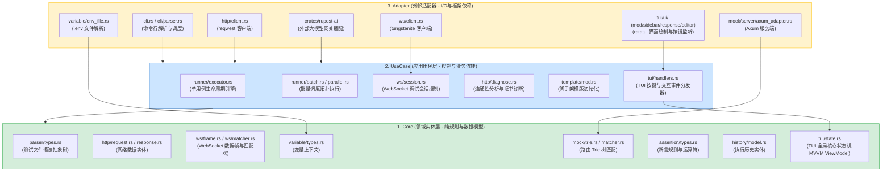

# RuPost 物理目录与文件结构说明文档 (Codebase Directory & File Structure)

本文档旨在详尽梳理 RuPost 项目的物理目录结构、每个核心源文件的职责分工，以及各子模块在 **Clean Architecture** 中的逻辑映射，为后续加入项目的开发智能体 (AI Agent) 提供清晰的代码导航与学习指南。

---

## 1. 顶层目录概览 (Top-Level Directories)

RuPost 项目的根目录由以下核心文件夹和配置文件组成：

*   [crates/](file:///Users/zsyzzx/project/rust/rupost/crates)：用于存放独立拆分的子 Crate。目前包含大模型适配模块 `rupost-ai`。
*   [src/](file:///Users/zsyzzx/project/rust/rupost/src)：主程序核心代码区，承载绝大部分的核心算法、执行流程与适配层。
*   [tests/](file:///Users/zsyzzx/project/rust/rupost/tests)：集成测试和端到端 (E2E) 测试目录，验证完整的命令行或网络交互。
*   [doc/](file:///Users/zsyzzx/project/rust/rupost/doc)：项目文档库（包括架构设计、开发流程规范、未来规划与进度汇总）。
*   [examples/](file:///Users/zsyzzx/project/rust/rupost/examples)：演示用例，包含 `.http` 与 `.md` 文件，用于展示功能并作为 CI 冒烟测试的输入。
*   [templates/](file:///Users/zsyzzx/project/rust/rupost/templates)：编译期通过 `include_str!` 内置的初始配置与用例模板。
*   [benches/](file:///Users/zsyzzx/project/rust/rupost/benches)：基准性能测试模块。
*   [Cargo.toml](file:///Users/zsyzzx/project/rust/rupost/Cargo.toml)：项目全局依赖与 Workspaces 配置。
*   [rupost.toml](file:///Users/zsyzzx/project/rust/rupost/rupost.toml)：全局默认的运行配置文件。

---

## 2. 核心模块逻辑依赖与 Clean Architecture 映射

各子模块在物理上位于 `src/` 和 `crates/` 下，在逻辑上严格遵循 **Clean Architecture** 的三层分层：



---

## 3. 物理目录与文件职责详述

### 3.1 独立子 Crate (`crates/`)

*   #### [crates/rupost-ai/](file:///Users/zsyzzx/project/rust/rupost/crates/rupost-ai)
    *   [client.rs](file:///Users/zsyzzx/project/rust/rupost/crates/rupost-ai/src/client.rs)：大模型网关 HTTP 请求发送器，处理与具体服务商的连接。
    *   [translator.rs](file:///Users/zsyzzx/project/rust/rupost/crates/rupost-ai/src/translator.rs)：将 OpenAI、Anthropic 等不同格式的普通或流式响应翻译规整为 RuPost 统一的事件帧（`LlmEventFrame`）。
    *   [error.rs](file:///Users/zsyzzx/project/rust/rupost/crates/rupost-ai/src/error.rs)：大模型适配模块自定义错误。
    *   [lib.rs](file:///Users/zsyzzx/project/rust/rupost/crates/rupost-ai/src/lib.rs)：模块的入口定义与公共导出。

### 3.2 顶层主模块文件 (`src/`)

*   [main.rs](file:///Users/zsyzzx/project/rust/rupost/src/main.rs)：二进制程序的总入口。主要负责 CLI 命令行参数解析的分发以及对底层抛出的错误的统一格式化输出。**此文件内无业务逻辑。**
*   [cli.rs](file:///Users/zsyzzx/project/rust/rupost/src/cli.rs)：基于 `clap` 定义的完整命令行参数接口（包含 `test`、`history`、`generate`、`diagnose`、`mock`、`init` 子命令与参数定义）。
*   [lib.rs](file:///Users/zsyzzx/project/rust/rupost/src/lib.rs)：Crate 库的根入口，向外暴露核心的数据结构和方法。
*   [error.rs](file:///Users/zsyzzx/project/rust/rupost/src/error.rs)：定义系统级的 `Error` 枚举（如 `ParserError`、`HttpError`、`AssertError`），使用 `thiserror` 进行统一包装。
*   [logger.rs](file:///Users/zsyzzx/project/rust/rupost/src/logger.rs)：控制终端日志输出等级与样式的工具。

### 3.3 核心业务子目录 (`src/*/`)

*   #### [src/cli/](file:///Users/zsyzzx/project/rust/rupost/src/cli)（外层命令行解析适配）
    *   [parser.rs](file:///Users/zsyzzx/project/rust/rupost/src/cli/parser.rs)：用于解析命令行传入的 curl 风格或 httpie 风格的参数，并翻译翻译为内部的 `ParsedRequest`，降低调试难度。

*   #### [src/tui/](file:///Users/zsyzzx/project/rust/rupost/src/tui)（新增：终端图形交互界面，遵循 MVVM 架构）
    *   [mod.rs](file:///Users/zsyzzx/project/rust/rupost/src/tui/mod.rs)：TUI 模块根入口，向外暴露 TUI 渲染和控制台生命周期管理器。
    *   [app.rs](file:///Users/zsyzzx/project/rust/rupost/src/tui/app.rs)：TUI 的渲染驱动和核心事件循环体，整合终端缓存并响应绘制事件。
    *   [event.rs](file:///Users/zsyzzx/project/rust/rupost/src/tui/event.rs)：提供终端输入（键盘按键、鼠标、时钟滴答）的多线程信道事件分发机制。
    *   [handlers.rs](file:///Users/zsyzzx/project/rust/rupost/src/tui/handlers.rs)：交互逻辑处理器。处理用户按键事件（如 Tab 键切换焦点、上下键列表滚动、Enter 执行、Esc 退出、目录折叠切换），将交互映射并修改 ViewModel 状态。
    *   [state.rs](file:///Users/zsyzzx/project/rust/rupost/src/tui/state.rs)：**核心 ViewModel 状态机**。管理选中的测试文件、目录展开状态、全局并发锁、历史记录选中项以及响应输出缓冲区等状态。
    *   #### [src/tui/ui/](file:///Users/zsyzzx/project/rust/rupost/src/tui/ui)（无状态视图组件 View）
        *   [mod.rs](file:///Users/zsyzzx/project/rust/rupost/src/tui/ui/mod.rs)：视图渲染总装配器。在 `Terminal::draw` 时负责切分总体布局（如侧边栏、主体编辑器与响应输出窗口）。
        *   [sidebar.rs](file:///Users/zsyzzx/project/rust/rupost/src/tui/ui/sidebar.rs)：侧边栏 Widget。负责渲染以树状图展现的文件夹及待测试用例文件结构。
        *   [editor.rs](file:///Users/zsyzzx/project/rust/rupost/src/tui/ui/editor.rs)：主体编辑器 Widget。展示当前正选中的用例内容（只读预览与当前运行属性）。
        *   [response.rs](file:///Users/zsyzzx/project/rust/rupost/src/tui/ui/response.rs)：响应预览 Widget。支持大文本折行、JSON 格式美化以及运行中状态的 loading spinner 动画渲染。

*   #### [src/ws/](file:///Users/zsyzzx/project/rust/rupost/src/ws)（新增：WebSocket 调试与开发模块）
    *   [mod.rs](file:///Users/zsyzzx/project/rust/rupost/src/ws/mod.rs)：WebSocket 模块公开接口导出。
    *   [client.rs](file:///Users/zsyzzx/project/rust/rupost/src/ws/client.rs)：底层的异步 WebSocket 客户端。基于 `tokio-tungstenite` 封装，负责维护底层 TCP 连接、网络协议握手和底层的消息发送与接收。
    *   [session.rs](file:///Users/zsyzzx/project/rust/rupost/src/ws/session.rs)：WebSocket 交互会话生命周期管理器。编排握手、根据事件处理机制执行发送、接收和关闭，并提供变量捕获和断言支持。
    *   [frame.rs](file:///Users/zsyzzx/project/rust/rupost/src/ws/frame.rs)：定义 WebSocket 交互事件的数据帧格式。
    *   [action_parser.rs](file:///Users/zsyzzx/project/rust/rupost/src/ws/action_parser.rs)：WebSocket 自定义 DSL 动作解析器（用于解析 `@ws-send` 等交互规则）。
    *   [matcher.rs](file:///Users/zsyzzx/project/rust/rupost/src/ws/matcher.rs)：用于对接收的 WebSocket 帧数据进行期望内容校验与正则匹配。

*   #### [src/parser/](file:///Users/zsyzzx/project/rust/rupost/src/parser)（解析层，无外部业务依赖）
    *   [types.rs](file:///Users/zsyzzx/project/rust/rupost/src/parser/types.rs)：定义解析后的抽象语法树 (AST) 数据结构，包含 `ParsedRequest`、`Assert`、`Capture`。
    *   [http_file.rs](file:///Users/zsyzzx/project/rust/rupost/src/parser/http_file.rs)：针对标准 `.http` 文件语法的解析器。支持行前缀剥离（支持 `#`、`//` 注释前缀）和基于启发式规则的请求切分。
    *   [markdown_file.rs](file:///Users/zsyzzx/project/rust/rupost/src/parser/markdown_file.rs)：针对 `.md` 文件的解析器。智能扫描并定位文件中的 ` ```http ` 语法围栏，提取内部的 HTTP 块并交由 `http_file` 处理。
    *   [metadata.rs](file:///Users/zsyzzx/project/rust/rupost/src/parser/metadata.rs)：提取请求关联的元数据（如以 `@name`, `@assert`, `@depends-on` 开头的注解指令）。
    *   [metadata_types.rs](file:///Users/zsyzzx/project/rust/rupost/src/parser/metadata_types.rs)：元数据解析的辅助临时定义。

*   #### [src/runner/](file:///Users/zsyzzx/project/rust/rupost/src/runner)（生命周期与批量调度层）
    *   [executor.rs](file:///Users/zsyzzx/project/rust/rupost/src/runner/executor.rs)：单用例的核心执行器（协调变量渲染、中间件链拦截、HTTP 请求发出、断言求值和变量捕获这 5 大主干流程）。
    *   [batch.rs](file:///Users/zsyzzx/project/rust/rupost/src/runner/batch.rs)：多测试用例文件的批量顺序（串行）运行调度器。
    *   [parallel.rs](file:///Users/zsyzzx/project/rust/rupost/src/runner/parallel.rs)：批量并行（并发）执行引擎。管理 `JoinSet` 协程池，并在父子依赖用例间执行多线程安全的会话状态与 Cookie 字段单向克隆（State Cloning）。
    *   [resolver.rs](file:///Users/zsyzzx/project/rust/rupost/src/runner/engine/resolver.rs)：依赖补偿加载器。扫描测试文件，自动解析并递归补全它们缺失的前置 `depends-on` 用例；对递归解析出的依赖做"依赖路径合理性校验"（必须落在用户输入路径的目录之下，防止 `@depends-on ../../..` 式越界引用）。用户显式传入的路径完全信任。注意该校验不是安全边界（对网络访问零限制）。
    *   [workflow.rs](file:///Users/zsyzzx/project/rust/rupost/src/runner/workflow.rs)：将测试文件集映射为有向无环图 (DAG)，通过 Kahn 拓扑排序进行防成环自检，输出最终的拓扑执行序列。
    *   [scanner.rs](file:///Users/zsyzzx/project/rust/rupost/src/runner/scanner.rs)：目录文件遍历器。递归扫描测试目录，过滤非 `.http`/`.md` 后缀文件，并自动规避 `.git/`、`.rupost/`、`target/` 等被忽略路径。
    *   [path.rs](file:///Users/zsyzzx/project/rust/rupost/src/runner/path.rs)：路径工具（受支持文件类型判断、`@depends-on` 相对路径解析为 canonical 绝对路径、展示用相对路径格式化）。
    *   [reporter.rs](file:///Users/zsyzzx/project/rust/rupost/src/runner/reporter.rs)：将运行结果整理成 CLI 终端彩色摘要报告或输出标准的 JSON 结构化报告。
    *   [file_sync.rs](file:///Users/zsyzzx/project/rust/rupost/src/runner/file_sync.rs)：为大模型流数据提供非阻塞的文件物理增量追加写入器 (`@stream_to`)。
    *   [types.rs](file:///Users/zsyzzx/project/rust/rupost/src/runner/types.rs)：执行结果相关的数据结构（`TestResult`、`BatchResult`）。

*   #### [src/http/](file:///Users/zsyzzx/project/rust/rupost/src/http)（底层网络适配与大模型网关层）
    *   [client.rs](file:///Users/zsyzzx/project/rust/rupost/src/http/client.rs)：底层的 HTTP 客户端，基于 `reqwest` 的二次封装，支持中间件链。
    *   [request.rs](file:///Users/zsyzzx/project/rust/rupost/src/http/request.rs)：执行期的 HTTP 请求实体（包含 URI, Header, Method, Body, CookieStore 等）。
    *   [response.rs](file:///Users/zsyzzx/project/rust/rupost/src/http/response.rs)：执行期的 HTTP 响应实体（包含状态码, 头部, 正文以及网络时延计时器）。
    *   [request_builder.rs](file:///Users/zsyzzx/project/rust/rupost/src/http/request_builder.rs)：数据转换适配器。负责将 Parser 层的纯语法结构 `ParsedRequest` 实例化转换成可执行的 `Request`。
    *   [diagnose.rs](file:///Users/zsyzzx/project/rust/rupost/src/http/diagnose.rs)：连通性诊断工作流。分步握手网络链路（DNS 耗时、TCP 耗时、TLS 协商耗时、TTFB 耗时），解析证书 X.509 validity 字段算出生效天数并输出高亮警告。
    *   [stream.rs](file:///Users/zsyzzx/project/rust/rupost/src/http/stream.rs)：流式数据（Server-Sent Events 与大模型流式 JSON 帧）解析捕获与事件流提取分发。
    *   [llm_adapter.rs](file:///Users/zsyzzx/project/rust/rupost/src/http/llm_adapter.rs)：对接 `rupost-ai` 的客户端适配类，处理通用大模型协议的转换。
    *   [timing.rs](file:///Users/zsyzzx/project/rust/rupost/src/http/timing.rs)：高精度耗时测量辅助结构。
    *   [types.rs](file:///Users/zsyzzx/project/rust/rupost/src/http/types.rs)：底层网络协议定义与大模型适配协议。
    *   [mock.rs](file:///Users/zsyzzx/project/rust/rupost/src/http/mock.rs)：在测试用例里适配大模型 Mock 所用的网络抽象。

*   #### [src/middleware/](file:///Users/zsyzzx/project/rust/rupost/src/middleware)（拦截中间件链）
    *   [mod.rs](file:///Users/zsyzzx/project/rust/rupost/src/middleware/mod.rs)：定义中间件 Trait `Middleware`（包含 `before_request` 和 `after_response` 生命回调），维护中间件链的串联调度。
    *   [cookie.rs](file:///Users/zsyzzx/project/rust/rupost/src/middleware/cookie.rs)：Cookie 管理中间件。负责在请求前根据域名注入有效 Cookie，在请求后将 `Set-Cookie` 字段更新至会话存储中。
    *   [routing.rs](file:///Users/zsyzzx/project/rust/rupost/src/middleware/routing.rs)：Mock 拦截与路由重定向中间件。静态安全扫描 API Key，并在需要大模型 Mock 时自动重定向请求的 Host 为本地 Mock 服务。

*   #### [src/mock/](file:///Users/zsyzzx/project/rust/rupost/src/mock)（本地 Mock 匹配引擎）
    *   [compiler.rs](file:///Users/zsyzzx/project/rust/rupost/src/mock/compiler.rs)：Mock 编译器。将用例文件中的 `@mock-when` 等断言元数据，编译解析成内存匹配变体 `MockVariant`。
    *   [trie.rs](file:///Users/zsyzzx/project/rust/rupost/src/mock/trie.rs)：动态 Trie 路由匹配树。对路径按 `/` 进行分词匹配，完全支持路由参数捕获（`:id` 提取）、单通配符（`*`）、跨级双通配符（`**`）。
    *   [variant.rs](file:///Users/zsyzzx/project/rust/rupost/src/mock/variant.rs)：条件分支评估引擎。当前置 URL 路由命中有多个变体规则时，通过 Header、Query、Body 属性的条件满足度，评估是否能够命中该变体。
    *   [matcher.rs](file:///Users/zsyzzx/project/rust/rupost/src/mock/matcher.rs)：整合 Trie 树与变体评估，为外部提供单一入口的路由最终匹配决策。
    *   [server.rs](file:///Users/zsyzzx/project/rust/rupost/src/mock/server.rs)：Mock 服务器启动控制。
    *   [server/axum_adapter.rs](file:///Users/zsyzzx/project/rust/rupost/src/mock/server/axum_adapter.rs)：外部网络框架适配。基于 `axum` 的轻量级 HTTP Web 服务器，承接真实 HTTP 流量，调用匹配器进行逻辑分发，并在控制台以高雅样式实时彩色打印访问日志。

*   #### [src/variable/](file:///Users/zsyzzx/project/rust/rupost/src/variable)（变量生命周期与环境变量层）
    *   [types.rs](file:///Users/zsyzzx/project/rust/rupost/src/variable/types.rs)：定义变量存储核心上下文 `VariableContext`。
    *   [resolver.rs](file:///Users/zsyzzx/project/rust/rupost/src/variable/resolver.rs)：变量渲染器。利用正则匹配 `{{variable_name}}`，对请求中的 Host、Path、Headers、Body 以及 Mock 响应体进行动态字符串替换。
    *   [capture.rs](file:///Users/zsyzzx/project/rust/rupost/src/variable/capture.rs)：变量捕获执行器。请求完成后，根据捕获表达式从响应 Header 或 Body 中以正则、JSONPath 等形式提炼值并存入 Context。
    *   [config.rs](file:///Users/zsyzzx/project/rust/rupost/src/variable/config.rs)：多级变量优先级加载管理器。级联覆盖并热加载本地全局配置 `rupost.toml` -> 本地被忽略的 `.env` -> 系统级 Env -> 运行时命令行 `--var` 传参。
    *   [env_file.rs](file:///Users/zsyzzx/project/rust/rupost/src/variable/env_file.rs)：高性能局部 `.env` 解析器，自动处理行尾注释与字符串前后包裹修剪。

*   #### [src/assertion/](file:///Users/zsyzzx/project/rust/rupost/src/assertion)（用例断言求值层）
    *   [types.rs](file:///Users/zsyzzx/project/rust/rupost/src/assertion/types.rs)：声明断言表达式抽象结构，包含断言值（`AssertValue`，支持 `None`/`Null` 语义）、断言比较符（`AssertOperator`，如 Equals, Contains, Exists）。
    *   [parser.rs](file:///Users/zsyzzx/project/rust/rupost/src/assertion/parser.rs)：断言语法解析器。负责将类似 `body.status == 200` 或 `header.Content-Type contains "json"` 的元数据断言行，解析为结构化的 `Assert` 规则。
    *   [extractor.rs](file:///Users/zsyzzx/project/rust/rupost/src/assertion/extractor.rs)：响应数据提取器。在求值前从 HTTP 响应的 Body (包含 JSONPath 拆分)、Header 或 Status 提取出待验证的目标值。
    *   [evaluator.rs](file:///Users/zsyzzx/project/rust/rupost/src/assertion/evaluator.rs)：最终断言验证器。将提取值与预期值结合断言操作符进行计算，对于路径不存在但期望是 None/Null 的场景执行特例放行，避免断言崩溃。

*   #### [src/template/](file:///Users/zsyzzx/project/rust/rupost/src/template)（脚手架初始化策略）
    *   [mod.rs](file:///Users/zsyzzx/project/rust/rupost/src/template/mod.rs)：模板生成命令 `rupost init` 的驱动调度。检测输出路径、判断重名阻断或强制重写并输出警告。
    *   [strategy.rs](file:///Users/zsyzzx/project/rust/rupost/src/template/strategy.rs)：策略实现（包含 `ConfigTemplateStrategy` 生成 rupost.toml、`SseTemplateStrategy` 生成 SSE http 模版与 env.example）。在编译期通过 `include_str!` 携带内容。

*   #### [src/utils/](file:///Users/zsyzzx/project/rust/rupost/src/utils)（通用组件库）
    *   [jsonpath.rs](file:///Users/zsyzzx/project/rust/rupost/src/utils/jsonpath.rs)：**系统内唯一的统一 JSONPath 解析求值组件。** 解决断言提取与 Mock 条件分支评估的分片逻辑不对齐问题。支持 `a.0.b`、`a[0].b`、`a['name']` 与 `$[0]` 多元点号和方括号语法。
    *   [formatter.rs](file:///Users/zsyzzx/project/rust/rupost/src/utils/formatter.rs)：格式化与终端高亮显示器。
    *   [security.rs](file:///Users/zsyzzx/project/rust/rupost/src/utils/security.rs)：静态安全性检测审计函数。

---

## 4. 智能体二次开发与文件指引索引 (Developer Navigation Index)

当需要新增功能或进行代码修改时，可通过下表快速定位需要工作的源文件：

| 开发目标场景 | 核心工作文件与目录 | 开发职责描述 |
| :--- | :--- | :--- |
| **新增命令行功能子命令** | [cli.rs](file:///Users/zsyzzx/project/rust/rupost/src/cli.rs) <br> [main.rs](file:///Users/zsyzzx/project/rust/rupost/src/main.rs) | 1. 在 `cli.rs` 的 `Commands` 中新增枚举项与 Clap 属性定义。<br>2. 在 `main.rs` 中路由分发给新用例层。 |
| **修改或添加 HTTP 解析语法** | [parser/http_file.rs](file:///Users/zsyzzx/project/rust/rupost/src/parser/http_file.rs) <br> [parser/types.rs](file:///Users/zsyzzx/project/rust/rupost/src/parser/types.rs) | 在 `http_file` 的词法/行扫描中添加处理逻辑，若扩展了新元数据，同时在 `types.rs` 中修改 AST 实体。 |
| **添加全新断言运算符 (如 matches)** | [assertion/types.rs](file:///Users/zsyzzx/project/rust/rupost/src/assertion/types.rs) <br> [assertion/parser.rs](file:///Users/zsyzzx/project/rust/rupost/src/assertion/parser.rs) <br> [assertion/evaluator.rs](file:///Users/zsyzzx/project/rust/rupost/src/assertion/evaluator.rs) | 1. 在 `types.rs` 的 `AssertOperator` 枚举中新增运算符。<br>2. 在 `parser.rs` 的断言行正则/字符串切分中添加识别。<br>3. 在 `evaluator.rs` 中编写具体运算规则。 |
| **引入请求前置或后置处理拦截** | [middleware/](file:///Users/zsyzzx/project/rust/rupost/src/middleware) | 新增结构体并实现 `Middleware` Trait，然后在 `HttpClient` 的中间件加载链条中将其注册。 |
| **扩展 Mock 规则匹配算法** | [mock/variant.rs](file:///Users/zsyzzx/project/rust/rupost/src/mock/variant.rs) <br> [mock/trie.rs](file:///Users/zsyzzx/project/rust/rupost/src/mock/trie.rs) | 1. 修改 `variant.rs` 来丰富 Header/Query/Body 的复合匹配条件。<br>2. 修改 `trie.rs` 调整物理路径 of 节点匹配查找流程。 |
| **优化或新增变量提取规则** | [variable/capture.rs](file:///Users/zsyzzx/project/rust/rupost/src/variable/capture.rs) | 在变量提取逻辑中扩展源数据的提取手段（例如支持从响应 XML/HTML 或响应时延字段中提取变量）。 |
| **修改 TUI 页面绘制布局与样式** | [tui/ui/](file:///Users/zsyzzx/project/rust/rupost/src/tui/ui) <br> [tui/app.rs](file:///Users/zsyzzx/project/rust/rupost/src/tui/app.rs) | 1. 修改 `ui/mod.rs` 调整总体面板切割比例和主框架。<br>2. 在对应的 `sidebar.rs`、`response.rs`、`editor.rs` 中微调对应面板的绘制边框、背景及文本状态。 |
| **更改 TUI 交互逻辑与按键动作** | [tui/handlers.rs](file:///Users/zsyzzx/project/rust/rupost/src/tui/handlers.rs) <br> [tui/state.rs](file:///Users/zsyzzx/project/rust/rupost/src/tui/state.rs) | 1. 在 `handlers.rs` 的键盘事件匹配中新增/修改动作路由。<br>2. 在 `state.rs` 中为 ViewModel (TuiState) 丰富状态字段和防写冲突保护。 |
| **更改 WebSocket 请求指令与断言** | [ws/](file:///Users/zsyzzx/project/rust/rupost/src/ws) | 1. 修改 `action_parser.rs` 扩展 DSL 指令解析。<br>2. 修改 `session.rs` 实现连接握手及多帧会话的生命周期管理。<br>3. 修改 `matcher.rs` 来增强消息体断言模式。 |
