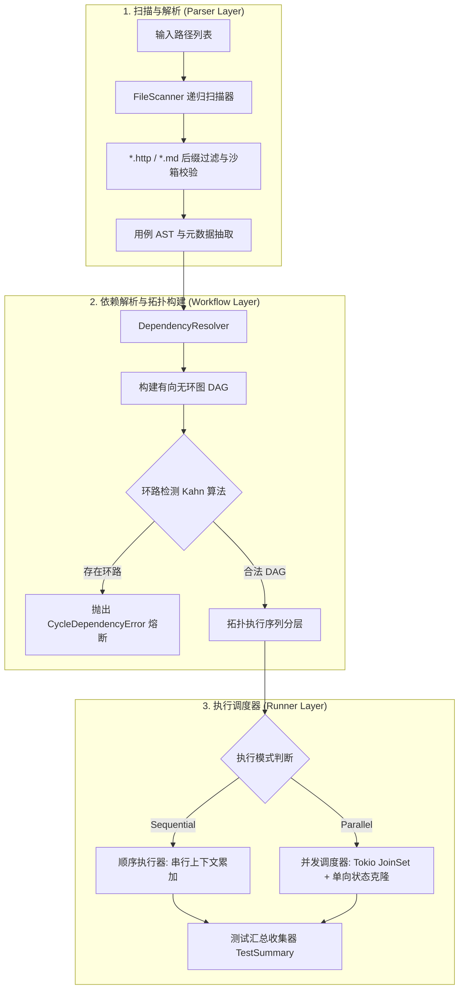

# 批处理执行引擎与工作流编排全貌 (Batch, Runner & Workflow Engine)

本文档是 RuPost 项目关于测试文件扫描、有向无环图 (DAG) 拓扑排序调度、并发/顺序双模式执行以及脚本流控的权威技术档案。整合自早期多文件测试、文件夹执行、动态脚本及断言流转设计，全面总结**业务需求、架构与核心算法演进、当前代码落地现状、后续演进规划**。

---

## 1. 业务需求与场景定义 (Why & What)

### 1.1 核心痛点与用户需求
在真实研发场景中，API 测试用例具有天然的层级化与依赖性：
1. **多文件组织分散**：用例按业务模块拆分在不同的子目录中（例如 `auth/login.http`、`order/create.http`、`payment/pay.http`）。开发者无法忍受只能单文件执行，需要类似 `rupost test tests/` 一键执行整个测试集。
2. **跨用例依赖与上下文传递 (Flow Control)**：后置接口依赖前置接口生成的 Token、ID 或状态码，需要明确的依赖关系与变量透传。
3. **并发与吞吐需求**：无状态读接口需要多并发跑以缩短回归时间；而涉及写或事务的接口必须严格顺序执行。
4. **快速失败 (Fail-Fast)**：CI 自动化场景中，若上游关键接口（如授权）失败，下游相关测试应立即熔断阻断，避免无效轮询和脏数据产生。

### 1.2 语法契约与声明规范
在 `.http` 或 `.md` 测试用例头部支持通过元数据声明执行关系：
```http
### 创建订单接口
# @name create_order
# @depends-on auth/login.http
# @loop 3
POST {{base_url}}/orders
Authorization: Bearer {{auth_token}}
Content-Type: application/json

{"item_id": "1001", "quantity": 1}
```
- `@depends-on <path>`：显式声明上游依赖文件/用例，驱动拓扑排序。
- `@loop <count>`：指定当前请求的重复执行或简单压测轮次。
- `@skip` / 条件执行：根据前序结果或环境标志跳过特定用例。

---

## 2. 架构演进与核心算法设计 (Architecture & Evolution)

### 2.1 批量调度与 Clean Architecture 分层映射


### 2.2 核心算法与机制设计

#### 2.2.1 依赖图拓扑排序与环路检测 (Kahn 算法)
执行引擎将每个测试文件视为图中的顶点 $V$，将 `@depends-on` 映射为有向边 $E$：
1. **入度统计**：计算所有节点的入度（In-degree）。
2. **入队与出队**：将入度为 0 的节点放入队列；出队时将其从图中剥离，并减少相邻节点的入度。
3. **环路识别**：若遍历完成但出队节点数小于总顶点数，说明存在循环依赖（如 A 依赖 B，B 依赖 A），立即阻断执行并输出环路追踪路径。

#### 2.2.2 顺序 vs 并行执行引擎
*   **顺序模式 (Sequential Mode)**：
    - 严格按照拓扑序列单线程调度。
    - 共享单个动态 `VariableContext`，前序请求通过捕获规则（`@capture`）提取的变量立即透传注入给后序请求。
*   **并发模式 (Parallel Mode)**：
    - 采用 Tokio `JoinSet` 与固定缓冲（`--concurrency N`）控制并发度。
    - **状态单向克隆隔离**：并发子任务执行前克隆独立的上下文与 Cookie 副本，防止多并发写穿透造成竞态脏读。

#### 2.2.3 动态脚本引擎选型思考 (Rhai vs Boa vs Lua)
早期架构论证针对前置/后置动态逻辑计算进行了深度对比：
*   **Rhai**（推荐原生选型）：Rust 原生嵌入式语言，体积极小（+300KB），默认安全沙箱隔离，类型系统与 Rust 零成本绑定。
*   **Boa**（备选）：JS 引擎，贴近前端习惯，但目前规范覆盖度与体积有额外开销。
*   **架构决策**：优先以内置函数宏（`$guid`, `$timestamp`, `$randomInt`）和外部钩子满足 90% 需求；对高级脚本预留嵌入式 Rhai 沙箱接口。

#### 2.2.4 断言数据流转与高亮判定
断言系统从 Response 提取状态码、响应头与响应体（支持 JSONPath 表达式提取），通过统一的操作符软匹配引擎（`equals`, `contains`, `matches`）进行判定，并将结构化结果汇总注入至 `TestSummary` 统一呈现。

---

## 3. 目前已完成什么 (Status & Implementation)

| 核心组件 | 代码位置 | 职责说明 |
| :--- | :--- | :--- |
| **递归文件扫描器** | [`src/parser/scanner.rs`](file:///Users/zsyzzx/project/rust/rupost/src/parser/scanner.rs) | 递归遍历文件夹、过滤 `.http` 和 `.md` 文件，规范化路径与沙箱安全检查 |
| **工作流依赖解析器** | [`src/runner/workflow.rs`](file:///Users/zsyzzx/project/rust/rupost/src/runner/workflow.rs) | 解析 `@depends-on`，构建 DAG 有向图，执行 Kahn 拓扑排序与循环依赖检测 |
| **批量顺序执行器** | [`src/runner/batch.rs`](file:///Users/zsyzzx/project/rust/rupost/src/runner/batch.rs) | 串行执行全量测试集，统一状态累加、Fail-Fast 熔断中断与终端汇总输出 |
| **并行并发执行器** | [`src/runner/parallel.rs`](file:///Users/zsyzzx/project/rust/rupost/src/runner/parallel.rs) | 基于 Tokio JoinSet 实现多线程并发调度，状态单向安全克隆 |
| **断言执行流转** | [`src/parser/assertion.rs`](file:///Users/zsyzzx/project/rust/rupost/src/parser/assertion.rs)<br>[`src/runner/assert.rs`](file:///Users/zsyzzx/project/rust/rupost/src/runner/assert.rs) | 支持状态码、Header、JSONPath 提取及操作符断言匹配 |
| **CLI 入口分发** | [`src/cli.rs`](file:///Users/zsyzzx/project/rust/rupost/src/cli.rs)<br>[`src/main.rs`](file:///Users/zsyzzx/project/rust/rupost/src/main.rs) | 提供 `rupost test <PATHS...>`，支持 `--mode parallel|sequential`、`--fail-fast` |

### 验证与测试套件
- **单元测试**：`src/parser/scanner.rs`（文件递归与过滤测试）、`src/runner/workflow.rs`（DAG 排序与环路检测单测）。
- **集成测试**：[`tests/batch_testing_test.rs`](file:///Users/zsyzzx/project/rust/rupost/tests/batch_testing_test.rs) 完整覆盖了批量文件扫描、顺序与并行执行、变量跨文件透传与 Fail-Fast 阻断。

---

## 4. 后续演进规划与待办 (Roadmap & Backlog)

1. **[P1] 增量智能测试 (Smart Diff)**：结合 Git 变更历史，仅执行与修改代码或契约相关的受影响测试文件，大幅缩短大型仓库的回归时间。
2. **[P2] 嵌入式 Rhai 脚本沙箱落地**：正式接入 Rhai 解释器，支持在请求块内书写 `pre-request` 动态签名逻辑与 `post-response` 高级断言。
3. **[P2] Tag / 标签动态过滤**：支持类似 `# @tag smoke,auth`，通过 CLI 参数 `rupost test ./tests --tag smoke` 选择性执行子集。
4. **[P3] 分布式与跨机器分片执行**：支持将 DAG 任务列表按分片因子（`--shard 1/4`）分发至多台 CI 节点执行。

---

## 5. 历史方案与设计文档追溯 (Historical Archive)

本档案完全吸收并承接了以下历史文档的核心内容与推演细节：
- [`multi_file_and_directory_testing.md`](../legacy_research/folder_execution/multi_file_and_directory_testing.md)：多文件与目录递归测试的设计规格说明书。
- [`technical_plan.md` (folder_execution)](../legacy_research/folder_execution/technical_plan.md)：文件夹测试执行技术方案（执行模式、控制流）。
- [`technical_plan.md` (script)](../legacy_research/script/technical_plan.md)：动态脚本能力技术方案与语言选型（Rhai vs Boa vs Lua 详细对比）。
- [`assertion-data-flow.md`](../legacy_research/assertion/assertion-data-flow.md)：断言系统数据流转详解与 AST 转换。
- `2026-06-04-multi-file-testing-design.md`：多文件并发执行与拓扑设计 PRD。
- `2026-06-05-sprint3-scripting-and-flow-control-prd.md`：Sprint 3 脚本与流控设计 PRD。
- `2026-06-16-heuristic-auto-split-prd.md`：大型测试集启发式自动拆分规划。
