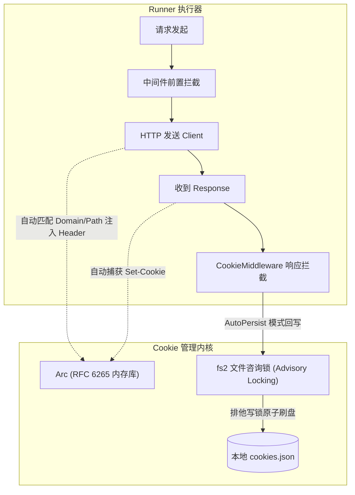

# Cookie 与跨请求会话管理全貌 (Cookie & Session Management)

本文档是 RuPost 项目中关于 Cookie 管理、会话维持与元数据解析的权威技术档案。整合自早期 7 篇离散技术方案与测试规约，提炼汇总了**业务需求、架构演进与方案抉择、当前代码落地现状、后续待办路线**，并提供完整的历史文档追溯。

---

## 1. 业务需求与场景定义 (Why & What)

### 1.1 核心痛点与用户需求
在基于纯文本（`.http` 与 `.md`）的接口自动化测试中，Cookie 管理面临以下核心挑战：
1. **跨请求状态流转**：登录接口返回 `Set-Cookie` 后，后续业务接口需要无缝带上 Session/Token，传统工具需要手动通过正则提取并在 Header 中手动拼装，体验割裂繁琐。
2. **多用例与并发隔离**：在批量执行多文件（Folder Execution）或并发跑测试套件时，不同租户、不同测试场景之间的 Cookie 必须严格隔离，不能发生会话串扰。
3. **文本声明式语法契约**：用户希望在用例头部通过简洁的注解（如 `@cookie` 或 `@cookie-jar`）直接声明该用例的 Cookie 行为（是共享全局、持久化到磁盘、还是纯内存临时会话）。

### 1.2 语法契约与模式设计
在 HTTP 块上方支持声明元数据注解：
```http
### 用户登录获取 Session
# @name login
# @cookie-jar .rupost/cookies.json
POST https://api.example.com/v1/auth/login
Content-Type: application/json

{"username": "admin", "password": "secret"}

### 业务接口自动携带
# @name profile
GET https://api.example.com/v1/user/profile
```
- **三种会话运行模式**：
  - `AutoPersist` (自动持久化)：加载指定路径的 Cookie 文件，请求结束及执行器析构时自动写回磁盘。
  - `Ephemeral` (临时内存)：仅在当前执行上下文内存中流转，进程退出后自动销毁，保证测试无状态且无副作用。
  - `Disabled` (禁用模式)：完全关闭 Cookie 接收与注入，适合绝对无状态的纯函数式接口验证。

---

## 2. 架构演进与方案设计抉择 (Architecture & Evolution)

在早期方案设计中（见下方历史文档），架构团队就“元数据解析器”与“并发安全模型”展开了关键权衡：

### 2.1 元数据解析架构：Trait 动态分发 vs 静态 Match
*   **探索背景**：解析 `# @cookie`、`# @name` 等注释时，团队评估了基于 Trait 的插件化解析注册表 (`MetadataRegistry`) 与静态 `match` 分发两种方案。
*   **方案对比**：
    - *Trait 方案*：为每个元数据实现 `MetadataParser` trait，支持动态拓展；但每次匹配产生虚函数表 (vtable) 查找与堆分配开销（最坏情况 30~50 ns），且无法保证静态编译期穷尽检查。
    - *静态 Match 方案*：在单一模式匹配中直接分支解析；零虚函数开销（~10 ns），编译期完全感知所有合法注解，报错集中。
*   **架构决策**：**核心解析层采用静态类型化分发**，同时对外层暴露清晰的抽象定义，确保解析器极度轻量与高吞吐。

### 2.2 数据流向与 Clean Architecture 映射
RuPost 遵循 Micro-Kernel + Middleware 设计：


### 2.3 并发安全与异常降级机制
1. **多进程文件冲突保护 (Advisory File Locking)**：
   借助 `fs2` 实现了多进程咨询锁：加载时加**共享读锁 (`lock_shared`)**，回写时加**排他写锁 (`lock_exclusive`)**，彻底避免多终端同时跑测试时截断或损坏 `cookies.json`。
2. **损坏容错降级 (Graceful Fallback)**：
   若本地 `cookies.json` 被手动篡改或损坏，解析器记录 `tracing::warn!` 报警，自动降级为全新空的临时内存 Store 恢复执行，坚决不发生 Panic 或阻断主流程。
3. **并发测试时的单向克隆隔离**：
   在并行执行测试时，采用父子状态单向克隆（Cloned Snapshot），子线程拥有独立的 CookieStore 副本，防止多并发用例互相覆盖会话状态。

---

## 3. 目前已完成什么 (Status & Implementation)

| 核心组件 | 代码位置 | 职责说明 |
| :--- | :--- | :--- |
| **HTTP 客户端 Provider** | [`src/http/client.rs`](file:///Users/zsyzzx/project/rust/rupost/src/http/client.rs) | 将 `CookieStore` 注入为 `reqwest` 底层 provider，基于 RFC 6265 自动注入与提取 Cookie |
| **中间件与持久化** | [`src/middleware/cookie.rs`](file:///Users/zsyzzx/project/rust/rupost/src/middleware/cookie.rs) | 实现 `AutoPersist`、`Ephemeral` 模式分发及 `fs2` 文件锁原子持久化 |
| **单用例执行生命周期** | [`src/runner/executor.rs`](file:///Users/zsyzzx/project/rust/rupost/src/runner/executor.rs) | 在请求生命周期内统一调度 Cookie 拦截器与上下文传递 |
| **并发用例隔离调度** | [`src/runner/parallel.rs`](file:///Users/zsyzzx/project/rust/rupost/src/runner/parallel.rs) | 并发批量测试时执行线程安全的 CookieStore 隔离复制 |
| **解析器注解支持** | [`src/parser/metadata.rs`](file:///Users/zsyzzx/project/rust/rupost/src/parser/metadata.rs) | 解析 `# @cookie`、`# @cookie-jar` 声明 |

### 验证与测试套件
- **单元测试**：`src/middleware/cookie.rs` 内置测试验证了三种模式的切换与状态保持。
- **集成测试**：[`tests/cookie_test.rs`](file:///Users/zsyzzx/project/rust/rupost/tests/cookie_test.rs) 完整覆盖了登录重定向、多接口会话传递、文件咨询锁并发竞争以及 JSON 损坏降级。

---

## 4. 后续演进规划与待办 (Roadmap & Backlog)

1. **[P2] Domain/Path 细粒度过滤与伪造防护**：支持在用例中配置 Cookie 白名单域名，防止跨域重定向时的 Cookie 泄露。
2. **[P2] 行业标准格式导入导出**：支持与 cURL、Netscape Cookie 规范以及 DevTools Cookies JSON 格式的双向转换与导出。
3. **[P3] 过期策略与自动驱逐**：增加根据 `Expires`/`Max-Age` 的后台主动驱逐机制，并提供 `--clean-cookies` 清理命令。
4. **[P3] TUI 会话查看与编辑面板**：在 TUI 模式下增加独立的可视化 Cookie 检查抽屉，支持就地查看和修改已有 Cookie 键值。

---

## 5. 历史方案与设计文档追溯 (Historical Archive)

本档案完全吸收并承接了以下历史文档的核心内容与推演细节：
- [`cookie_integration_thought_process.md`](../legacy_research/cookie/cookie_integration_thought_process.md)：早期 Cookie 接入思路说明与痛点分析。
- [`cookie_management_plan.md`](../legacy_research/cookie/cookie_management_plan.md)：Cookie 管理功能实施方案。
- [`cookie_test_specification.md`](../legacy_research/cookie/cookie_test_specification.md)：Cookie 功能与测试技术规约（文件锁、降级策略详述）。
- [`metadata_parser_comparison.md`](../legacy_research/cookie/metadata_parser_comparison.md)：Trait vs 静态 Match 方案的纳秒级基准对比。
- [`metadata_parser_implementation.md`](../legacy_research/cookie/metadata_parser_implementation.md)：元数据解析器实现方案。
- [`metadata_parser_trait_approach.md`](../legacy_research/cookie/metadata_parser_trait_approach.md)：元数据解析器重构方案草案。
- [`parser_optimization_suggestions.md`](../legacy_research/cookie/parser_optimization_suggestions.md)：Parser 模块优化建议。
