# 全链路排障、网络诊断与历史重放全貌 (Debug, Diagnostics & Replay System)

本文档是 RuPost 项目关于生产排障、细粒度网络连通性诊断 (`rupost diagnose`)、执行历史快照持久化与单用例重放能力的权威技术档案。整合自早期生产调试模式评估、商业价值分析及 7 篇排障与重放 PRD，全面总结**业务需求、架构设计演进、当前代码落地现状、后续演进路线**。

---

## 1. 业务需求与场景定义 (Why & What)

### 1.1 核心痛点与行业背景
API 调试过程中，绝大多数诡异的“偶发失败”或“接口超时”往往发生在网络与传输层，而非业务逻辑层：
1. **网络黑盒**：传统工具（如 Postman、普通 curl）仅返回一个最终耗时或直接抛出 `Connection refused` / `Timeout`，开发者无法获知究竟卡在 DNS 解析、TCP 建连、TLS 证书握手还是服务端首包 (TTFB)。
2. **证书隐患频发**：生产与预发环境中证书过期、SAN 域名不匹配导致客户端抛出不可见错误。
3. **现场不可重现**：CI 跑批或线上巡检失败时，日志中只留下一个简陋的报错，没有保留当时的请求头、响应快照与环境变量，无法精确单条重放（Replay）。

### 1.2 核心用户场景与交互契约
- **场景 1：网络连通性瀑布图体检 (`rupost diagnose <URL>`)**：
  对目标 URL 进行细粒度网络层诊断，精确分解各个阶段时延，并解析 TLS 证书状态：
  ```bash
  rupost diagnose https://api.example.com/v1/health
  # 输出:
  # ├── DNS 解析耗时: 12ms (命中 IP: 93.184.216.34)
  # ├── TCP 握手耗时: 35ms
  # ├── TLS 握手耗时: 42ms
  # │   └── 证书健康: 有效期剩余 86 天, Issuer: Let's Encrypt
  # └── TTFB (首包时延): 68ms (HTTP/2 200 OK)
  # 总耗时: 157ms
  ```
- **场景 2：失败用例单条就地重放 (`rupost replay --id <SNAPSHOT_ID>`)**：
  从历史快照中直接恢复失败用例的完整上下文，无需重新跑整个大套件，就地复现并调试。
- **场景 3：失败证据钩子 (`--on-failure trace`)**：
  当任何断言不通过时，自动捕获内存抓包与网络上下文，存盘至 `.rupost/history/` 供回溯。

---

## 2. 架构演进与方案设计抉择 (Architecture & Evolution)

```mermaid
flowchart TD
    subgraph DiagnoseEngine ["网络诊断引擎 (src/http/diagnose.rs)"]
        TargetUrl[目标 URL 解析] --> DnsPhase["1. Tokio Async DNS (测量解析时延 & IP 列表)"]
        DnsPhase --> TcpPhase["2. TcpStream::connect (测量 TCP 三次握手时延)"]
        TcpPhase --> TlsPhase["3. tokio-rustls 握手 (测量 TLS 协商时延)"]
        TlsPhase --> X509Parse["4. x509-parser 解析 DER 证书 (SAN / 有效期 / 颁发者)"]
        X509Parse --> HttpPhase["5. HTTP 发送并测量 TTFB 首包时延"]
        HttpPhase --> DiagReport[DiagnosticsReport 结构化报告]
    end

    subgraph HistoryEngine ["历史与快照存储 (src/history/)"]
        TestRun[测试执行] --> FailureEvent{断言是否失败?}
        FailureEvent -->|失败| CaptureSnapshot[捕获完整上下文快照]
        CaptureSnapshot --> SqliteOrJson[轻量级历史存储]
        SqliteOrJson --> ReplayDispatcher[Replay 独立重放调度器]
    end
```



### 2.1 架构设计抉择

#### 2.1.1 纯 Rust 原生协议栈诊断 (tokio-rustls + x509-parser)
早期评估曾探讨是否调用外部 `curl` 或 `openssl` CLI 工具输出诊断信息。
*   **架构决策**：**坚决采用纯 Rust 原生实现**。使用 `tokio` 异步网络栈配合 `tokio-rustls` 和 `x509-parser`：
    - **无外部依赖**：在任何无 OpenSSL 的精简容器或 Alpine 镜像中立即可用。
    - **纳秒级时延测量**：基于 `std::time::Instant` 精确统计各网络握手切面。
    - **深层协议兼容**：原生支持 HTTPS 与 WebSocket 协议升级验证。

#### 2.1.2 历史存储格式演进：JSONL vs SQLite vs 内存环形缓冲
*   **探索背景**：每次执行产生请求与响应上下文，如何持久化以支持 `--replay`？
*   **方案权衡**：
    - SQLite：具备强查询能力，但引入额外 C 依赖或较大体积。
    - JSON Lines (JSONL)：单向追加写入，性能极高，支持流式日志审计；配合内存索引可秒级定位。
*   **架构结论**：采用轻量级文件系统快照持久化（`.rupost/history/<uuid>.json`），配合索引摘要列表，实现零开销与完全可审查。

---

## 3. 目前已完成什么 (Status & Implementation)

| 核心组件 | 代码位置 | 职责说明 |
| :--- | :--- | :--- |
| **网络诊断核心** | [`src/http/diagnose.rs`](file:///Users/zsyzzx/project/rust/rupost/src/http/diagnose.rs) | 实现 DNS、TCP、TLS 阶段耗时统计、X.509 DER 证书解析与 WebSocket 连通性探测 |
| **诊断高亮渲染** | [`src/http/diagnose.rs`](file:///Users/zsyzzx/project/rust/rupost/src/http/diagnose.rs) | 提供符合 ANSI 美学的色彩高亮、瀑布图与证书过期告警提示输出 |
| **历史存储与索引** | [`src/history/`](file:///Users/zsyzzx/project/rust/rupost/src/history) | 记录每次请求生命周期快照、生成唯一 RunId、提供查询接口 |
| **单条重放调度器** | [`src/runner/executor.rs`](file:///Users/zsyzzx/project/rust/rupost/src/runner/executor.rs) | 接收历史快照并还原上下文参数就地重放 |
| **CLI 子命令** | [`src/cli.rs`](file:///Users/zsyzzx/project/rust/rupost/src/cli.rs)<br>[`src/main.rs`](file:///Users/zsyzzx/project/rust/rupost/src/main.rs) | `rupost diagnose <url>`、`rupost history`、`rupost replay` |

### 验证与测试套件
- **单元测试**：`src/http/diagnose.rs` 内置测试验证了 DER 证书解析器正确识别过期时间、SAN 域名与非法字节降级。
- **集成测试**：[`tests/diagnose_integration_test.rs`](file:///Users/zsyzzx/project/rust/rupost/tests/diagnose_integration_test.rs) 验证了 `rupost diagnose` 探测本地与真实公网 URL 的完整流程。

---

## 4. 后续演进规划与待办 (Roadmap & Backlog)

1. **[P2] 全链路调用链 Trace ID 提取与树状渲染**：自动识别 `x-trace-id`、`x-request-id`、W3C `traceparent`，在诊断报告中将微服务各跨度进行树状还原。
2. **[P2] 生产数据敏感字段动态脱敏**：在持久化历史快照时，根据配置对 `Authorization`、`Cookie`、`password` 等字段进行星号脱敏。
3. **[P3] PCAP 网络抓包文件流式导出**：支持 `--pcap out.pcap`，将单次用例的网络流量导出为 Wireshark 可直接打开的标准数据包。

---

## 5. 历史方案与设计文档追溯 (Historical Archive)

本档案完全吸收并承接了以下历史文档的核心内容与推演细节：
- [`production_debug_mode_assessment.md`](../legacy_research/debug/production_debug_mode_assessment.md)：生产调试模式功能评估报告。
- [`production_debug_mode_business_analysis.md`](../legacy_research/debug/production_debug_mode_business_analysis.md)：生产调试模式商业价值分析报告。
- [`production_debugging_features.md`](../legacy_research/debug/production_debugging_features.md)：生产环境问题排查功能设计。
- `2026-06-23-network-diagnostics-and-stream-capture.md`：网络诊断与流式捕获 PRD。
- `2026-07-01-snapshot-replay-roadmap.md`：快照与重放路线图。
- `2026-07-11-history-storage-optimization-design.md`：历史存储优化设计。
- `2026-10-28-developer-debug-experience-prd.md`：开发者排障体验 PRD。
- `2026-11-04-debug-chain-r6-replay-per-entry-prd.md`：单条重放链 PRD。
