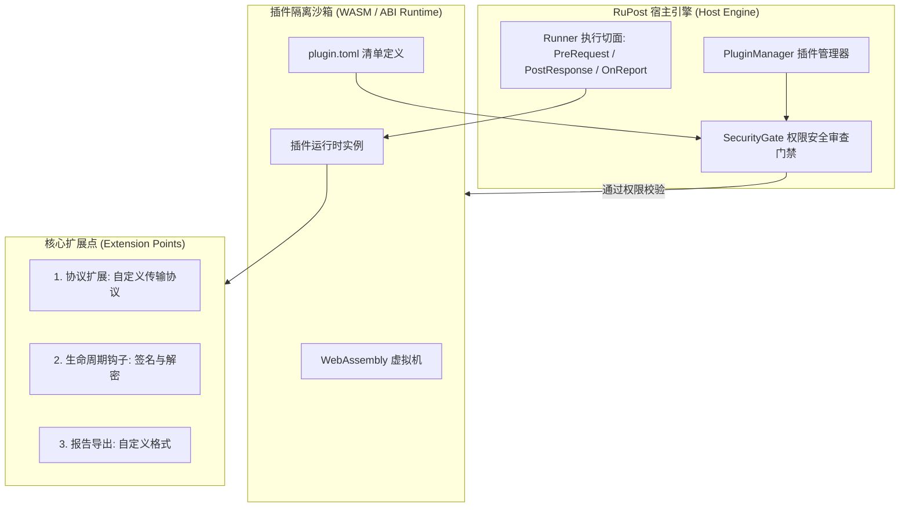

# 插件体系与开放扩展全貌 (Plugin Architecture & Extensibility)

本文档是 RuPost 项目关于插件生态、动态扩展能力、沙箱权限隔离与元数据规范的权威技术档案。整合自早期 7 篇插件系统架构设计、权限模型与可行性报告，全面总结**业务需求、规范设计演进、当前落地现状、后续演进路线**。

---

## 1. 业务需求与场景定义 (Why & What)

### 1.1 核心痛点与开放诉求
作为专注于极简与高性能的 API 测试引擎，RuPost 核心库应保持极致轻量（符合 Micro-Kernel 理念）。然而现实业务场景存在千差万别的定制化诉求：
1. **企业私有协议适配**：部分团队使用自研 RPC、双向私有二进制通信或特定加解密算法（如国密 SM2/SM3/SM4、AWS SigV4 动态签名），核心库无法也不应该无限膨胀内置。
2. **测试报告自定义输出**：除了内置的控制台彩色输出与 JSON 报告外，企业需要对接自建质量平台、发送 Slack/钉钉群告警、或生成特定格式的 HTML/Allure 报告。
3. **第三方断言与校验扩展**：支持业务团队扩展自定义断言算子（例如校验身份证号、银行卡 Luhn 算法合规性）。

### 1.2 插件架构目标
- **声明式元数据清单 (Plugin Manifest)**：每个插件提供独立的 `plugin.toml` 声明名称、版本与权限。
- **严格沙箱与分级权限 (Zero Trust Permissions)**：插件必须显式申请网络访问（`network`）、本地磁盘读写（`fs`）与环境变量读取（`env`），未经授权无法触碰宿主系统敏感数据。
- **隔离与跨平台运行时**：未来优先通过 WebAssembly (Wasm) 运行时加载执行，保证一份编译、跨平台（Mac/Linux/Windows）安全运行。

---

## 2. 规范设计与架构演进 (Architecture & Evolution)



### 2.1 核心扩展点契约定义
根据规范设计，插件主要拦截以下三个核心生命周期切面：
1. **前置拦截 (`before_request`)**：可读取并改写当前请求的 Headers、URL 与 Body（例如动态计算签名并追加到 Header）。
2. **后置拦截 (`after_response`)**：在收到响应后执行定制提取、落盘或上报。
3. **报告拦截 (`on_report`)**：在整个测试套件执行完毕后，获取全量 `TestSummary` 执行数据，生成第三方报告。

### 2.2 分级权限系统设计 (Permissions Model)
在 `plugin.toml` 中强制要求声明权限字典：
```toml
[plugin]
name = "custom-auth-signer"
version = "0.1.0"
author = "infra-team"

[permissions]
network = ["api.internal.auth.com"]  # 仅允许访问指定的内网鉴权机
fs_read = [".env.local"]             # 仅允许读取本地私钥文件
env_vars = ["SIGN_KEY_SECRET"]       # 仅允许访问指定的系统环境变量
```

---

## 3. 目前已完成什么 (Status & Implementation)

| 核心组件 | 代码位置 / 归档位置 | 现状与职责说明 |
| :--- | :--- | :--- |
| **插件系统规范集** | [`doc/architecture/features/plugin_and_extensibility.md`](#) | 汇总完成生命周期、Manifest 清单定义与 API 契约 |
| **API 接口与 Trait 规约** | `src/middleware/` | 主库已具备中间件管道机制，预留了插件拦截器的接入接口 |
| **元数据规范草案** | [`metadata_spec.md`](../legacy_research/plugin/metadata_spec.md) | 规范了插件包目录结构、图标、版本约束与依赖树 |
| **权限系统规范** | [`permissions.md`](../legacy_research/plugin/permissions.md) | 制定了安全门禁检查算法与未授权访问阻断规则 |

> **真实落地透明说明 (Transparency Notice)**：
> 经 2026-10 全量工程审计确认：当前插件系统已完成高水平的**规范定义、API 契约设计与权限模型规约**，但核心代码库尚未接入实体 Wasm 运行时（Wasmtime）。主程序目前优先使用内部编译期中间件满足当期能力，插件运行时作为后续生态扩展项。

---

## 4. 后续演进规划与待办 (Roadmap & Backlog)

1. **[P2] 基于 Wasmtime 的轻量级 Wasm 插件沙箱接入**：引入 `wasmtime` 作为插件宿主，实现第一方 Demo 插件（如钉钉机器人告警上报插件）。
2. **[P3] CLI 插件管理工具链**：提供 `rupost plugin install <URL>`、`rupost plugin list` 等配套安装管理指令。
3. **[P3] 官方插件注册中心与脚手架**：推出标准插件开发模版仓库（Rust / AssemblyScript / Go-Wasm）。

---

## 5. 历史方案与设计文档追溯 (Historical Archive)

本档案完全吸收并承接了以下历史文档的核心内容与推演细节：
- [`architecture.md` (doc/plugin)](../legacy_research/plugin/architecture.md)：插件系统架构设计。
- [`api_reference.md` (doc/plugin)](../legacy_research/plugin/api_reference.md)：插件 API 与 Trait 参考手册。
- [`metadata_spec.md` (doc/plugin)](../legacy_research/plugin/metadata_spec.md)：插件元数据规范与清单文件定义。
- [`permissions.md` (doc/plugin)](../legacy_research/plugin/permissions.md)：插件分级权限模型。
- [`feasibility_report.md` (doc/plugin)](../legacy_research/plugin/feasibility_report.md)：插件系统可行性分析。
- [`quickstart.md` (doc/plugin)](../legacy_research/plugin/quickstart.md)：插件开发者上手教程。
