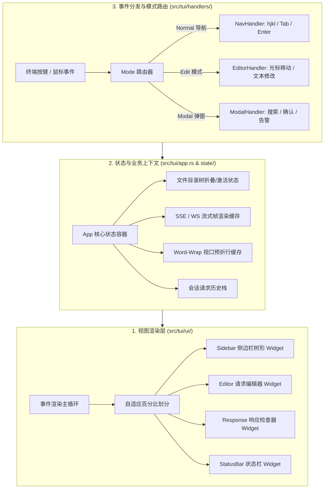

# 终端交互系统 (TUI) 架构全貌 (Terminal User Interface & UX)

本文档是 RuPost 项目关于终端用户界面 (TUI Mode)、M-V-VM 架构分层、键盘路由体系与无头离屏测试保障的权威技术档案。整合自早期 6 篇 TUI 设计方案、按键手册与 4 篇 TUI 演进 PRD，全面总结**业务需求、架构与核心算法演进、当前代码落地现状、后续演进路线**。

---

## 1. 业务需求与交互美学 (Why & What)

### 1.1 核心痛点与产品定位
现代开发者在开发和调试 API 时，常常在两种割裂的工具形态中切换：
- **重量级 GUI 客户端（如 Postman、Insomnia）**：启动缓慢、内存占用高（基于 Electron），无法通过 SSH 远程服务器使用，且无法享受终端极速键盘流。
- **纯 CLI 工具（如 curl、httpie）**：虽然轻快，但在查看长 JSON 响应、格式化排版、切换请求用例与交互式调试时缺乏全局上下文感知。

**RuPost TUI 的定位**：
打造一个**“零鼠标依赖、毫秒级启动、经典 ASCII 高审美与现代响应式布局并存”**的终端沉浸式工作台。

### 1.2 核心布局与按键交互模型
终端自适应布局划分为三大核心工作区：
```text
┌─ 侧边栏 (Sidebar: 25%) ──┬─ 请求编辑器 (Editor: 40%) ─┬─ 响应检查器 (Response: 35%) ─┐
│ ▼ tests/                 │ POST https://api.com/users │ Status: 200 OK (38ms)        │
│   ├── auth.http          │ Content-Type: json         │ {                            │
│   └── order.http         │                            │   "code": 0,                 │
│                          │ {                          │   "data": { "id": 1001 }     │
│ [Space] 运行选中文件       │   "name": "Alice"          │ }                            │
│ [Enter] 打开载入编辑器     │ }                          │                              │
└──────────────────────────┴────────────────────────────┴──────────────────────────────┘
 [Tab] 切换聚焦面板 │ [r] 运行请求 │ [/] 搜索树 │ [Esc] 返回主控 │ [q] 退出
```

---

## 2. 架构演进与方案设计抉择 (Architecture & Evolution)



### 2.1 架构设计与性能优化抉择

#### 2.1.1 经典 M-V-VM 模式彻底解耦
早期的原型将按键监听、状态修改与 Ratatui 绘制杂糅在单文件中，极易引发状态冲突与 Panic。
- **架构重构**：采用 M-V-VM 模式：
  - **Model**：核心执行引擎 `src/runner/` 及其输出的结构化结果。
  - **ViewModel (`src/tui/state/`)**：管理 UI 独占状态（如聚焦窗口、滚动条偏移、折行树索引），不依赖任何终端输出。
  - **View (`src/tui/ui/`)**：纯函数式无状态 Widget 绘制，依据 ViewModel 投影为 Frame 块。

#### 2.1.2 流式 Word-Wrap 预折行性能优化 (`src/tui/state/wrap.rs`)
在展示数十万行的大体积 JSON 或流式 Token 响应时，每帧重新计算软折行会导致严重的终端掉帧卡顿。
- **优化方案**：引入 `WrapCache` 预折行引擎，仅在视口尺寸改变或内容追加时进行段落增量折行计算，实现恒定 60FPS 流畅滚动。

#### 2.1.3 键盘路由无缝防冲突机制
引入严格的模式机（`TuiMode::Normal`、`TuiMode::Editing`、`TuiMode::Search`）：
- 在 `Editing` 模式下，全量字符输入直接落盘至编辑器缓冲区，阻断全局快捷键；
- 只有触发 `Esc` 退出编辑后，`h/j/k/l`、`Tab` 等导航快捷键才重新激活。

---

## 3. 目前已完成什么 (Status & Implementation)

| 核心组件 | 代码位置 | 职责说明 |
| :--- | :--- | :--- |
| **TUI 核心生命周期** | [`src/tui/app.rs`](file:///Users/zsyzzx/project/rust/rupost/src/tui/app.rs) | 协调全局状态、初始化终端通道、捕获 Panic 恢复终端正常流 |
| **状态机与分层状态** | [`src/tui/state/`](file:///Users/zsyzzx/project/rust/rupost/src/tui/state) | 管理树形折叠、滚动偏移、流式缓冲、历史会话与查找状态 |
| **无状态 Widget 渲染** | [`src/tui/ui/`](file:///Users/zsyzzx/project/rust/rupost/src/tui/ui) | 负责 Sidebar、Editor、Response、Popups 弹窗的绘制 |
| **模式化按键处理器** | [`src/tui/handlers/`](file:///Users/zsyzzx/project/rust/rupost/src/tui/handlers) | 模块化分发导航、编辑、查找、确认与鼠标点击操作 |
| **CLI 启动入口** | [`src/cli.rs`](file:///Users/zsyzzx/project/rust/rupost/src/cli.rs) | `rupost tui` 独立入口，支持 `--env` 预加载 |

### 验证与离屏测试保障
根据 [TUI 设计规范](file:///Users/zsyzzx/project/rust/rupost/.agents/skills/tui_design_guidelines/SKILL.md)，所有 TUI 组件均采用 `ratatui::backend::TestBackend` 进行离屏无头测试：
- **测试套件**：位于 `tests/tui_*.rs`，覆盖窗口调整尺寸、按键状态机转移、搜索框过滤与编辑器行内光标移动，无需真实终端即可在 CI 中稳定跑通。

---

## 4. 后续演进规划与待办 (Roadmap & Backlog)

1. **[P1] TUI 与 CLI 核心特性 100% 对齐 (Parity)**：补齐在 TUI 中一键触发网络诊断瀑布图（Diagnose）、Mock 服务器前台挂载控制的能力。
2. **[P2] 流式 AI 对话辅助侧边栏**：在 TUI 右侧或弹窗中集成 `crates/rupost-ai`，支持在终端就地对错误结果呼叫 AI 询问修复方案。
3. **[P3] Web-UI 与 TUI 双端联动**：基于 `doc/plans/2026-11-06-web-ui-*`，实现通过浏览器打开与终端 TUI 状态实时同步的轻量 Web 编辑面板。

---

## 5. 历史方案与设计文档追溯 (Historical Archive)

本档案完全吸收并承接了以下历史文档的核心内容与推演细节：
- [`design_overview.md` (doc/tui)](../legacy_research/tui/design_overview.md)：RuPost TUI 界面设计方案。
- [`implementation_plan.md` (doc/tui)](../legacy_research/tui/implementation_plan.md)：TUI 实施方案与里程碑分解。
- [`keybindings.md` (doc/tui)](../legacy_research/tui/keybindings.md)：全量按键参考手册。
- [`technical_architecture.md` (doc/tui)](../legacy_research/tui/technical_architecture.md)：TUI 技术结构与架构说明。
- [`usage_and_testing.md` (doc/tui)](../legacy_research/tui/usage_and_testing.md)：TUI 模式使用与测试指南。
- `2026-10-18-tui-design-v3.md`：TUI V3 架构演进 PRD。
- `2026-10-30-tui-streaming-debug-prd.md`：流式调试交互 PRD。
- `2026-11-05-tui-cli-parity-prd.md`：TUI-CLI 特性对齐 PRD。
