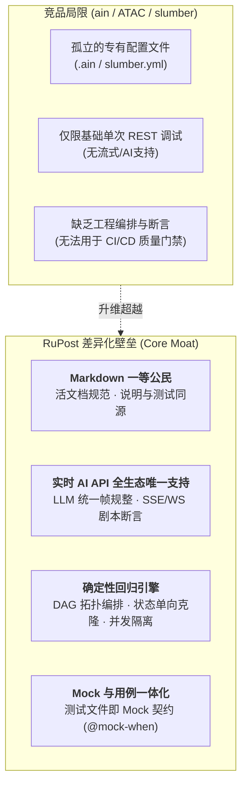

# 终端 API 客户端深度竞品剖析与演进启示：ain、ATAC 与 slumber (2026-10)

> **创建日期**：2026-10-27  
> **研究对象**：
> 1. **ain** (`jonaslu/ain`，Go) —— *Unix 纯粹管道流与请求编译器*
> 2. **ATAC** (`Julien-cpsn/ATAC`，Rust/Ratatui) —— *全功能 Postman 终端复刻*
> 3. **slumber** (`LucasPickering/slumber`，Rust/Ratatui) —— *声明式配方驱动的优雅 TUI*
>
> **定位关联**：作为 [2026-10 竞争格局复审](file:///Users/zsyzzx/project/rust/rupost/doc/competition/2026-10-25-competitive-landscape-review.md) 的专项深度补充，剖析终端交互与配方管理流派，提炼 RuPost 差异化演进路径。

---

## 一、 宏观格局演进：终端 API 客户端的三大设计哲学

在 2026 年的 API 工具生态中，随着 Electron GUI 应用（Postman / Insomnia）的持续臃肿、强制云端登录与团队协作冲突加剧，开发者注意力大规模回流终端。在终端工具链的垂直演进中，涌现出三种截然不同的设计哲学：

```
                    ┌────────────────────────────────────────────────────────┐
                    │               终端 API 客户端核心哲学演进                │
                    └───────────────────────────┬────────────────────────────┘
                                                │
         ┌──────────────────────────────┼──────────────────────────────┐
         ▼                              ▼                              ▼
┌──────────────────┐           ┌──────────────────┐           ┌──────────────────┐
│   ain (Unix 派)   │           │   ATAC (GUI 终端化) │           │ slumber (配方派)  │
│  - 纯文本段落    │           │  - Postman 终端平替 │           │  - 声明式 YAML 配方│
│  - 委派外部 CLI  │           │  - 树状集合与导入   │           │  - 惰性依赖链      │
│  - 管道与 Shell 注入│         │  - 多语言代码生成   │           │  - 交互式选择器    │
└──────────────────┘           └──────────────────┘           └──────────────────┘
         │                              │                              │
         └──────────────────────────────┼──────────────────────────────┘
                                        ▼
                    ┌────────────────────────────────────────┐
                    │           RuPost 综合定位              │
                    │ - 文档即测试 (Markdown 一等公民)       │
                    │ - 确定性回归编排 (DAG 拓扑)            │
                    │ - 实时 AI API 闭环 (LLM 帧规整/SSE/WS) │
                    └────────────────────────────────────────┘
```

1. **Unix 管道派（ain）**：“做请求的组织者，而不是网络库”——坚信 Unix 哲学，自身不做 HTTP 引擎，专注于把文本模板编译为 `curl` 或 `httpie` 并与 Shell 管道集成；
2. **Postman 终端平替派（ATAC）**：“脱离 Electron 的全键盘 REST 客户端”——完整复刻 Postman 的 Collection/Folder 目录树与全局环境，提供开箱即用的跨生态导入；
3. **声明式配方派（slumber）**：“结构化声明，像管理代码一样管理请求”——采用现代强类型 YAML Recipes，引入响应链式求值与交互式动态选择，追求极致的 TUI 美感与开发舒适度。

---

## 二、 三款竞品全景画像与核心特质横向对比

| 核心维度 | **ain** (`jonaslu/ain`) | **ATAC** (`Julien-cpsn/ATAC`) | **slumber** (`LucasPickering/slumber`) | **RuPost** (本项目) |
| :--- | :--- | :--- | :--- | :--- |
| **开发语言** | Go | Rust (Ratatui + Tokio) | Rust (Ratatui + Tokio) | **Rust** (Ratatui + Tokio) |
| **核心定位** | 请求组织与 CLI 编译器 | 终端无云版 Postman | 声明式配方驱动的优雅客户端 | **实时 AI 时代的文档回归引擎** |
| **配置载体** | 自创 `.ain` 类 INI 分段格式 | 本地 JSON/YAML 文件集合 | 声明式 `slumber.yml` | **标准 Markdown (`.md`) 与 `.http`** |
| **网络底座** | 外部二进制 (`curl`/`httpie`/`wget`) | 内置 `reqwest` | 内置 `reqwest` | 内置 **`reqwest` + 异步流式引擎** |
| **变量与动态链** | 原生 Shell 注入 `$(cmd)` 与环境 | 嵌入式 JS 脚本 (`pm.*`) | 内置模板表达式 `{{ response(...) }}` | **5 层级联变量 + 拓扑 `@capture`** |
| **流式与长连接** | 依赖外部 CLI 自身行为 | 仅基础 HTTP，无专项长连支持 | 仅单次请求与响应查看 | **LLM SSE 帧规整 + WS 剧本断言** |
| **断言与自动化** | 无（依赖外部管道 `grep`/`jq`） | 依赖 JS 脚本手动断言 | 无原生断言引擎（偏调试） | **原生 8 运算符 `@assert` + DAG 编排** |
| **Mock 服务** | 无 | 无 | 无 | **内置 Trie 路由 `@mock-when` 服务** |

---

## 三、 各竞品杀手级特性与技术实现深度解构

### 1. `ain`：将 Unix 管道流与编译器模式贯彻到底
- **特性 1：透明的 Native CLI 映射与代码导出（Request Compiler）**
  - `ain` 最具启发性的设计在于其**不发明第二套网络引擎**，而是将 `.ain` 模板文件直接编译为合法的 `curl`、`httpie` 或 `wget` 命令（`ain -b curl --print-cmd`）。开发者可随时将生成的精准命令粘贴到终端排查、发送给同事或写入生产 Shell 脚本。
- **特性 2：原生的 Shell 命令注入与动态凭据求值**
  - 在文件内任意 Header 或 Body 中直接支持 `$(command)` 语法。例如获取云厂商临时 STS Token：
    ```ini
    [Headers]
    Authorization: Bearer $(aws-vault exec prod -- aws sts get-session-token ...)
    ```
    无需开发专门的 AWS 插件或安装特定 SDK，天然与宿主机已有 CLI 工具链 100% 互通。
- **特性 3：分段层叠与级联覆盖（Cascading Files）**
  - 支持多文件类似 CSS 样式的合并：`base.ain`（定义全局域名与标准鉴权头） + `user_get.ain`（定义具体路径与 Query），执行时 `ain base.ain user_get.ain` 自动合并，保持极简 DRY。

---

### 2. `ATAC`：开箱即用的跨生态导入与多语言代码生成
- **特性 1：极其丰富的生态无缝迁入工具箱（Importers）**
  - 原生支持导入 `Postman Collection v2.1`、`OpenAPI v3`、`Insomnia` 以及原始 `cURL` 文本。从重度 GUI 工具迁移至终端的开发者几乎零阻力。
- **特性 2：内置多语言客户端代码生成器（Code Generation）**
  - 在 TUI 详情界面按下快捷键，可直接将当前配置好（已替换变量）的请求一键转换为目标编程语言代码：
    - Rust (`reqwest`)
    - Python (`requests`)
    - JavaScript / TypeScript (`fetch` / `axios`)
    - PHP (`Guzzle`) / Go (`net/http`)
- **特性 3：本地优先与纯文件存储**
  - 彻底抛弃强制在线同步，所有 Collection、Folder 和 Request 完全映射为磁盘上的普通文件，天生契合 Git 版本控制。

---

### 3. `slumber`：声明式配方系统与惰性依赖链（最具美感）
- **特性 1：声明式跨请求链路引用与惰性自愈 (Chained Requests & Lazy Invocation)**
  - 支持在 YAML 配方中通过模板函数直接引用前置请求的响应：
    ```yaml
    headers:
      Authorization: "Bearer {{ response('login') | jsonpath('$.data.access_token') }}"
    ```
  - **核心壁垒与杀手体验**：在 TUI 模式下，当开发者单独运行 `get_profile` 请求时，如果检测到依赖的 `login` 尚未执行或 Token 缓存已过期，slumber 会**自动静默拉起执行上游请求**，提取数据注入当前请求后继续执行。彻底终结了“必须手动先点一遍登录”的割裂交互。
- **特性 2：交互式动态选择器 (Interactive Selector)**
  - 引入了 `select()` 模板过滤器：
    ```yaml
    url: "https://api.example.com/users/{{ response('list_users') | jsonpath('$.users[*].id') | select() }}"
    ```
  - 当触发请求时，TUI 会即时弹出一个模糊搜索弹窗（Fuzzy Search Modal），列出所有可用的 User ID，用户回车选中后自动代入 URL 发送，探索性调试极其丝滑。
- **特性 3：本地 SQLite 响应缓存与历史回溯**
  - 采用轻量 SQLite 存储历史响应元数据与 Body，支持高效的跨会话状态缓存，并保证了极端内存压力下的视口流畅度。

---

## 四、 RuPost 的独特优势与不可替代性 (Why RuPost Wins)

对比上述三个工具，RuPost 并不是“又一个简单的 TUI 发包工具”，而是**面向工程化交付的确定性回归引擎**。RuPost 的核心壁垒在于：



1. **“活文档”哲学（Markdown 一等公民）**：
   - 无论是 `slumber.yml` 还是 `.ain`，都脱离了开发团队的说明文档；
   - RuPost 直接解析 `README.md` 或设计规范 `.md` 中的 HTTP 围栏。**文档写完之日，自动化回归测试与 Mock 仿真即刻就绪**，真正实现“文档即代码（Executable Documentation）”。
2. **实时 AI API 与长连接流式协议的原生支持（业内空白）**：
   - 2026 年几乎所有现代系统均集成了大模型或实时长连接。ain、ATAC 和 slumber 均**完全无法测试流式 LLM 输出与 WebSocket 交互**；
   - RuPost 具备专有的 `stream.llm.content` 自动聚合、SSE 增量落盘（`@stream_to`）、WS `SEND`/`EXPECT` 剧本断言以及内置的大模型 Mock 引擎。
3. **工程化 DAG 拓扑编排与确定性测试**：
   - 竞品多偏向个人终端的手动“点触式”调试；
   - RuPost 原生支持跨文件 `@depends-on` 有向无环图分析、Kahn 拓扑排序、Cookie 状态单向克隆隔离、Fail-Fast 中断与结构化 JSON 测试报告，是能直接接入 CI/CD 门禁的确定性引擎。

---

## 五、 从竞品中提炼的可吸收精华与落地转化路线图

RuPost 应坚持 Clean Architecture 与 YAGNI 原则，吸取竞品在终端人机交互与生态互通上的极致亮点：

### 阶段一：生态互通与终端复制（已交付 & 正在演进）
- [x] **统一命令导出体系 (`rupost export`)** *(已交付)*：
  - 汲取 `ain` 的“请求编译器”思想，内置 `curl`、`httpie`、`wget` 导出插件，支持凭据脱敏（`--redact`）与单行紧凑模式（`--compact`）。
- [ ] **TUI OSC 52 零依赖终端剪贴板集成** *(推荐优先落地)*：
  - 汲取 `ATAC` 与 `slumber` 的交互便利性，在 TUI 详情界面按下快捷键 `y`，直接生成 cURL 命令并通过 ANSI OSC 52 转义序列写入系统剪贴板（即使在远程 SSH 终端下也能直接复制到本地剪贴板）。

### 阶段二：动态求值与单请求惰性自愈（演进规划）
- [ ] **原生 Shell 命令求值注入 `$(cmd)`** *(借鉴 ain)*：
  - 扩展 `VariableResolver`，在执行前识别并执行局部 `$(aws-vault ...)`，满足临时获取动态云凭据的诉求。
- [ ] **交互式单请求依赖自愈 (Lazy Invocation)** *(借鉴 slumber)*：
  - 当在 TUI 或通过 `@name` 单独运行某个后置请求时，如果其上游依赖变量未捕获，引擎自动向后递归执行依赖链，消除手动先跑前置请求的繁琐步骤。

### 阶段三：生态格式无损编译（迁入工具链）
- [ ] **生态导入转换工具 (`rupost init --from postman/openapi`)** *(借鉴 ATAC)*：
  - 提供将 Postman v2.1 Collection 与 OpenAPI v3 规范一键逆向编译为标准 `.http` 或 `.md` 测试用例的脚手架工具，极大降低大型团队从 GUI 平台的迁移门槛。

---

## 六、 结论

ain、ATAC 和 slumber 各自在终端的不同维度做到了极致：ain 守住了 Unix 管道的极简；ATAC 守住了 Postman 用户的习惯；slumber 展现了现代化 TUI 配方的美感。

RuPost 的使命不是成为它们的简单翻版，而是站在它们的肩膀上，以 **“Markdown 活文档”** 与 **“实时 AI API 确定性回归”** 为核心护城河，汲取 ain 的编译器思维、ATAC 的生态兼容力与 slumber 的配方依赖自愈，打造 2026 年终端开发者首选的 API 伴侣。
