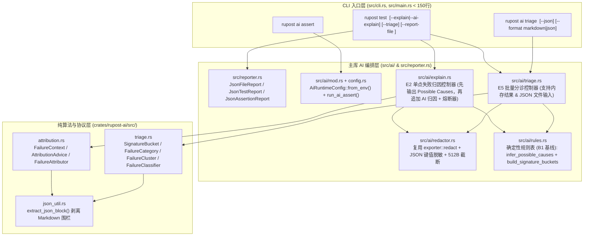

# Rupost AI 失败归因 (E2) 与智能分诊 (E5) 实施手册 (Flash 模型零歧义执行版 v1.1)

- **文档状态**: Ready for Execution (Flash-Model Audited & Verified v1.1 + Gap Review v1.2，新增 §6 查漏补缺评审——执行前必读)
- **创建日期**: 2026-10-28
- **关联 PRD**: [`doc/plans/2026-10-28-ai-failure-triage-and-attribution-prd.md`](file:///Users/zsyzzx/project/rust/rupost/doc/plans/2026-10-28-ai-failure-triage-and-attribution-prd.md) (v1.1)
- **关联架构蓝图**: [`doc/plans/2026-10-27-ai-master-roadmap.md`](file:///Users/zsyzzx/project/rust/rupost/doc/plans/2026-10-27-ai-master-roadmap.md)
- **适用执行者**: Gemini Flash / 同级别快速编码模型

---

## 0. 执行铁律与防呆清单 (Flash Model Guardrails — 必读)

在开始任何一步编码前，**必须逐条遵守以下 9 条硬性约束**。违反任意一条都会导致编译失败、存量测试回归或违反架构规范：

1. **零新增外部依赖**：
   - **禁止**修改根 [`Cargo.toml`](file:///Users/zsyzzx/project/rust/rupost/Cargo.toml) 或 [`crates/rupost-ai/Cargo.toml`](file:///Users/zsyzzx/project/rust/rupost/crates/rupost-ai/Cargo.toml) 添加任何新的第三方 crate。现有依赖（`serde`, `serde_json`, `reqwest`, `url`, `thiserror`, `async-trait`, `colored`, `clap`, `mockall`, `wiremock`）已 100% 满足需求。
2. **禁止裸切片截断字符串（兼容 `rust-version = "1.89"` 防 UTF-8 Panic）**：
   - 根 [`Cargo.toml`](file:///Users/zsyzzx/project/rust/rupost/Cargo.toml#L5) 声明 `rust-version = "1.89"`。截断任何可能包含中文或 Emoji 的响应体/错误消息时，**严禁**写 `&s[..512]`，也不要依赖 1.91+ 才稳定的方法。
   - **必须**使用兼容所有 Rust 版本的 `is_char_boundary` 回退循环：
     ```rust
     let mut end = max_bytes.min(text.len());
     while end > 0 && !text.is_char_boundary(end) {
         end -= 1;
     }
     ```
3. **严格遵守 `src/main.rs` 150 行上限（`AGENTS.md §6`）**：
   - 当前 [`src/main.rs`](file:///Users/zsyzzx/project/rust/rupost/src/main.rs) 为 180 行（因包含了 `run_ai_assert` 逻辑）。在 **Step 0** 中，必须将 `run_ai_assert` 和 `truncate_message` 原样下沉到 `src/ai/mod.rs`，使 `src/main.rs` 降至 **约 130 行**。
4. **100% 保护存量测试 [`tests/ai_assert_test.rs`](file:///Users/zsyzzx/project/rust/rupost/tests/ai_assert_test.rs) 的行为契约**：
   - `rupost ai assert` 是显式 AI 命令（B2 契约）：当缺少 `RUPOST_AI_API_KEY` / `OPENAI_API_KEY` 或后端返回 401/500 时，**必须返回 `Err(RupostError::Other(...))` 并以退出码 `1` 退出**；生成成功时每行必须以 `# @assert ` 开头！**严禁**改动 `run_ai_assert` 的输出格式与错误返回契约。
5. **精确匹配 `crates/rupost-ai` 现有接口签名（禁止臆造类型）**：
   - [`crates/rupost-ai/src/client.rs`](file:///Users/zsyzzx/project/rust/rupost/crates/rupost-ai/src/client.rs#L12-L36) 现有的唯一客户端 Trait 与实现为：
     - `pub trait AiClient: Send + Sync { async fn generate_text(&self, system_prompt: &str, user_prompt: &str) -> Result<String>; }`
     - `pub struct OpenAiClient` 及 `OpenAiClient::new(api_key: String, base_url: Option<String>, model: Option<String>) -> Self`
   - [`crates/rupost-ai/src/error.rs`](file:///Users/zsyzzx/project/rust/rupost/crates/rupost-ai/src/error.rs#L4-L16) 现有的字符串错误变体是 **`AiError::TranslationFailed(String)`**（注意：`AiError::ParseError(#[from] serde_json::Error)` 仅接收 `serde_json::Error`，不接收 `String`！）。
   - [`src/error.rs`](file:///Users/zsyzzx/project/rust/rupost/src/error.rs#L4-L46) 现有的字符串错误变体是 **`RupostError::ParseError(String)`** 或 **`RupostError::Other(String)`**（不存在 `RupostError::ConfigError`！）。
6. **精确匹配 [`AssertionResult`](file:///Users/zsyzzx/project/rust/rupost/src/assertion/types.rs#L277-L326) 的真实字段类型**：
   - `AssertionResult` 的真实字段为：`pub raw: String`, `pub passed: bool`, `pub actual: Option<String>`, `pub expected: String`（非 `Option`！）, `pub message: Option<String>`（是 `Option<String>`！）。
   - 构造失败断言结果的唯一合法函数是 `AssertionResult::failure(raw: String, actual: String, expected: String, message: String)`（注意参数顺序：`actual` 在第 2 位，`expected` 在第 3 位）。
7. **严格遵守 B0 核心引擎零污染不变量**：
   - **严禁**在 `src/runner/executor.rs`、`src/runner/batch.rs`、`src/http/`、`src/parser/`、`src/assertion/` 中 `use rupost_ai` 或 `use crate::ai`。
   - `--explain` 与 `--triage` 仅允许在 [`src/runner/app.rs`](file:///Users/zsyzzx/project/rust/rupost/src/runner/app.rs) 的 **第 7 步（测试执行完毕后的报告渲染阶段）** 调用 `crate::ai::*`。
8. **复用现有脱敏逻辑，禁止重复造轮子（DRY 原则）**：
   - [`src/exporter/redact.rs`](file:///Users/zsyzzx/project/rust/rupost/src/exporter/redact.rs) 已提供 `pub fn is_sensitive_key(key: &str) -> bool`、`pub fn redact_header_value(key: &str, value: &str) -> String` 和 `pub fn redact_url(raw_url: &str) -> String`。
   - `src/ai/redactor.rs` **必须直接 `pub use crate::exporter::redact::{is_sensitive_key, redact_header_value, redact_url};`**。
9. **每步提交前必跑门禁命令**：
   - 每完成一个 Step，必须依次运行：
     ```bash
     cargo fmt --check
     cargo clippy --workspace --all-targets --all-features -- -D warnings
     cargo test --workspace
     ```
   - 全部 0 warning、0 error 后，使用 `jj describe -m "..." && jj new` 提交。

---

## 1. 架构与模块全景图



### 文件变更总览表

| 步骤 | 操作 | 文件路径 | 职责简述 |
| :--- | :--- | :--- | :--- |
| **Step 0** | 新增 | `src/ai/config.rs` | 统一从环境变量读取 `RUPOST_AI_*` / `OPENAI_API_KEY` 并构建 `OpenAiClient` |
| **Step 0** | 新增 | `src/ai/redactor.rs` | 复用 `exporter::redact` 并扩展 JSON Body 递归脱敏与 UTF-8 安全截断 |
| **Step 0** | 新增 | `src/ai/mod.rs` | AI 模块入口，无损迁入 `main.rs` 的 `run_ai_assert` |
| **Step 0** | 修改 | `src/lib.rs`, `src/main.rs` | 导出 `pub mod ai;`，精简 `main.rs` 至 ~125 行 |
| **Step 1** | 修改 | `src/reporter.rs` | 引入强类型 `JsonFileReport` 等，支持 `expected`/`actual`/`response_body_snippet` |
| **Step 1** | 修改 | `src/cli.rs`, `src/runner/app.rs`, `src/main.rs` | 为 `rupost test` 增加 `--report-file <FILE>`，支持终端+JSON 双路输出 |
| **Step 2** | 新增 | `crates/rupost-ai/src/json_util.rs` | 宽容提取 JSON 块（剥离 ```` ```json ```` 围栏与前后缀噪音） |
| **Step 2** | 新增 | `crates/rupost-ai/src/attribution.rs` | E2 `FailureContext`、`AttributionAdvice` 与 `FailureAttributor` |
| **Step 2** | 新增 | `crates/rupost-ai/src/triage.rs` | E5 `SignatureBucket`、`FailureCategory`（无损反序列化）、`FailureClassifier` |
| **Step 2** | 修改 | `crates/rupost-ai/src/lib.rs` | 导出 `json_util`、`attribution`、`triage` 及核心类型 |
| **Step 3** | 新增 | `src/ai/rules.rs` | 确定性规则引擎：E2 `[Possible Causes]` 推导 + E5 URL/状态码签名分桶 |
| **Step 3** | 新增 | `src/ai/explain.rs` | E2 控制器：输出 `[Possible Causes]`、调用 AI 输出 `[AI Explanation]`、内建熔断器 |
| **Step 3** | 新增 | `src/ai/triage.rs` | E5 控制器：读取报告/内存结果、签名分桶、AI 归并、Markdown/JSON 渲染 |
| **Step 3** | 修改 | `src/cli.rs`, `src/runner/app.rs`, `src/main.rs` | 接入 `--explain` (`--ai-explain`)、`--triage` 与 `rupost ai triage` 子命令 |
| **Step 4** | 新增/修改 | `examples/ai_triage/mock_ai.json`, `tests/ai_triage_test.rs`, `tests/verify_features.sh` | 离线 Mock E2E 回归测试、冒烟脚本更新与文档归档 |

---

## Step 0: 抽取 `src/ai/` 基础模块、配置中心与统一脱敏器

### 0.1 目标
1. 创建 `src/ai/config.rs`，统一读取 `RUPOST_AI_API_KEY`（回退 `OPENAI_API_KEY`）、`RUPOST_AI_BASE_URL`、`RUPOST_AI_MODEL` 并构造 `Arc<dyn rupost_ai::AiClient>`。
2. 创建 `src/ai/redactor.rs`，复用 [`src/exporter/redact.rs`](file:///Users/zsyzzx/project/rust/rupost/src/exporter/redact.rs) 并增加 JSON 递归脱敏与 UTF-8 字符边界安全截断。
3. 创建 `src/ai/mod.rs`，将 [`src/main.rs`](file:///Users/zsyzzx/project/rust/rupost/src/main.rs#L129-L180) 中的 `run_ai_assert` 与 `truncate_message` **100% 保持原契约**迁入，使 `src/main.rs` 降至约 125 行。

### 0.2 详细代码实现

#### (1) 新建 `src/ai/config.rs`
```rust
use rupost_ai::{AiClient, OpenAiClient};
use std::sync::Arc;

/// 主库运行时 AI 环境变量配置（遵循零配置与密钥不落盘原则，仅从环境变量读取）
#[derive(Debug, Clone, Default)]
pub struct AiRuntimeConfig {
    pub api_key: Option<String>,
    pub base_url: Option<String>,
    pub model: Option<String>,
}

impl AiRuntimeConfig {
    /// 从当前进程环境变量加载配置：
    /// - 密钥优先级：`RUPOST_AI_API_KEY` > `OPENAI_API_KEY`（空字符串视同未配置）
    /// - 端点：`RUPOST_AI_BASE_URL`
    /// - 模型：`RUPOST_AI_MODEL`
    pub fn from_env() -> Self {
        let api_key = std::env::var("RUPOST_AI_API_KEY")
            .ok()
            .filter(|k| !k.trim().is_empty())
            .or_else(|| {
                std::env::var("OPENAI_API_KEY")
                    .ok()
                    .filter(|k| !k.trim().is_empty())
            });

        let base_url = std::env::var("RUPOST_AI_BASE_URL")
            .ok()
            .filter(|v| !v.trim().is_empty());

        let model = std::env::var("RUPOST_AI_MODEL")
            .ok()
            .filter(|v| !v.trim().is_empty());

        Self {
            api_key,
            base_url,
            model,
        }
    }

    pub fn is_configured(&self) -> bool {
        self.api_key.is_some()
    }

    /// 若已配置 API Key，则构建 `Arc<dyn AiClient>`；否则返回 `None`
    pub fn into_client(self) -> Option<Arc<dyn AiClient>> {
        let key = self.api_key?;
        Some(Arc::new(OpenAiClient::new(key, self.base_url, self.model)))
    }
}
```

#### (2) 新建 `src/ai/redactor.rs`
直接复用 `crate::exporter::redact` 的 3 个公开函数，补充 JSON 敏感字段递归掩码与 512 字节安全截断（使用 `is_char_boundary` 兼容 Rust 1.89）：
```rust
pub use crate::exporter::redact::{is_sensitive_key, redact_header_value, redact_url};
use serde_json::Value;

/// 默认最大响应体片段字节数（512 Bytes）
pub const DEFAULT_SNIPPET_MAX_BYTES: usize = 512;

/// 在 UTF-8 字符边界安全截断文本（按字节上限），超出时追加 `...[truncated]`
pub fn truncate_utf8_safe(text: &str, max_bytes: usize) -> String {
    if text.len() <= max_bytes {
        return text.to_string();
    }
    let mut end = max_bytes;
    while end > 0 && !text.is_char_boundary(end) {
        end -= 1;
    }
    format!("{}...[truncated]", &text[..end])
}

/// 按字符数截断错误消息，防止 AI 后端返回的超长错误体刷屏
pub fn truncate_chars(msg: &str, max_chars: usize) -> String {
    if msg.chars().count() <= max_chars {
        msg.to_string()
    } else {
        let truncated: String = msg.chars().take(max_chars).collect();
        format!("{truncated}...[truncated]")
    }
}

/// 递归遍历 JSON Value，将命中 `is_sensitive_key` 的对象字段值替换为 `"[REDACTED]"`
pub fn redact_json_value(val: &mut Value) {
    match val {
        Value::Object(map) => {
            for (k, v) in map.iter_mut() {
                if is_sensitive_key(k) {
                    *v = Value::String("[REDACTED]".to_string());
                } else {
                    redact_json_value(v);
                }
            }
        }
        Value::Array(arr) => {
            for item in arr.iter_mut() {
                redact_json_value(item);
            }
        }
        _ => {}
    }
}

/// 对响应体进行结构化脱敏并安全截断至 `max_bytes`
/// 1. 若响应体可解析为 JSON，先递归掩码敏感键，再序列化为紧凑字符串；
/// 2. 在 UTF-8 字符边界处截断至 `max_bytes`。
pub fn redact_and_truncate_body(body: &str, max_bytes: usize) -> String {
    let trimmed = body.trim();
    if trimmed.is_empty() {
        return String::new();
    }

    let sanitized = if (trimmed.starts_with('{') || trimmed.starts_with('['))
        && let Ok(mut json_val) = serde_json::from_str::<Value>(trimmed)
    {
        redact_json_value(&mut json_val);
        serde_json::to_string(&json_val).unwrap_or_else(|_| trimmed.to_string())
    } else {
        trimmed.to_string()
    };

    truncate_utf8_safe(&sanitized, max_bytes)
}

#[cfg(test)]
mod tests {
    use super::*;

    #[test]
    fn test_redact_json_body_and_preserve_structure() {
        let raw = r#"{"user":"alice","access_token":"secret-jwt-123","nested":{"password":"pw","code":401}}"#;
        let out = redact_and_truncate_body(raw, 512);
        assert!(out.contains(r#""user":"alice""#));
        assert!(out.contains(r#""access_token":"[REDACTED]""#));
        assert!(out.contains(r#""password":"[REDACTED]""#));
        assert!(!out.contains("secret-jwt-123"));
    }

    #[test]
    fn test_truncate_utf8_safe_multibyte_chinese() {
        // 每个汉字占 3 字节，"错误原因分析" = 18 字节
        let text = "错误原因分析：数据库连接超时";
        // 截断在 10 字节处（位于第 4 个汉字中间），is_char_boundary 回退到 9 字节（前 3 个汉字）
        let truncated = truncate_utf8_safe(text, 10);
        assert_eq!(truncated, "错误原...[truncated]");
    }
}
```

#### (3) 新建 `src/ai/mod.rs`
将原来位于 `src/main.rs` 底部的 `run_ai_assert` 移入 `src/ai/mod.rs`（**100% 保持原输出格式与错误返回契约**，确保 [`tests/ai_assert_test.rs`](file:///Users/zsyzzx/project/rust/rupost/tests/ai_assert_test.rs) 全绿）：
```rust
pub mod config;
pub mod redactor;

use crate::{Result, RupostError};
use colored::Colorize;
use config::AiRuntimeConfig;
use redactor::truncate_chars;
use rupost_ai::AssertionTranslator;

/// `rupost ai assert`: 将自然语言期望翻译为标准 @assert 断言行（创作期辅助，密钥仅从环境变量读取）
pub async fn run_ai_assert(text: &str, raw: bool) -> Result<()> {
    let client = AiRuntimeConfig::from_env().into_client().ok_or_else(|| {
        RupostError::Other(
            "未配置 AI 密钥：请先 `export RUPOST_AI_API_KEY=...`（或 `OPENAI_API_KEY`）；\
             可选 `RUPOST_AI_BASE_URL` 指定 OpenAI 兼容端点、`RUPOST_AI_MODEL` 指定模型"
                .to_string(),
        )
    })?;

    let translator = AssertionTranslator::new(client);
    let assertions = translator
        .translate(text)
        .await
        .map_err(|e| RupostError::Other(truncate_chars(&e.to_string(), 500)))?;

    if raw {
        for assertion in &assertions {
            println!("# @assert {assertion}");
        }
    } else {
        println!(
            "{} 已生成 {} 条标准断言（粘贴到请求块末尾即可生效）:",
            "[✓]".green().bold(),
            assertions.len()
        );
        for assertion in &assertions {
            println!("# @assert {assertion}");
        }
    }
    Ok(())
}
```

#### (4) 修改 `src/lib.rs` 与 `src/main.rs`
- 在 [`src/lib.rs`](file:///Users/zsyzzx/project/rust/rupost/src/lib.rs) 第 1 行添加 `pub mod ai;`。
- 在 [`src/main.rs`](file:///Users/zsyzzx/project/rust/rupost/src/main.rs) 中：
  - 删除第 7 行的 `use rupost_ai::{AssertionTranslator, OpenAiClient};`（如不再直接使用）。
  - 将第 108 行的 `if let Err(e) = run_ai_assert(&text, raw).await` 改为 `if let Err(e) = rupost::ai::run_ai_assert(&text, raw).await`。
  - 删除第 128–180 行的 `run_ai_assert` 与 `truncate_message`。

### 0.3 Step 0 验证与提交
```bash
cargo fmt --check
cargo clippy --workspace --all-targets --all-features -- -D warnings
cargo test --workspace
jj describe -m "refactor(ai): extract src/ai module, config loader and redactor"
jj new
```

---

## Step 1: 升级强类型 `JsonFileReport` 与 `--report-file` 双路输出

### 1.1 目标
1. 在 [`src/reporter.rs`](file:///Users/zsyzzx/project/rust/rupost/src/reporter.rs) 中定义强类型 `JsonFileReport`、`JsonTestReport`、`JsonAssertionReport`（派生 `Serialize, Deserialize`），替代原有的无类型 `serde_json::json!` 宏拼装。
2. 补齐 `JsonAssertionReport.expected`、`JsonAssertionReport.actual`，并在请求失败（`!r.success`）时写入经 `crate::ai::redactor::redact_and_truncate_body` 脱敏截断后的 `response_body_snippet: Option<String>`（及脱敏后的 `url`）。
3. 在 `rupost test` 中新增 `--report-file <FILE>` 参数，支持终端正常渲染的同时将 JSON 报告落盘到文件。
4. 为 [`TestSuiteOptions`](file:///Users/zsyzzx/project/rust/rupost/src/runner/app.rs#L13-L29) 实现 `Default`。

### 1.2 详细代码实现

#### (1) 修改 `src/reporter.rs`
在 [`src/reporter.rs`](file:///Users/zsyzzx/project/rust/rupost/src/reporter.rs) 顶部引入 `serde::{Deserialize, Serialize}`，并定义以下 3 个公开结构体（注意 `message` 为 `Option<String>`，与 `AssertionResult.message` 精确对应）：

```rust
use serde::{Deserialize, Serialize};

/// 单个文件的 JSON 测试报告（强类型序列化与反序列化契约）
#[derive(Debug, Clone, Serialize, Deserialize)]
pub struct JsonFileReport {
    pub file_path: String,
    pub results: Vec<JsonTestReport>,
}

/// 单个请求的 JSON 测试报告
#[derive(Debug, Clone, Serialize, Deserialize)]
pub struct JsonTestReport {
    pub request_number: usize,
    pub name: Option<String>,
    pub method: String,
    pub url: String,
    pub status: Option<u16>,
    pub duration_ms: u128,
    pub success: bool,
    pub error: Option<String>,
    pub skipped: bool,
    pub assertions: Vec<JsonAssertionReport>,
    #[serde(default)]
    pub warnings: Vec<String>,
    #[serde(default)]
    pub diagnose_report: Option<crate::http::DiagnosticsReport>,
    /// 仅在失败请求 (!success) 且存在响应体时记录脱敏+512B截断后的响应片段
    #[serde(default, skip_serializing_if = "Option::is_none")]
    pub response_body_snippet: Option<String>,
}

/// 单条断言的 JSON 报告（保留 expected 与 actual 供 E2/E5 分诊使用）
#[derive(Debug, Clone, Serialize, Deserialize)]
pub struct JsonAssertionReport {
    pub raw: String,
    pub passed: bool,
    pub message: Option<String>,
    #[serde(default, skip_serializing_if = "Option::is_none")]
    pub expected: Option<String>,
    #[serde(default, skip_serializing_if = "Option::is_none")]
    pub actual: Option<String>,
}
```

将 `TestReporter::report_json`（原第 246–290 行）替换为基于 `build_json_reports` 的实现：

```rust
    /// 将内存测试结果转换为强类型 `Vec<JsonFileReport>`（对失败请求的响应片段与 URL 进行脱敏与 512B 截断）
    pub fn build_json_reports(
        results: &[(std::path::PathBuf, Vec<TestResult>)],
    ) -> Vec<JsonFileReport> {
        results
            .iter()
            .map(|(path, file_results)| {
                let req_results = file_results
                    .iter()
                    .map(|r| {
                        let assertions = r
                            .assertions
                            .iter()
                            .map(|a| JsonAssertionReport {
                                raw: a.raw.clone(),
                                passed: a.passed,
                                message: a.message.clone(),
                                expected: (!a.expected.is_empty()).then(|| a.expected.clone()),
                                actual: a.actual.clone(),
                            })
                            .collect();

                        let response_body_snippet = if !r.success {
                            r.response
                                .as_ref()
                                .map(|resp| {
                                    crate::ai::redactor::redact_and_truncate_body(
                                        &resp.body,
                                        crate::ai::redactor::DEFAULT_SNIPPET_MAX_BYTES,
                                    )
                                })
                                .filter(|s| !s.is_empty())
                        } else {
                            None
                        };

                        JsonTestReport {
                            request_number: r.request_number,
                            name: r.name.clone(),
                            method: r.method.clone(),
                            url: crate::ai::redactor::redact_url(&r.url),
                            status: r.status,
                            duration_ms: r.duration.as_millis(),
                            success: r.success,
                            error: r.error.clone(),
                            skipped: r.skipped,
                            assertions,
                            warnings: r.warnings.clone(),
                            diagnose_report: r.diagnose_report.clone(),
                            response_body_snippet,
                        }
                    })
                    .collect();

                JsonFileReport {
                    file_path: path.to_string_lossy().to_string(),
                    results: req_results,
                }
            })
            .collect()
    }

    /// 导出为 JSON 报告
    pub fn report_json(
        results: &[(std::path::PathBuf, Vec<TestResult>)],
        writer: &mut impl std::io::Write,
    ) -> crate::Result<()> {
        let json_list = Self::build_json_reports(results);
        let json_str = serde_json::to_string_pretty(&json_list)?;
        writer.write_all(json_str.as_bytes())?;
        Ok(())
    }
```

#### (2) 修改 `src/cli.rs`、`src/runner/app.rs` 与 `src/main.rs`
1. 在 [`src/cli.rs`](file:///Users/zsyzzx/project/rust/rupost/src/cli.rs#L64-L67) 的 `Commands::Test` 中，`report: String` 下方增加：
   ```rust
        /// 将 JSON 格式测试报告额外写入指定文件（不干扰终端输出）
        #[arg(long, value_name = "FILE")]
        report_file: Option<String>,
   ```
2. 在 [`src/runner/app.rs`](file:///Users/zsyzzx/project/rust/rupost/src/runner/app.rs#L13-L29) 的 `TestSuiteOptions` 中增加 `pub report_file: Option<String>,`，并为其添加 `#[derive(Debug, Clone)]` 与 `impl Default for TestSuiteOptions`：
   ```rust
   #[derive(Debug, Clone)]
   pub struct TestSuiteOptions {
       pub paths: Vec<String>,
       pub mode: String,
       pub concurrency: usize,
       pub report: String,
       pub report_file: Option<String>,
       pub fail_fast: bool,
       pub env: Option<String>,
       pub var: Vec<String>,
       pub env_file: Option<String>,
       pub verbose: bool,
       pub no_cookies: bool,
       pub cookie_file: Option<String>,
       pub debug: bool,
       pub debug_on_failure: bool,
       pub default_scheme: String,
       pub save_snapshot: Option<String>,
   }

   impl Default for TestSuiteOptions {
       fn default() -> Self {
           Self {
               paths: Vec::new(),
               mode: "sequential".to_string(),
               concurrency: 4,
               report: "terminal".to_string(),
               report_file: None,
               fail_fast: false,
               env: None,
               var: Vec::new(),
               env_file: None,
               verbose: false,
               no_cookies: false,
               cookie_file: None,
               debug: false,
               debug_on_failure: false,
               default_scheme: "http".to_string(),
               save_snapshot: None,
           }
       }
   }
   ```
3. 在 [`src/runner/app.rs`](file:///Users/zsyzzx/project/rust/rupost/src/runner/app.rs#L140) 报告输出块之后、保存快照之前，加入 `report_file` 落盘逻辑：
   ```rust
    if let Some(report_path) = &options.report_file {
        let mut file = std::fs::File::create(report_path)?;
        TestReporter::report_json(&batch_results, &mut file)?;
    }
   ```
4. 更新 [`src/runner/app.rs` 的 `test_run_test_suite_empty_paths`](file:///Users/zsyzzx/project/rust/rupost/src/runner/app.rs#L155) 使用 `let options = TestSuiteOptions::default();`。
5. 更新 [`src/main.rs`](file:///Users/zsyzzx/project/rust/rupost/src/main.rs#L19-L50) 中 `Commands::Test` 的模式匹配与 `TestSuiteOptions` 构造，传入 `report_file`。

#### (3) 在 `src/reporter.rs` 中新增 Round-Trip 单元测试
在 [`src/reporter.rs`](file:///Users/zsyzzx/project/rust/rupost/src/reporter.rs#L350) 的 `mod tests` 中追加（注意使用 `AssertionResult::failure(raw, actual, expected, message)`）：
```rust
    #[test]
    fn test_json_report_round_trip_with_assertions_and_redacted_snippet() {
        use crate::assertion::AssertionResult;
        use crate::http::Response;
        use reqwest::header::HeaderMap;

        let resp = Response::new(
            401,
            HeaderMap::new(),
            r#"{"error":"invalid_token","access_token":"secret-xyz"}"#.to_string(),
            Duration::from_millis(12),
            Duration::from_millis(5),
            Duration::from_millis(7),
        )
        .unwrap();

        let mut result = TestResult::success(
            1,
            Some("AuthCheck".to_string()),
            "POST".to_string(),
            "https://api.example.com/login?api_key=12345".to_string(),
            resp,
        );
        result.success = false;
        // 注意 AssertionResult::failure 参数顺序：(raw, actual, expected, message)
        result.assertions.push(AssertionResult::failure(
            "status == 200".to_string(),
            "401".to_string(),
            "200".to_string(),
            "Status code mismatch".to_string(),
        ));

        let batch = vec![(std::path::PathBuf::from("auth.http"), vec![result])];
        let mut buf = Vec::new();
        TestReporter::report_json(&batch, &mut buf).unwrap();

        let parsed: Vec<JsonFileReport> = serde_json::from_slice(&buf).unwrap();
        assert_eq!(parsed.len(), 1);
        let req = &parsed[0].results[0];
        assert!(
            req.url.contains("api_key=%5BREDACTED%5D") || req.url.contains("api_key=[REDACTED]")
        );
        assert_eq!(req.assertions[0].expected.as_deref(), Some("200"));
        assert_eq!(req.assertions[0].actual.as_deref(), Some("401"));
        assert_eq!(
            req.assertions[0].message.as_deref(),
            Some("Status code mismatch")
        );
        let snippet = req.response_body_snippet.as_deref().unwrap();
        assert!(snippet.contains(r#""access_token":"[REDACTED]""#));
        assert!(!snippet.contains("secret-xyz"));
    }
```

### 1.3 Step 1 验证与提交
```bash
cargo fmt --check
cargo clippy --workspace --all-targets --all-features -- -D warnings
cargo test --workspace
jj describe -m "feat(reporter): typed JsonFileReport with failure snippet and --report-file"
jj new
```

---

## Step 2: 在 `crates/rupost-ai` 中实现纯算法层 (`json_util`, `attribution`, `triage`)

### 2.1 目标
在 `crates/rupost-ai` 中基于现有 `AiClient::generate_text(&self, system_prompt: &str, user_prompt: &str)` 接口实现：
1. `json_util.rs`：剥离 LLM 常见的 ```` ```json ... ``` ```` 代码围栏与前后缀解释文字。
2. `attribution.rs`：E2 单点失败归因 DTO (`FailureContext`, `FailedAssertionInfo`, `AttributionAdvice`) 与 `FailureAttributor`。
3. `triage.rs`：E5 签名分桶 DTO (`SignatureBucket`, `FailureCategory`, `FailureCluster`, `TriageReport`) 与 `FailureClassifier`（含 **无损枚举反序列化** 与 **分桶 ID 守恒定律**）。

### 2.2 详细代码实现

#### (1) 新建 `crates/rupost-ai/src/json_util.rs`
```rust
/// 从 LLM 原始文本中提取 JSON 字符串块（自动剥离 ```json 围栏及首尾非 JSON 噪音）
pub fn extract_json_block(raw: &str) -> &str {
    let trimmed = raw.trim();

    // 1. 如果包含 ``` 围栏，优先提取第一个围栏内部的内容
    if let Some(fence_start) = trimmed.find("```") {
        let after_fence = &trimmed[fence_start + 3..];
        // 跳过第一行的语言标识符（如 "json\n"）
        let content_start = after_fence.find('\n').map(|i| i + 1).unwrap_or(0);
        let inner = &after_fence[content_start..];
        if let Some(fence_end) = inner.find("```") {
            return inner[..fence_end].trim();
        }
    }

    // 2. 否则定位最外层的 `{ ... }` 或 `[ ... ]`
    let first_brace = trimmed.find('{');
    let first_bracket = trimmed.find('[');

    match (first_brace, first_bracket) {
        (Some(b), Some(k)) if b < k => {
            if let Some(end) = trimmed.rfind('}')
                && end >= b
            {
                return &trimmed[b..=end];
            }
        }
        (Some(b), None) => {
            if let Some(end) = trimmed.rfind('}')
                && end >= b
            {
                return &trimmed[b..=end];
            }
        }
        (None, Some(k)) | (Some(_), Some(k)) => {
            if let Some(end) = trimmed.rfind(']')
                && end >= k
            {
                return &trimmed[k..=end];
            }
        }
        (None, None) => {}
    }

    trimmed
}

#[cfg(test)]
mod tests {
    use super::*;

    #[test]
    fn test_extract_json_block_from_markdown_fence() {
        let raw = "Here is the analysis:\n```json\n{\"root_cause\": \"401\"}\n```\nHope this helps!";
        assert_eq!(extract_json_block(raw), r#"{"root_cause": "401"}"#);
    }

    #[test]
    fn test_extract_json_block_from_plain_text_with_prefix() {
        let raw = "Sure! [{\"category\": \"Auth\"}] is the result.";
        assert_eq!(extract_json_block(raw), r#"[{"category": "Auth"}]"#);
    }
}
```

#### (2) 新建 `crates/rupost-ai/src/attribution.rs`
注意：使用 `self.client.generate_text(ATTRIBUTION_SYSTEM_PROMPT, &user_json).await?` 及 `AiError::TranslationFailed(...)`，测试模块内用 `mockall::mock!` 定义 `MockClient`（与 [`crates/rupost-ai/src/translator.rs`](file:///Users/zsyzzx/project/rust/rupost/crates/rupost-ai/src/translator.rs#L61-L67) 完全一致）：

```rust
use crate::client::AiClient;
use crate::error::{AiError, Result};
use crate::json_util::extract_json_block;
use serde::{Deserialize, Serialize};

const ATTRIBUTION_SYSTEM_PROMPT: &str = r#"You are a senior API testing diagnostic expert for the `rupost` CLI tool.
Analyze the failed HTTP request context and output ONLY a valid JSON object (no markdown fences, no extra prose) with this exact schema:
{
  "root_cause": "One concise sentence explaining why the request or assertion failed",
  "fix_suggestion": "Concrete actionable step to fix the .http file, environment variable, or backend service",
  "suggested_assert": "Optional updated @assert line if the assertion itself is outdated, or null"
}"#;

/// 失败断言摘要 DTO
#[derive(Debug, Clone, Serialize, Deserialize, PartialEq, Eq)]
pub struct FailedAssertionInfo {
    pub raw: String,
    pub expected: Option<String>,
    pub actual: Option<String>,
    pub message: Option<String>,
}

/// 传入 `FailureAttributor` 的单次失败脱敏上下文（已由调用方完成脱敏与 512B 截断）
#[derive(Debug, Clone, Serialize, Deserialize, PartialEq, Eq)]
pub struct FailureContext {
    pub request_name: Option<String>,
    pub method: String,
    pub url: String,
    /// 网络/DNS/TLS 故障时为 None
    pub status_code: Option<u16>,
    pub error: Option<String>,
    pub failed_assertions: Vec<FailedAssertionInfo>,
    pub response_body_snippet: Option<String>,
    pub warnings: Vec<String>,
}

/// AI 单点失败归因输出结构（同时兼容 `summary`/`suggested_action` 别名）
#[derive(Debug, Clone, Serialize, Deserialize, PartialEq, Eq)]
pub struct AttributionAdvice {
    #[serde(alias = "summary")]
    pub root_cause: String,
    #[serde(alias = "suggested_action")]
    pub fix_suggestion: String,
    #[serde(default)]
    pub suggested_assert: Option<String>,
}

pub struct FailureAttributor<'a> {
    client: &'a dyn AiClient,
}

impl<'a> FailureAttributor<'a> {
    pub fn new(client: &'a dyn AiClient) -> Self {
        Self { client }
    }

    pub async fn attribute(&self, ctx: &FailureContext) -> Result<AttributionAdvice> {
        let user_json = serde_json::to_string_pretty(ctx)?;
        let raw_reply = self
            .client
            .generate_text(ATTRIBUTION_SYSTEM_PROMPT, &user_json)
            .await?;
        let clean_json = extract_json_block(&raw_reply);

        let advice: AttributionAdvice = serde_json::from_str(clean_json).map_err(|e| {
            AiError::TranslationFailed(format!(
                "Invalid JSON in attribution response ({e}): {clean_json}"
            ))
        })?;

        if advice.root_cause.trim().is_empty() {
            return Err(AiError::TranslationFailed(
                "Attribution root_cause cannot be empty".to_string(),
            ));
        }

        Ok(advice)
    }
}

#[cfg(test)]
mod tests {
    use super::*;
    use async_trait::async_trait;
    use mockall::mock;

    mock! {
        pub Client {}
        #[async_trait]
        impl AiClient for Client {
            async fn generate_text(&self, system_prompt: &str, user_prompt: &str) -> Result<String>;
        }
    }

    fn sample_context() -> FailureContext {
        FailureContext {
            request_name: Some("GetUserProfile".to_string()),
            method: "GET".to_string(),
            url: "https://api.example.com/v1/profile".to_string(),
            status_code: Some(401),
            error: None,
            failed_assertions: vec![FailedAssertionInfo {
                raw: "status == 200".to_string(),
                expected: Some("200".to_string()),
                actual: Some("401".to_string()),
                message: Some("Status code mismatch".to_string()),
            }],
            response_body_snippet: Some(r#"{"error":"token_expired"}"#.to_string()),
            warnings: vec![],
        }
    }

    #[tokio::test]
    async fn test_attribute_parses_fenced_json_successfully() {
        let mut mock = MockClient::new();
        mock.expect_generate_text().times(1).returning(|_, _| {
            Ok("```json\n{\"root_cause\":\"JWT token expired\",\"fix_suggestion\":\"Refresh token via login endpoint first\",\"suggested_assert\":null}\n```".to_string())
        });

        let attributor = FailureAttributor::new(&mock);
        let advice = attributor.attribute(&sample_context()).await.unwrap();
        assert_eq!(advice.root_cause, "JWT token expired");
        assert_eq!(
            advice.fix_suggestion,
            "Refresh token via login endpoint first"
        );
        assert_eq!(advice.suggested_assert, None);
    }

    #[tokio::test]
    async fn test_attribute_rejects_malformed_json() {
        let mut mock = MockClient::new();
        mock.expect_generate_text()
            .times(1)
            .returning(|_, _| Ok("Not a json object at all".to_string()));

        let attributor = FailureAttributor::new(&mock);
        let res = attributor.attribute(&sample_context()).await;
        assert!(matches!(res, Err(AiError::TranslationFailed(_))));
    }
}
```

#### (3) 新建 `crates/rupost-ai/src/triage.rs`
注意 `FailureCategory` 兼容 PRD v1.1 的所有分类名与别名，未知分类无损落入 `Other(String)`；`FailureClassifier` 使用 `self.client.generate_text` 并严格执行 **分桶 ID 守恒**：

```rust
use crate::client::AiClient;
use crate::error::{AiError, Result};
use crate::json_util::extract_json_block;
use serde::{Deserialize, Deserializer, Serialize, Serializer};
use std::collections::HashSet;

const TRIAGE_SYSTEM_PROMPT: &str = r#"You are a CI Failure Triage Engine for `rupost`.
Given a JSON array of deterministic failure signature buckets (`bucket_id`, `signature`, `default_category`, `count`, `sample_requests`, `sample_error`), merge buckets that share the same underlying root cause into clusters.
Output ONLY a valid JSON array (no markdown fences, no extra prose) where each element has this schema:
[
  {
    "category": "Auth | Upstream5xx | SchemaDrift | AssertionMismatch | NetworkAndTls | VariableOrConfig",
    "title": "Short cluster title",
    "bucket_ids": [0, 2],
    "root_cause": "Concise explanation of the shared root cause",
    "fix_suggestion": "Actionable remediation step"
  }
]
Every input `bucket_id` MUST appear in exactly one cluster."#;

/// 失败根因分类枚举（支持大小写/PRD别名宽容解析，未知分类自动落入 `Other(String)`，绝不报 ParseError）
#[derive(Debug, Clone, PartialEq, Eq)]
pub enum FailureCategory {
    Auth,
    Upstream5xx,
    SchemaDrift,
    AssertionMismatch,
    NetworkAndTls,
    VariableOrConfig,
    Other(String),
}

impl FailureCategory {
    pub fn as_str(&self) -> &str {
        match self {
            Self::Auth => "Auth",
            Self::Upstream5xx => "Upstream5xx",
            Self::SchemaDrift => "SchemaDrift",
            Self::AssertionMismatch => "AssertionMismatch",
            Self::NetworkAndTls => "NetworkAndTls",
            Self::VariableOrConfig => "VariableOrConfig",
            Self::Other(s) => s.as_str(),
        }
    }

    pub fn from_loose_str(s: &str) -> Self {
        let norm = s.trim();
        match norm.to_ascii_lowercase().as_str() {
            "auth" | "authentication" | "authorization" | "authenticationexpired" | "401"
            | "403" => Self::Auth,
            "upstream5xx" | "upstream_5xx" | "internalservererror" | "server_error" | "5xx" => {
                Self::Upstream5xx
            }
            "schemadrift" | "schema_drift" | "contractmismatch" | "schema" => Self::SchemaDrift,
            "assertionmismatch" | "assertion_mismatch" | "assertionlogicerror" | "assertion" => {
                Self::AssertionMismatch
            }
            "networkandtls"
            | "network_and_tls"
            | "infrastructuretimeout"
            | "network"
            | "tls"
            | "dns"
            | "timeout" => Self::NetworkAndTls,
            "variableorconfig" | "variable_or_config" | "variable" | "config" => {
                Self::VariableOrConfig
            }
            _ => Self::Other(if norm.is_empty() {
                "Uncategorized".to_string()
            } else {
                norm.to_string()
            }),
        }
    }
}

impl Serialize for FailureCategory {
    fn serialize<S: Serializer>(&self, serializer: S) -> std::result::Result<S::Ok, S::Error> {
        serializer.serialize_str(self.as_str())
    }
}

impl<'de> Deserialize<'de> for FailureCategory {
    fn deserialize<D: Deserializer<'de>>(deserializer: D) -> std::result::Result<Self, D::Error> {
        let s = String::deserialize(deserializer)?;
        Ok(Self::from_loose_str(&s))
    }
}

/// 确定性签名分桶（由主库规则层在调用 AI 前生成，单次最多传 20 个桶给 LLM）
#[derive(Debug, Clone, Serialize, Deserialize, PartialEq, Eq)]
pub struct SignatureBucket {
    pub bucket_id: usize,
    pub signature: String,
    pub default_category: FailureCategory,
    pub count: usize,
    /// 代表性失败请求标识（如 `["auth.http#1 (Login)", "order.http#3 (CreateOrder)"]`，最多 5 条）
    pub sample_requests: Vec<String>,
    pub sample_error: String,
    pub sample_snippet: Option<String>,
    /// 该桶对应的全部失败请求标识（不发给 LLM，用于在归并后还原完整 `affected_requests`）
    #[serde(skip_serializing)]
    pub all_requests: Vec<String>,
    /// 规则引擎生成的默认原因描述（用于无 Key 降级或兜底）
    #[serde(skip_serializing)]
    pub default_root_cause: String,
    /// 规则引擎生成的默认修复建议
    #[serde(skip_serializing)]
    pub default_fix_suggestion: String,
}

/// 最终输出的单个失败根因簇
#[derive(Debug, Clone, Serialize, Deserialize, PartialEq, Eq)]
pub struct FailureCluster {
    pub category: FailureCategory,
    pub title: String,
    pub count: usize,
    pub affected_requests: Vec<String>,
    pub root_cause: String,
    pub fix_suggestion: String,
}

/// 完整分诊报告结构
#[derive(Debug, Clone, Serialize, Deserialize, PartialEq, Eq)]
pub struct TriageReport {
    pub total_requests: usize,
    pub failed_requests: usize,
    pub cluster_count: usize,
    pub ai_enhanced: bool,
    pub clusters: Vec<FailureCluster>,
}

/// LLM 返回的原始簇 DTO
#[derive(Debug, Deserialize)]
struct RawAiCluster {
    category: FailureCategory,
    title: String,
    bucket_ids: Vec<usize>,
    root_cause: String,
    fix_suggestion: String,
}

/// 将单个 `SignatureBucket` 直接转换为确定性 `FailureCluster`（用于 B1 离线基线与遗漏桶兜底）
pub fn bucket_to_deterministic_cluster(bucket: &SignatureBucket) -> FailureCluster {
    let requests = if bucket.all_requests.is_empty() {
        bucket.sample_requests.clone()
    } else {
        bucket.all_requests.clone()
    };
    FailureCluster {
        category: bucket.default_category.clone(),
        title: bucket.signature.clone(),
        count: bucket.count,
        affected_requests: requests,
        root_cause: bucket.default_root_cause.clone(),
        fix_suggestion: bucket.default_fix_suggestion.clone(),
    }
}

pub struct FailureClassifier<'a> {
    client: &'a dyn AiClient,
}

impl<'a> FailureClassifier<'a> {
    pub fn new(client: &'a dyn AiClient) -> Self {
        Self { client }
    }

    /// 对签名桶列表进行 AI 语义归并，并严格保证分桶 ID 守恒（不丢桶、不重算）
    pub async fn classify(&self, buckets: &[SignatureBucket]) -> Result<Vec<FailureCluster>> {
        if buckets.is_empty() {
            return Ok(Vec::new());
        }

        let payload = serde_json::to_string_pretty(buckets)?;
        let raw_reply = self
            .client
            .generate_text(TRIAGE_SYSTEM_PROMPT, &payload)
            .await?;
        let clean_json = extract_json_block(&raw_reply);

        let raw_clusters: Vec<RawAiCluster> = serde_json::from_str(clean_json).map_err(|e| {
            AiError::TranslationFailed(format!(
                "Invalid JSON in triage response ({e}): {clean_json}"
            ))
        })?;

        if raw_clusters.is_empty() {
            return Err(AiError::TranslationFailed(
                "AI returned empty cluster list".to_string(),
            ));
        }

        // 分桶守恒合并：追踪已被消费的 bucket_id
        let mut consumed_ids = HashSet::new();
        let mut final_clusters = Vec::new();

        for rc in raw_clusters {
            let mut count = 0;
            let mut affected = Vec::new();
            for bid in rc.bucket_ids {
                if consumed_ids.contains(&bid) {
                    continue;
                }
                if let Some(b) = buckets.iter().find(|b| b.bucket_id == bid) {
                    consumed_ids.insert(bid);
                    count += b.count;
                    if b.all_requests.is_empty() {
                        affected.extend(b.sample_requests.iter().cloned());
                    } else {
                        affected.extend(b.all_requests.iter().cloned());
                    }
                }
            }
            if count > 0 {
                final_clusters.push(FailureCluster {
                    category: rc.category,
                    title: rc.title,
                    count,
                    affected_requests: affected,
                    root_cause: rc.root_cause,
                    fix_suggestion: rc.fix_suggestion,
                });
            }
        }

        // 兜底：若 LLM 漏掉了任何输入 bucket_id，自动追加为确定性簇，保证失败总数 100% 守恒
        for b in buckets {
            if !consumed_ids.contains(&b.bucket_id) {
                final_clusters.push(bucket_to_deterministic_cluster(b));
            }
        }

        Ok(final_clusters)
    }
}

#[cfg(test)]
mod tests {
    use super::*;
    use async_trait::async_trait;
    use mockall::mock;

    mock! {
        pub Client {}
        #[async_trait]
        impl AiClient for Client {
            async fn generate_text(&self, system_prompt: &str, user_prompt: &str) -> Result<String>;
        }
    }

    fn sample_buckets() -> Vec<SignatureBucket> {
        vec![
            SignatureBucket {
                bucket_id: 0,
                signature: "HTTP 401 @ /v1/*".to_string(),
                default_category: FailureCategory::Auth,
                count: 3,
                sample_requests: vec!["a.http#1".to_string()],
                sample_error: "status == 200 (actual 401)".to_string(),
                sample_snippet: None,
                all_requests: vec![
                    "a.http#1".to_string(),
                    "a.http#2".to_string(),
                    "a.http#3".to_string(),
                ],
                default_root_cause: "HTTP 401 Unauthorized".to_string(),
                default_fix_suggestion: "Check auth token".to_string(),
            },
            SignatureBucket {
                bucket_id: 1,
                signature: "HTTP 502 @ /v1/pay".to_string(),
                default_category: FailureCategory::Upstream5xx,
                count: 2,
                sample_requests: vec!["b.http#1".to_string()],
                sample_error: "502 Bad Gateway".to_string(),
                sample_snippet: None,
                all_requests: vec!["b.http#1".to_string(), "b.http#2".to_string()],
                default_root_cause: "Upstream 502".to_string(),
                default_fix_suggestion: "Check upstream gateway".to_string(),
            },
        ]
    }

    #[tokio::test]
    async fn test_classify_conserves_missing_buckets_and_unknown_category() {
        let mut mock = MockClient::new();
        // LLM 只返回了 bucket_id 0，且使用了未知分类名称 "CustomAuthError"，漏掉了 bucket_id 1
        mock.expect_generate_text().times(1).returning(|_, _| {
            Ok(r#"[{"category":"CustomAuthError","title":"Expired Token","bucket_ids":[0],"root_cause":"Token expired","fix_suggestion":"Re-login"}]"#.to_string())
        });

        let classifier = FailureClassifier::new(&mock);
        let clusters = classifier.classify(&sample_buckets()).await.unwrap();

        // 应包含 2 个簇：bucket 0 (AI 归并) + bucket 1 (守恒自动补齐)
        assert_eq!(clusters.len(), 2);
        let total_counted: usize = clusters.iter().map(|c| c.count).sum();
        assert_eq!(total_counted, 5);
        assert_eq!(
            clusters[0].category,
            FailureCategory::Other("CustomAuthError".to_string())
        );
        assert_eq!(clusters[1].category, FailureCategory::Upstream5xx);
    }
}
```

#### (4) 修改 `crates/rupost-ai/src/lib.rs`
将 [`crates/rupost-ai/src/lib.rs`](file:///Users/zsyzzx/project/rust/rupost/crates/rupost-ai/src/lib.rs) 更新为：
```rust
pub mod attribution;
pub mod client;
pub mod error;
pub mod json_util;
pub mod translator;
pub mod triage;

pub use attribution::{AttributionAdvice, FailedAssertionInfo, FailureAttributor, FailureContext};
pub use client::{AiClient, OpenAiClient};
pub use error::{AiError, Result};
pub use translator::AssertionTranslator;
pub use triage::{
    FailureCategory, FailureClassifier, FailureCluster, SignatureBucket, TriageReport,
    bucket_to_deterministic_cluster,
};
```

### 2.3 Step 2 验证与提交
```bash
cargo fmt --check
cargo clippy --workspace --all-targets --all-features -- -D warnings
cargo test --workspace
jj describe -m "feat(ai): add attribution and signature-bucket triage in rupost-ai"
jj new
```

---

## Step 3: 实现主库规则基线 (`rules.rs`)、归因与分诊控制器 (`explain.rs`, `triage.rs`) 并挂载 CLI

### 3.1 目标
1. 创建 `src/ai/rules.rs`：实现 B1 零成本确定性规则基线：
   - E2 确定性原因推导 `infer_possible_causes(ctx: &FailureContext) -> Vec<String>`。
   - E5 确定性签名分桶 `build_signature_buckets(reports: &[JsonFileReport]) -> Vec<SignatureBucket>`。
2. 创建 `src/ai/explain.rs`：实现 E2 控制器，**始终先打印规则版 `[Possible Causes]`（B1 基线）**，随后在配置了 AI 密钥且未触发熔断（`MAX_AI_EXPLAIN_CALLS = 3`）时追加输出 `[AI Explanation]`。
3. 创建 `src/ai/triage.rs`：实现 E5 控制器，提供可显式传入 `Option<&dyn AiClient>` 的纯函数 `build_triage_report_with_client`（便于测试隔离环境变量），以及 `run_inline_triage` 和 `run_ai_triage_from_file`。
4. 在 `src/cli.rs`、`src/runner/app.rs`、`src/main.rs` 挂载 `--explain`（别名 `--ai-explain` 及 `RUPOST_AI_EXPLAIN=1`）、`--triage` 与 `AiCommands::Triage`（同时支持 `--json` 与 `--format`）。

### 3.2 详细代码实现

#### (1) 新建 `src/ai/rules.rs`
```rust
use crate::reporter::{JsonFileReport, JsonTestReport};
use rupost_ai::{FailedAssertionInfo, FailureCategory, FailureContext, SignatureBucket};
use std::collections::BTreeMap;

/// 最大分桶上限（防止超过 LLM 上下文窗口）
pub const MAX_SIGNATURE_BUCKETS: usize = 20;

/// 从 `JsonTestReport` 构建 `FailureContext`
pub fn context_from_json_test_report(r: &JsonTestReport) -> FailureContext {
    let failed_assertions = r
        .assertions
        .iter()
        .filter(|a| !a.passed)
        .map(|a| FailedAssertionInfo {
            raw: a.raw.clone(),
            expected: a.expected.clone(),
            actual: a.actual.clone(),
            message: a.message.clone(),
        })
        .collect();

    FailureContext {
        request_name: r.name.clone(),
        method: r.method.clone(),
        url: r.url.clone(),
        status_code: r.status,
        error: r.error.clone(),
        failed_assertions,
        response_body_snippet: r.response_body_snippet.clone(),
        warnings: r.warnings.clone(),
    }
}

/// E2 确定性原因推导表（B1 基线 & B2 降级兜底）
pub fn infer_possible_causes(ctx: &FailureContext) -> Vec<String> {
    let mut causes = Vec::new();

    // 1. 检查未定义变量或前置捕获失败警告
    if ctx
        .warnings
        .iter()
        .any(|w| w.contains("未定义") || w.contains("capture") || w.contains("捕获"))
    {
        causes.push(
            "检测到未定义变量或前置 @capture 失败警告，请检查 --env 环境配置或前置依赖请求是否成功导出变量。"
                .to_string(),
        );
    }

    // 2. 检查网络/TLS/连接层错误 (status_code == None)
    if ctx.status_code.is_none()
        && let Some(err) = &ctx.error
    {
        let lower = err.to_ascii_lowercase();
        if lower.contains("connection refused") || lower.contains("connect") {
            causes.push(
                "目标服务拒绝连接 (Connection Refused)，请确认本地或远端测试服务已启动且端口正确。"
                    .to_string(),
            );
        } else if lower.contains("dns") || lower.contains("resolve") {
            causes.push("域名解析失败 (DNS Error)，请检查请求 URL 主机名或本地网络设置。".to_string());
        } else if lower.contains("tls") || lower.contains("certificate") || lower.contains("ssl") {
            causes.push("TLS/证书握手失败，可执行 `rupost diagnose <URL>` 排查证书有效期与 SANs。".to_string());
        } else if lower.contains("timed out") || lower.contains("timeout") {
            causes.push("请求超时 (Timeout)，请检查下游服务响应延迟或防火墙策略。".to_string());
        } else {
            causes.push(format!("网络传输层异常 ({err})，请求未能获得 HTTP 状态码。"));
        }
    }

    // 3. 检查 HTTP 状态码特征
    if let Some(status) = ctx.status_code {
        match status {
            401 | 403 => causes.push(format!(
                "收到 HTTP {status} 鉴权失败，请检查 Authorization Header、Token 是否过期或 --cookie-file 会话状态。"
            )),
            404 => causes.push(
                "收到 HTTP 404 Not Found，请检查请求路由路径、API 版本前缀或被查询的资源 ID 是否存在。"
                    .to_string(),
            ),
            400 | 422 => causes.push(format!(
                "收到 HTTP {status} 参数校验失败，请核对请求 Body JSON 字段类型、必填项及 Content-Type 请求头。"
            )),
            429 => causes.push(
                "收到 HTTP 429 Too Many Requests，触发服务端限流，请降低 `--concurrency` 并发度或改用 `--mode sequential`。"
                    .to_string(),
            ),
            500..=599 => causes.push(format!(
                "收到 HTTP {status} 服务端异常，表明下游服务或网关发生内部错误，请结合响应片段排查后端日志。"
            )),
            _ => {}
        }
    }

    // 4. 检查断言不匹配特征
    for fa in &ctx.failed_assertions {
        if fa.raw.contains("body.") || fa.raw.contains("jsonpath") {
            if fa.actual.as_deref() == Some("null") || fa.actual.as_deref() == Some("<missing>") {
                causes.push(format!(
                    "断言 `{}` 提取值为空，可能是响应 JSON 结构发生漂移 (Schema Drift) 或错误响应未返回业务字段。",
                    fa.raw
                ));
            } else {
                causes.push(format!(
                    "响应体断言 `{}` 不匹配（期望 {:?}，实际 {:?}），请核对测试数据或更新断言预期。",
                    fa.raw, fa.expected, fa.actual
                ));
            }
        }
    }

    if causes.is_empty() {
        causes.push(
            "断言条件未满足，请对比上方 Expected 与 Actual 值，核对接口返回状态或测试断言配置。"
                .to_string(),
        );
    }

    causes
}

/// 将 URL 路径归约为模式签名（数字 ID 与 UUID 替换为 `:id`）
pub fn normalize_url_pattern(raw_url: &str) -> String {
    if let Ok(parsed) = url::Url::parse(raw_url) {
        let segments: Vec<&str> = parsed
            .path_segments()
            .map(|c| c.collect())
            .unwrap_or_default();
        if segments.is_empty() {
            return "/".to_string();
        }
        let normalized: Vec<String> = segments
            .into_iter()
            .take(4)
            .map(|seg| {
                if !seg.is_empty()
                    && (seg.chars().all(|c| c.is_ascii_digit())
                        || (seg.len() >= 16
                            && seg.chars().all(|c| c.is_ascii_hexdigit() || c == '-')))
                {
                    ":id".to_string()
                } else {
                    seg.to_string()
                }
            })
            .collect();
        format!("/{}", normalized.join("/"))
    } else {
        raw_url.to_string()
    }
}

/// 根据单个失败请求计算确定性分桶签名与默认分类
fn compute_bucket_key_and_category(
    r: &JsonTestReport,
) -> (String, FailureCategory, String, String) {
    let path_pattern = normalize_url_pattern(&r.url);

    if r.warnings.iter().any(|w| w.contains("未定义")) {
        return (
            format!("UnresolvedVariable @ {path_pattern}"),
            FailureCategory::VariableOrConfig,
            "请求包含未定义的模板变量，导致发送了字面量占位符".to_string(),
            "检查 `--env` 环境名称、`rupost.toml` 或前置请求的 `@capture` 变量名拼写".to_string(),
        );
    }

    match r.status {
        None => (
            format!("NetworkError @ {path_pattern}"),
            FailureCategory::NetworkAndTls,
            r.error
                .clone()
                .unwrap_or_else(|| "网络连接或超时异常".to_string()),
            "确认目标服务已启动且网络可达，或运行 `rupost diagnose <URL>` 检查连接".to_string(),
        ),
        Some(status @ (401 | 403)) => (
            format!("HTTP {status} @ {path_pattern}"),
            FailureCategory::Auth,
            format!("接口返回 HTTP {status} 鉴权或权限拒绝"),
            "检查登录前置步骤、Bearer Token 环境变量或 Cookie 会话文件".to_string(),
        ),
        Some(status @ 500..=599) => (
            format!("HTTP {status} @ {path_pattern}"),
            FailureCategory::Upstream5xx,
            format!("下游服务端返回 HTTP {status} 内部或网关错误"),
            "检查后端服务健康状态与服务端错误日志".to_string(),
        ),
        Some(status) => {
            let first_assertion = r
                .assertions
                .iter()
                .find(|a| !a.passed)
                .map(|a| a.raw.as_str())
                .unwrap_or("status check");
            let category = if first_assertion.contains("body.")
                && r.assertions
                    .iter()
                    .any(|a| !a.passed && a.actual.as_deref() == Some("null"))
            {
                FailureCategory::SchemaDrift
            } else {
                FailureCategory::AssertionMismatch
            };
            (
                format!("HTTP {status} [{first_assertion}] @ {path_pattern}"),
                category,
                format!("HTTP {status} 响应未通过断言 `{first_assertion}`"),
                "对比断言期望值与实际返回值，修正业务参数或更新过期的 `@assert` 断言".to_string(),
            )
        }
    }
}

/// 将 `JsonFileReport` 列表中的失败请求聚合为确定性签名桶（最多 20 个桶）
pub fn build_signature_buckets(reports: &[JsonFileReport]) -> Vec<SignatureBucket> {
    struct TempGroup {
        signature: String,
        category: FailureCategory,
        all_requests: Vec<String>,
        sample_error: String,
        sample_snippet: Option<String>,
        default_root_cause: String,
        default_fix_suggestion: String,
    }

    let mut groups: BTreeMap<String, TempGroup> = BTreeMap::new();

    for file_rep in reports {
        for r in &file_rep.results {
            if r.success || r.skipped {
                continue;
            }
            let (sig, cat, root_cause, fix) = compute_bucket_key_and_category(r);
            let req_label = match &r.name {
                Some(name) => format!("{}#{} ({})", file_rep.file_path, r.request_number, name),
                None => format!(
                    "{}#{} ({} {})",
                    file_rep.file_path, r.request_number, r.method, r.url
                ),
            };
            let err_summary = r
                .error
                .clone()
                .or_else(|| {
                    r.assertions.iter().find(|a| !a.passed).map(|a| {
                        let msg = a.message.as_deref().unwrap_or("assertion failed");
                        format!("{}: {}", a.raw, msg)
                    })
                })
                .unwrap_or_else(|| format!("HTTP {:?}", r.status));

            let entry = groups.entry(sig.clone()).or_insert_with(|| TempGroup {
                signature: sig,
                category: cat,
                all_requests: Vec::new(),
                sample_error: err_summary,
                sample_snippet: r.response_body_snippet.clone(),
                default_root_cause: root_cause,
                default_fix_suggestion: fix,
            });
            entry.all_requests.push(req_label);
        }
    }

    let mut buckets: Vec<SignatureBucket> = groups
        .into_values()
        .enumerate()
        .map(|(idx, g)| SignatureBucket {
            bucket_id: idx,
            signature: g.signature,
            default_category: g.category,
            count: g.all_requests.len(),
            sample_requests: g.all_requests.iter().take(5).cloned().collect(),
            sample_error: g.sample_error,
            sample_snippet: g.sample_snippet,
            all_requests: g.all_requests,
            default_root_cause: g.default_root_cause,
            default_fix_suggestion: g.default_fix_suggestion,
        })
        .collect();

    // 按失败数量降序排列，若超过 MAX_SIGNATURE_BUCKETS 则将尾部合并入第 20 个桶
    buckets.sort_by(|a, b| b.count.cmp(&a.count));
    for (idx, b) in buckets.iter_mut().enumerate() {
        b.bucket_id = idx;
    }

    if buckets.len() > MAX_SIGNATURE_BUCKETS {
        let tail = buckets.split_off(MAX_SIGNATURE_BUCKETS);
        if let Some(last) = buckets.last_mut() {
            for t in tail {
                last.count += t.count;
                last.all_requests.extend(t.all_requests);
            }
            last.signature = format!("{} (and other minor signatures)", last.signature);
        }
    }

    buckets
}

#[cfg(test)]
mod tests {
    use super::*;
    use crate::reporter::JsonAssertionReport;

    #[test]
    fn test_normalize_url_pattern_replaces_numeric_and_uuid_segments() {
        assert_eq!(
            normalize_url_pattern("https://api.example.com/v1/users/98765/orders"),
            "/v1/users/:id/orders"
        );
    }

    #[test]
    fn test_infer_possible_causes_covers_401_and_warnings() {
        let ctx = FailureContext {
            request_name: None,
            method: "GET".to_string(),
            url: "http://localhost/api".to_string(),
            status_code: Some(401),
            error: None,
            failed_assertions: vec![],
            response_body_snippet: None,
            warnings: vec!["变量 {{token}} 未定义".to_string()],
        };
        let causes = infer_possible_causes(&ctx);
        assert!(causes.iter().any(|c| c.contains("未定义变量")));
        assert!(causes.iter().any(|c| c.contains("401")));
    }

    #[test]
    fn test_build_signature_buckets_groups_identical_patterns() {
        let make_fail = |num: usize, url: &str| JsonTestReport {
            request_number: num,
            name: None,
            method: "GET".to_string(),
            url: url.to_string(),
            status: Some(401),
            duration_ms: 10,
            success: false,
            error: None,
            skipped: false,
            assertions: vec![JsonAssertionReport {
                raw: "status == 200".to_string(),
                passed: false,
                message: Some("mismatch".to_string()),
                expected: Some("200".to_string()),
                actual: Some("401".to_string()),
            }],
            warnings: vec![],
            diagnose_report: None,
            response_body_snippet: None,
        };

        let reports = vec![JsonFileReport {
            file_path: "suite.http".to_string(),
            results: vec![
                make_fail(1, "http://api.local/v1/users/101"),
                make_fail(2, "http://api.local/v1/users/202"),
            ],
        }];

        let buckets = build_signature_buckets(&reports);
        assert_eq!(buckets.len(), 1);
        assert_eq!(buckets[0].count, 2);
        assert_eq!(buckets[0].default_category, FailureCategory::Auth);
    }
}
```

#### (2) 新建 `src/ai/explain.rs`
```rust
use crate::ai::config::AiRuntimeConfig;
use crate::ai::redactor::{
    DEFAULT_SNIPPET_MAX_BYTES, redact_and_truncate_body, redact_url, truncate_utf8_safe,
};
use crate::ai::rules::infer_possible_causes;
use crate::runner::TestResult;
use colored::Colorize;
use rupost_ai::{FailedAssertionInfo, FailureAttributor, FailureContext};

/// 单次批量运行最多调用 AI 解释的失败请求上限（超出自动仅保留确定性提示）
pub const MAX_AI_EXPLAIN_CALLS: usize = 3;
/// 连续 AI 调用报错/超时熔断阈值
pub const CIRCUIT_BREAKER_THRESHOLD: usize = 2;

/// 跟踪单次 `rupost test --explain` 周期内的 AI 调用计数与熔断状态
#[derive(Debug, Default)]
pub struct ExplainSession {
    pub ai_calls_made: usize,
    pub consecutive_ai_errors: usize,
    pub limit_warned: bool,
}

impl ExplainSession {
    pub fn new() -> Self {
        Self::default()
    }

    /// 从 `TestResult` 构建脱敏后的 `FailureContext`
    pub fn build_context(r: &TestResult) -> FailureContext {
        let failed_assertions = r
            .assertions
            .iter()
            .filter(|a| !a.passed)
            .map(|a| FailedAssertionInfo {
                raw: a.raw.clone(),
                expected: (!a.expected.is_empty()).then(|| a.expected.clone()),
                actual: a.actual.clone(),
                message: a.message.clone(),
            })
            .collect();

        let response_body_snippet = r
            .response
            .as_ref()
            .map(|resp| redact_and_truncate_body(&resp.body, DEFAULT_SNIPPET_MAX_BYTES))
            .filter(|s| !s.is_empty());

        FailureContext {
            request_name: r.name.clone(),
            method: r.method.clone(),
            url: redact_url(&r.url),
            status_code: r.status,
            error: r.error.clone(),
            failed_assertions,
            response_body_snippet,
            warnings: r.warnings.clone(),
        }
    }

    /// 对单个失败请求输出归因分析：
    /// 1. 始终先打印确定性规则版 `[Possible Causes]`（B1 基线）；
    /// 2. 若配置了 AI Key 且未触发熔断，则追加打印 `[AI Explanation]`。
    pub async fn explain_failure(&mut self, r: &TestResult) {
        if r.success || r.skipped {
            return;
        }

        let ctx = Self::build_context(r);
        Self::print_deterministic_causes(&ctx);

        let Some(client) = AiRuntimeConfig::from_env().into_client() else {
            return;
        };

        if self.consecutive_ai_errors >= CIRCUIT_BREAKER_THRESHOLD {
            return;
        }

        if self.ai_calls_made >= MAX_AI_EXPLAIN_CALLS {
            if !self.limit_warned {
                eprintln!(
                    "    {} Reached per-run AI explanation limit ({MAX_AI_EXPLAIN_CALLS}); using deterministic rules for remaining failures (tip: use `--triage` for batch clustering).",
                    "ℹ".cyan()
                );
                self.limit_warned = true;
            }
            return;
        }

        self.ai_calls_made += 1;
        let attributor = FailureAttributor::new(client.as_ref());
        match attributor.attribute(&ctx).await {
            Ok(advice) => {
                self.consecutive_ai_errors = 0;
                println!("    {}", "[AI Explanation]".cyan().bold());
                println!("      {}   {}", "Root Cause:".bold(), advice.root_cause);
                println!(
                    "      {} {}",
                    "Suggested Fix:".bold(),
                    advice.fix_suggestion
                );
                if let Some(assert_line) = advice.suggested_assert
                    && !assert_line.trim().is_empty()
                {
                    println!("      {} {}", "Suggested Assert:".bold(), assert_line);
                }
            }
            Err(e) => {
                self.consecutive_ai_errors += 1;
                let safe_err = truncate_utf8_safe(&e.to_string(), 160);
                eprintln!(
                    "    {} [AI Explanation unavailable: {}]",
                    "⚠".yellow(),
                    safe_err
                );
            }
        }
    }

    fn print_deterministic_causes(ctx: &FailureContext) {
        let causes = infer_possible_causes(ctx);
        println!("    {}", "[Possible Causes]".yellow().bold());
        for c in causes {
            println!("      - {}", c);
        }
    }
}
```

#### (3) 新建 `src/ai/triage.rs`
注意：提供 `build_triage_report_with_client(reports: &[JsonFileReport], client: Option<&dyn AiClient>) -> TriageReport` 以便测试中直接传入 `None` 或 `&mock_client`，避免宿主机环境变量污染；错误映射使用 `RupostError::ParseError`：

```rust
use crate::Result;
use crate::ai::config::AiRuntimeConfig;
use crate::ai::redactor::truncate_utf8_safe;
use crate::ai::rules::build_signature_buckets;
use crate::error::RupostError;
use crate::reporter::{JsonFileReport, TestReporter};
use crate::runner::TestResult;
use colored::Colorize;
use rupost_ai::{
    AiClient, FailureClassifier, TriageReport, bucket_to_deterministic_cluster,
};
use std::path::PathBuf;

/// 从 `JsonFileReport` 切片与可选 `AiClient` 构建 `TriageReport`（纯函数入口，可注入 Mock 或 `None`）
pub async fn build_triage_report_with_client(
    reports: &[JsonFileReport],
    client: Option<&dyn AiClient>,
) -> TriageReport {
    let total_requests: usize = reports.iter().map(|f| f.results.len()).sum();
    let failed_requests: usize = reports
        .iter()
        .flat_map(|f| &f.results)
        .filter(|r| !r.success && !r.skipped)
        .count();

    if failed_requests == 0 {
        return TriageReport {
            total_requests,
            failed_requests: 0,
            cluster_count: 0,
            ai_enhanced: false,
            clusters: Vec::new(),
        };
    }

    let buckets = build_signature_buckets(reports);

    let Some(ai_client) = client else {
        let clusters: Vec<_> = buckets
            .iter()
            .map(bucket_to_deterministic_cluster)
            .collect();
        return TriageReport {
            total_requests,
            failed_requests,
            cluster_count: clusters.len(),
            ai_enhanced: false,
            clusters,
        };
    };

    let classifier = FailureClassifier::new(ai_client);
    match classifier.classify(&buckets).await {
        Ok(clusters) => TriageReport {
            total_requests,
            failed_requests,
            cluster_count: clusters.len(),
            ai_enhanced: true,
            clusters,
        },
        Err(e) => {
            let safe_err = truncate_utf8_safe(&e.to_string(), 160);
            eprintln!(
                "{} AI triage failed ({}). Falling back to deterministic signature clustering:",
                "⚠".yellow(),
                safe_err
            );
            let clusters: Vec<_> = buckets
                .iter()
                .map(bucket_to_deterministic_cluster)
                .collect();
            TriageReport {
                total_requests,
                failed_requests,
                cluster_count: clusters.len(),
                ai_enhanced: false,
                clusters,
            }
        }
    }
}

/// 自动从环境变量读取 AI 配置并生成 `TriageReport`
pub async fn build_triage_report(reports: &[JsonFileReport]) -> TriageReport {
    let client_arc = AiRuntimeConfig::from_env().into_client();
    build_triage_report_with_client(reports, client_arc.as_deref()).await
}

/// 将 `TriageReport` 格式化为 Markdown 文本
pub fn format_triage_markdown(report: &TriageReport) -> String {
    if report.failed_requests == 0 {
        return format!(
            "## Failure Triage Summary\n\nAll {} requests passed. Zero failures to triage.\n",
            report.total_requests
        );
    }

    let mode_label = if report.ai_enhanced {
        "AI Failure Triage Summary"
    } else {
        "Failure Triage Summary (Deterministic Baseline)"
    };

    let mut out = format!(
        "## {} ({} failures across {} requests -> {} root-cause clusters)\n\n",
        mode_label, report.failed_requests, report.total_requests, report.cluster_count
    );

    for (idx, c) in report.clusters.iter().enumerate() {
        out.push_str(&format!(
            "### {}. [{}] {} ({} failures)\n",
            idx + 1,
            c.category.as_str(),
            c.title,
            c.count
        ));
        out.push_str(&format!(
            "- **Affected**: {}\n",
            c.affected_requests.join(", ")
        ));
        out.push_str(&format!("- **Root Cause**: {}\n", c.root_cause));
        out.push_str(&format!("- **Suggested Fix**: {}\n\n", c.fix_suggestion));
    }

    out
}

/// 供 `rupost test --triage` 在内存批量结果上直接调用并打印
pub async fn run_inline_triage(batch_results: &[(PathBuf, Vec<TestResult>)]) {
    let json_reports = TestReporter::build_json_reports(batch_results);
    let triage = build_triage_report(&json_reports).await;
    if triage.failed_requests > 0 {
        println!("{}", format_triage_markdown(&triage));
    }
}

/// 供 `rupost ai triage <report_path> [--json] [--format markdown|json]` 独立子命令调用
pub async fn run_ai_triage_from_file(report_path: &str, json_flag: bool, format: &str) -> Result<()> {
    let content = std::fs::read_to_string(report_path)?;
    let json_reports: Vec<JsonFileReport> = serde_json::from_str(&content).map_err(|e| {
        RupostError::ParseError(format!(
            "Failed to parse JSON test report '{}': {}",
            report_path, e
        ))
    })?;

    let triage = build_triage_report(&json_reports).await;
    if json_flag || format.eq_ignore_ascii_case("json") {
        let s = serde_json::to_string_pretty(&triage)?;
        println!("{}", s);
    } else {
        print!("{}", format_triage_markdown(&triage));
    }
    Ok(())
}
```

#### (4) 更新 `src/ai/mod.rs`、`src/cli.rs`、`src/runner/app.rs` 与 `src/main.rs`
1. 在 `src/ai/mod.rs` 顶部导出子模块：
   ```rust
   pub mod config;
   pub mod explain;
   pub mod redactor;
   pub mod rules;
   pub mod triage;
   ```
2. 在 [`src/cli.rs`](file:///Users/zsyzzx/project/rust/rupost/src/cli.rs) 中：
   - 为 `Commands::Test` 增加两个布尔开关（仅在 `--report terminal` 默认模式下渲染，不污染 `--report json` 的 stdout）：
     ```rust
        /// 对每个失败请求输出原位原因分析与修复建议（兼容 --ai-explain 与 RUPOST_AI_EXPLAIN=1）
        #[arg(long, visible_alias = "ai-explain")]
        explain: bool,

        /// 在批量测试汇总后输出失败根因聚类分诊报告
        #[arg(long)]
        triage: bool,
     ```
   - 在 `AiCommands` 枚举中增加 `Triage` 子命令（同时支持 `--json` 快捷标志与 `--format`）：
     ```rust
     #[derive(Subcommand)]
     pub enum AiCommands {
         /// Translate natural language expectations into standard @assert lines
         Assert {
             /// Natural language description of the expected behavior
             text: String,

             /// Print plain assertion lines only (machine-friendly)
             #[arg(long)]
             raw: bool,
         },

         /// Cluster failed requests from a JSON test report into root-cause groups
         Triage {
             /// Path to the JSON report generated by `rupost test --report json` or `--report-file`
             #[arg(value_name = "REPORT_JSON")]
             report_file: String,

             /// Output machine-readable JSON triage report
             #[arg(long)]
             json: bool,

             /// Output format (markdown or json)
             #[arg(long, default_value = "markdown")]
             format: String,
         },
     }
     ```
3. 在 [`src/runner/app.rs`](file:///Users/zsyzzx/project/rust/rupost/src/runner/app.rs) 中：
   - 为 `TestSuiteOptions` 增加 `pub explain: bool,` 和 `pub triage: bool,`，并在 `Default::default()` 中均初始化为 `false`。
   - 在 `run_test_suite` 的第 7 步终端输出分支中（原第 130–139 行）挂载 `ExplainSession` 与 `run_inline_triage`（当 `options.report == "json"` 时保持纯 JSON 输出不掺杂任何解释文本）：
     ```rust
     if options.report == "json" {
         TestReporter::report_json(&batch_results, &mut std::io::stdout())?;
     } else {
         let reporter = TestReporter::new(options.verbose);
         let mut explain_session = crate::ai::explain::ExplainSession::new();
         for (path, file_results) in &batch_results {
             let path_str = path.to_string_lossy().to_string();
             reporter.print_header(&path_str, file_results.len());
             for r in file_results {
                 reporter.print_result(r);
                 if options.explain && !r.success {
                     explain_session.explain_failure(r).await;
                 }
             }
         }
         TestReporter::print_batch_summary(&batch_results, duration);
         if options.triage && has_failure {
             crate::ai::triage::run_inline_triage(&batch_results).await;
         }
     }
     ```
4. 在 [`src/main.rs`](file:///Users/zsyzzx/project/rust/rupost/src/main.rs) 中：
   - 将 `Commands::Test` 新增的 `report_file, explain, triage` 透传给 `TestSuiteOptions`（其中 `explain` 合并环境变量 `RUPOST_AI_EXPLAIN`）：
     ```rust
     let explain_enabled = explain
         || std::env::var("RUPOST_AI_EXPLAIN")
             .is_ok_and(|v| v == "1" || v.eq_ignore_ascii_case("true"));
     ```
   - 在 `Commands::Ai { command }` 中增加分支：
     ```rust
     AiCommands::Triage {
         report_file,
         json,
         format,
     } => {
         rupost::ai::triage::run_ai_triage_from_file(&report_file, json, &format).await?;
     }
     ```

### 3.3 Step 3 验证与提交
```bash
cargo fmt --check
cargo clippy --workspace --all-targets --all-features -- -D warnings
cargo test --workspace
jj describe -m "feat(cli): wire --explain (E2) and ai triage / --triage (E5)"
jj new
```

---

## Step 4: 离线 Mock E2E 测试、冒烟脚本更新与文档归档

### 4.1 目标
1. 新建 `examples/ai_triage/mock_ai.json`（严格遵循 `Vec<MockRouteConfig>` 顶层数组格式，与 [`examples/ai_assert/mock_ai.json`](file:///Users/zsyzzx/project/rust/rupost/examples/ai_assert/mock_ai.json) 一致）。
2. 新建集成测试 `tests/ai_triage_test.rs`，覆盖：
   - `build_triage_report_with_client(&reports, None)` 离线确定性分桶（完全免疫宿主机环境变量干扰）；
   - 启动本地 `rupost mock examples/ai_triage/mock_ai.json` 测试 `rupost ai triage <file> --json` 的 AI 增强聚类全链路。
3. 在 [`tests/verify_features.sh`](file:///Users/zsyzzx/project/rust/rupost/tests/verify_features.sh) 中增加 E5 离线确定性分诊冒烟验证（使用 `env -u RUPOST_AI_API_KEY -u OPENAI_API_KEY` 隔离环境）。
4. 更新 [`doc/plans/progress_summary.md`](file:///Users/zsyzzx/project/rust/rupost/doc/plans/progress_summary.md) 与 [`checkpoint.md`](file:///Users/zsyzzx/project/rust/rupost/checkpoint.md)。

### 4.2 详细代码实现

#### (1) 新建 `examples/ai_triage/mock_ai.json`
**注意**：`rupost mock` 要求顶层为 JSON 数组 `Vec<MockRouteConfig>`，且包含 `variants` 与 `response_body` 字段：
```json
[
  {
    "method": "POST",
    "path": "/v1/chat/completions",
    "variants": [
      {
        "condition": null,
        "status": 200,
        "headers": {
          "Content-Type": "application/json"
        },
        "response_body": "{\"choices\":[{\"message\":{\"content\":\"[{\\\"category\\\":\\\"Auth\\\",\\\"title\\\":\\\"Expired Session Token\\\",\\\"bucket_ids\\\":[0],\\\"root_cause\\\":\\\"All 401 endpoints failed due to expired JWT\\\",\\\"fix_suggestion\\\":\\\"Run login.http first or refresh token\\\"}]\"}}]}"
      }
    ]
  }
]
```

#### (2) 新建 `tests/ai_triage_test.rs`
```rust
use rupost::ai::triage::{build_triage_report_with_client, format_triage_markdown};
use rupost::reporter::{JsonAssertionReport, JsonFileReport, JsonTestReport};
use rupost_ai::{OpenAiClient, TriageReport};

fn sample_failed_reports() -> Vec<JsonFileReport> {
    vec![JsonFileReport {
        file_path: "auth_suite.http".to_string(),
        results: vec![
            JsonTestReport {
                request_number: 1,
                name: Some("GetProfile".to_string()),
                method: "GET".to_string(),
                url: "http://127.0.0.1:18080/v1/users/10".to_string(),
                status: Some(401),
                duration_ms: 5,
                success: false,
                error: None,
                skipped: false,
                assertions: vec![JsonAssertionReport {
                    raw: "status == 200".to_string(),
                    passed: false,
                    message: Some("Status mismatch".to_string()),
                    expected: Some("200".to_string()),
                    actual: Some("401".to_string()),
                }],
                warnings: vec![],
                diagnose_report: None,
                response_body_snippet: Some(r#"{"error":"unauthorized"}"#.to_string()),
            },
            JsonTestReport {
                request_number: 2,
                name: Some("UpdateProfile".to_string()),
                method: "POST".to_string(),
                url: "http://127.0.0.1:18080/v1/users/20".to_string(),
                status: Some(401),
                duration_ms: 6,
                success: false,
                error: None,
                skipped: false,
                assertions: vec![JsonAssertionReport {
                    raw: "status == 200".to_string(),
                    passed: false,
                    message: Some("Status mismatch".to_string()),
                    expected: Some("200".to_string()),
                    actual: Some("401".to_string()),
                }],
                warnings: vec![],
                diagnose_report: None,
                response_body_snippet: Some(r#"{"error":"unauthorized"}"#.to_string()),
            },
        ],
    }]
}

#[tokio::test]
async fn test_deterministic_triage_groups_two_401_requests_into_single_cluster() {
    let reports = sample_failed_reports();
    // 显式传入 None，100% 免疫宿主机环境变量干扰
    let triage = build_triage_report_with_client(&reports, None).await;
    assert!(!triage.ai_enhanced);
    assert_eq!(triage.total_requests, 2);
    assert_eq!(triage.failed_requests, 2);
    assert_eq!(triage.cluster_count, 1);
    assert_eq!(triage.clusters[0].count, 2);

    let md = format_triage_markdown(&triage);
    assert!(md.contains("Auth"));
    assert!(md.contains("auth_suite.http#1"));
    assert!(md.contains("auth_suite.http#2"));
}

#[tokio::test]
async fn test_ai_triage_with_mock_server_enhances_clusters() {
    use wiremock::matchers::{method, path};
    use wiremock::{Mock, MockServer, ResponseTemplate};

    let server = MockServer::start().await;
    Mock::given(method("POST"))
        .and(path("/v1/chat/completions"))
        .respond_with(ResponseTemplate::new(200).set_body_json(serde_json::json!({
            "choices": [{
                "message": {
                    "content": r#"[{"category":"Auth","title":"Expired Session Token","bucket_ids":[0],"root_cause":"All 401 endpoints failed due to expired JWT","fix_suggestion":"Run login.http first"}]"#
                }
            }]
        })))
        .mount(&server)
        .await;

    let client = OpenAiClient::new(
        "mock-key".to_string(),
        Some(format!("{}/v1", server.uri())),
        Some("mock-model".to_string()),
    );

    let reports = sample_failed_reports();
    let triage: TriageReport = build_triage_report_with_client(&reports, Some(&client)).await;
    assert!(triage.ai_enhanced);
    assert_eq!(triage.cluster_count, 1);
    assert_eq!(triage.clusters[0].title, "Expired Session Token");
    assert_eq!(triage.clusters[0].count, 2);
}
```

#### (3) 在 `tests/verify_features.sh` 中增加冒烟校验段
在 [`tests/verify_features.sh`](file:///Users/zsyzzx/project/rust/rupost/tests/verify_features.sh) 末尾最终横幅（`RuPost 核心特性端到端自动化验证通过！[PASS]`）**之前**，追加对 `rupost ai triage` 离线确定性分诊的验证（使用 `env -u RUPOST_AI_API_KEY -u OPENAI_API_KEY` 彻底清除宿主机环境变量影响；注意脚本为 `set -e`，故意失败的命令须用 `|| VAR=$?` 捕获退出码；新增 dogfooding 步骤使用端口 9002，避免与既有 9000/9001 冲突）：
```bash
echo "--- Verifying AI Triage deterministic fallback ---"
TMP_REPORT=$(mktemp /tmp/rupost_report_XXXXXX.json)
cat << 'EOF' > "$TMP_REPORT"
[
  {
    "file_path": "smoke.http",
    "results": [
      {
        "request_number": 1,
        "name": "CheckAuth",
        "method": "GET",
        "url": "http://localhost:9999/v1/items/1",
        "status": 401,
        "duration_ms": 3,
        "success": false,
        "error": null,
        "skipped": false,
        "assertions": [
          {
            "raw": "status == 200",
            "passed": false,
            "message": "expected 200, got 401",
            "expected": "200",
            "actual": "401"
          }
        ],
        "warnings": []
      }
    ]
  }
]
EOF
TRIAGE_OUT=$(env -u RUPOST_AI_API_KEY -u OPENAI_API_KEY cargo run --quiet -- ai triage "$TMP_REPORT" --json)
echo "$TRIAGE_OUT" | grep -q '"category": "Auth"'
rm -f "$TMP_REPORT"
```

### 4.3 Step 4 验证与提交
```bash
cargo fmt --check
cargo clippy --workspace --all-targets --all-features -- -D warnings
cargo test --workspace
bash tests/verify_features.sh
jj describe -m "test(e2e): add ai_triage integration tests and verify_features smoke check"
jj new
```

---

## 5. 最终验收核对表 (Definition of Done)

接手执行的模型在宣布任务完成前，必须逐项勾选以下清单：

- [ ] `wc -l src/main.rs` 行数 **小于 150 行**（预期约 125–135 行）。
- [ ] `rg "rupost_ai" src/runner/ src/http/ src/parser/ src/assertion/` 结果为空（核心引擎对 `rupost-ai` 零直接依赖，仅 `src/runner/app.rs` 调用 `crate::ai`）。
- [ ] `cargo test --test ai_assert_test` 4 个存量测试 100% PASS。
- [ ] `cargo clippy --workspace --all-targets --all-features -- -D warnings` 零警告通过。
- [ ] `cargo test --workspace` 全量单元与集成测试 100% PASS。
- [ ] `bash tests/verify_features.sh` 全特性冒烟测试 100% PASS。

---

## 6. 查漏补缺评审 (Gap Review Addendum v1.2)

> **评审方法**: 正文全部代码引用与仓库真实代码逐项核对（`TestResult`/`AssertionResult`/`Response::new`/`TestReporter`/`app.rs` 渲染块/`DiagnosticsReport` serde/`exporter::redact` 均已实证吻合），并对照 [PRD v1.1](file:///Users/zsyzzx/project/rust/rupost/doc/plans/2026-10-28-ai-failure-triage-and-attribution-prd.md) 验收条款与 dev-plan 技术选型。以下条目与正文同等强制。

### 6.1 编译级 / 契约级缺口（P1，不修必炸或违背 PRD）

**GAP-1【已证伪，禁止执行】`runner/mod.rs` 的 `TestResult` re-export 已存在**
复核修正：`src/runner/mod.rs:11` 实际已有 `pub use types::{TestResult, TestSummary};`（初审 grep 输出被截断导致误报）。`use crate::runner::TestResult` 可直接编译。
修法：**什么都不做**——若再补一行重复 `pub use types::TestResult;` 反而触发 E0252 重定义编译错误。

**GAP-2 ExplainSession 缺"按签名去重"（PRD US1 明确条款）**
PRD US1 要求"仅对前 3 个**不同错误签名**的失败请求调用 AI"；正文 ExplainSession 仅计数不去重，同签名失败会重复消耗配额。
修法（Step 3）：① `rules.rs` 新增 `pub fn failure_signature(ctx: &FailureContext) -> String`：`format!("{}|{:?}|{}", normalize_url_pattern(&ctx.url), ctx.status_code, 首个错误类型)`（错误类型 = error 首行或首个失败断言 raw）；② `ExplainSession` 增加 `explained_signatures: HashSet<String>`，`explain_failure` 计算签名，已存在则直接返回（规则版已打印），未存在才插入并消耗配额。

**GAP-3 无 Key 降级缺黄色警告（PRD US2 And 明确条款）**
正文 `build_triage_report` 在 `into_client()` 为 None 时静默降级；PRD 要求输出警告。
修法：`build_triage_report`（env 路径）client 为 None 时 `eprintln!("{} AI 不可用（未检测到配置），已输出确定性签名分组结果", "⚠".yellow())`。`build_triage_report_with_client` 保持静默（测试注入纯净性），警告只加在 env 路径。

**GAP-4 E2（`--explain`）零集成测试**
Step 4 仅覆盖 triage；PRD US1 And（无 Key → 规则基线 + 黄色警告 + exit 1）未被任何测试锁定。
修法：`tests/ai_triage_test.rs` 补用例：起 401 mock → `rupost test <fixture> --explain`（`env -u` 清空全部 AI 变量）→ stdout 含 `[Possible Causes]`、不含 `[AI Explanation]`、exit code == 1。

### 6.2 行为与质量缺口（P2）

**GAP-5 缺真实 dogfooding 闭环（P-4 路径未端到端验证）**
Step 4 的 `ai triage` 测试用手写 JSON 报告；`rupost test --report-file` 的产物从未被 `ai triage` 消费过。
修法：① `examples/ai_triage/mock_ai.json` 增加第二条路由 `GET /v1/users/:id` → 401；② 新增 `examples/ai_triage/failing_suite.http`（`GET {{base_url}}/v1/users/1` + `@assert status == 200`）；③ 集成测试补闭环：起 mock（端口 9002）→ `rupost test failing_suite.http --var base_url=... --report-file report.json`（exit 1）→ `rupost ai triage report.json --json` → 含 `"category": "Auth"`。verify_features.sh 增加同型步骤。

**GAP-6 `JsonAssertionReport` 缺 `stream_event_index`**
`AssertionResult` 含 `stream_event_index: Option<usize>`（SSE 流断言）；报告丢弃后，同一断言跨多事件的失败在 triage 中不可区分。
修法：增加 `#[serde(default, skip_serializing_if = "Option::is_none")] pub stream_event_index: Option<usize>,`；`build_json_reports` 映射之；§4.2 测试 fixture 字面量同步补 `stream_event_index: None`。

**GAP-7 verify_features.sh 锚点修正**（已内联修正）：原引用不存在的英文标记，已改为中文横幅锚点；dogfooding 端口约定 9002。
**GAP-8 clippy 门禁对齐**（已内联修正）：铁律 #9 与全部 Step 验证块统一为 `cargo clippy --workspace --all-targets --all-features -- -D warnings`。

### 6.3 健壮性小缺口（P3）

- **GAP-9** `AttributionAdvice.fix_suggestion` 缺 `#[serde(default)]`——LLM 省略该字段会导致整体 TranslationFailed 而非降级为空建议（root_cause 已有空值检查兜底）。
- **GAP-10** `SignatureBucket` 三个 `#[serde(skip_serializing)]` 字段（all_requests/default_root_cause/default_fix_suggestion）缺 `#[serde(default)]`——当前管线只序列化不反序列化，但下游一旦读回即炸，补 default 消除隐患。
- **GAP-11** `run_inline_triage` 在 failed==0 时静默，使 `format_triage_markdown` 的零失败分支成为死代码——改为始终打印（全绿时输出 "All N requests passed" 单行）。
- **GAP-12** Step 4 文档归档不全：补 `doc/architecture/directory_structure.md`（新增 `src/ai/{config,redactor,rules,explain,triage}.rs` 与 crate `json_util/attribution/triage` 条目——项目文档-代码对齐政策）与 `CHANGELOG.md`（Added：`--explain`、`ai triage` 两行）。

### 6.4 范围与偏差注记（防执行误解，非缺陷）

- **NOTE-1** Step 0 的 config 是 **env-only 子集**：B4 完整链（`~/.rupost/ai.toml`、本地 Ollama 探测、本地占位 Key 规则）与 `--last/--response` 属 P0 后续交付，不在本手册——执行者勿在 Step 0 私自添加探测逻辑。
- **NOTE-2** E2 **串行** AI 调用为正确取舍（修订 dev-plan T3）：归因输出必须逐条跟随各失败请求打印，并行会打乱输出交错；MAX_AI_EXPLAIN_CALLS=3 + 熔断已限定最坏延迟。dev-plan T3（有界并行）就此标记 superseded。
- **NOTE-3** 输出格式与 PRD 样例的演化：分类枚举（Auth/Upstream5xx/SchemaDrift/…）与 PRD 样例（InfrastructureTimeout/ContractMismatch/InternalServerError）经 `from_loose_str` 别名表双向兼容；PRD §6.2 `probable_causes: Vec<String>` 收敛为 `root_cause + fix_suggestion` 单条形态——**以本手册为准**，US1/US2 的 Then 断言按手册格式校验。
- **NOTE-4** 旧 JSON 报告消费者兼容性已实证：旧 `report_json` 字段名与新 `JsonTestReport` 完全一致（仅新增 expected/actual/response_body_snippet），`tests/batch_testing_test.rs` 不受影响（由 workspace 测试门禁兜底）。
- **NOTE-5** app.rs 挂载点已实证：正文 Step 3 引用的渲染块（print_header/print_result/print_batch_summary、has_failure）与 `src/runner/app.rs:120-146` 真实结构逐行吻合；`Headers` 即 `reqwest::header::HeaderMap` 别名，测试代码可直接用 `HeaderMap::new()`。

### 6.5 DoD 清单增补

- [x] GAP-1【已证伪】：`runner/mod.rs` 第 11 行已含 `pub use types::{TestResult, TestSummary};`——无需也不得重复添加
- [ ] GAP-2：同签名失败只调用一次 AI（mock 调用次数 ≤ 不同签名数）
- [ ] GAP-3：无 Key `ai triage` stderr 含 "AI 不可用" 且 exit 0
- [ ] GAP-4/5：E2 无 Key 用例与 dogfooding 闭环（`--report-file` → `ai triage`）全绿
