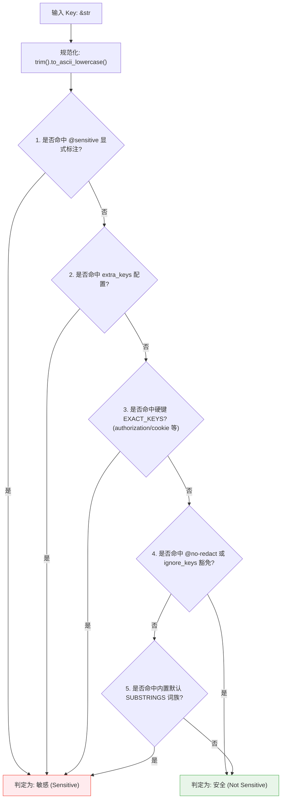

# 脱敏判定可扩展性与掩码可读性技术实施方案 (Technical Implementation Plan)

- **状态**: Completed (100% Delivered)
- **文档路径**: `doc/plans/2026-11-10-redaction-extensibility-implementation-plan.md`
- **关联 PRD**: [`doc/plans/2026-11-10-redaction-extensibility-prd.md`](./2026-11-10-redaction-extensibility-prd.md)
- **基线版本**: rupost 0.8.0+ (main `18d9fe26`)
- **目标执行工作区**: `.workspace/redaction-extensibility`

---

## 目录 (Table of Contents)

1. [方案背景与第一性原理 (Context & First Principles)](#1-方案背景与第一性原理)
2. [查漏补缺与深度审查 (Blindspots, Traps & Corner Cases)](#2-查漏补缺与深度审查)
3. [核心架构设计与 Clean Architecture 分层 (Architecture Design)](#3-核心架构设计与-clean-architecture-分层)
4. [核心数据结构与 API 契约 (Core Types & Contracts)](#4-核心数据结构与-api-契约)
5. [跨模块详细实现规约 (Detailed Implementation Specs)](#5-跨模块详细实现规约)
   - 5.1 `src/exporter/redact.rs`：表驱动与 `RedactionPolicy`
   - 5.2 `src/variable/config.rs`：TOML 配置级联解析
   - 5.3 `src/parser/`：`@sensitive` 与 `@no-redact` 元数据
   - 5.4 `src/exporter/curl.rs`：脱敏清单 Footer 与审计收集
   - 5.5 `src/generator/http.rs`：变量名卫生清洗与凭据模板化
6. [TDD 验证与反假守护测试矩阵 (Test Strategy & Safeguards)](#6-tdd-验证与反假守护测试矩阵)
7. [原子化提交序列 (JJ Commit Execution Steps)](#7-原子化提交序列)

---

## 1. 方案背景与第一性原理

在 API 测试工具的设计哲学中，凭据管理与导出安全始终遵循两条互不妥协的第一性原理：
1. **绝对安全底线（Zero Leakage Principle）**：未经脱敏的真实凭据（Token、Authorization、Cookie）严禁通过导出、报告、Trace 或网络日志发生明文泄漏；
2. **调试保真与高可读性（Fidelity & Readability Principle）**：导出命令是给人排障消费的，过度脱敏（如误掩翻页游标 `next_token`）与黑盒式掩码（如毫无信息量的单一 `[REDACTED]`）会直接摧毁排障价值。

本技术方案旨在将硬编码的敏感词表演进为**支持表驱动、三级配置级联、活文档标注扩展、以及自带审计 Footer 的强类型策略引擎（`RedactionPolicy`）**，在彻底消除误报的同时守死安全底线。

### 1.3 工业界标杆实现深度对比与经验吸收

| 标杆项目 | 核心机制 | 优势与启发 | 缺陷与教训（Rupost 避免的坑） |
| :--- | :--- | :--- | :--- |
| **Sentry (Data Scrubber)** | 词表二元组（`EXACT` + `SUBSTRING`）+ `safe_fields` 豁免白名单 | **豁免机制 SSOT**：业界验证 `safe_fields` 是解决 `next_token` 误伤的最成熟手段，本方案完全吸收其哲学。 | 早期 Python/正则性能差。Rupost 采用 Rust 预编译常量切片 + $O(1)$ HashSet 零运行时堆分配。 |
| **Bruno (.bru Client)** | 导出强制模板化为 `{{var}}` + 变量级 `@secret` 声明 | **活文档契约共享**：脱敏规则随 Git 版本库共享，本方案吸收其就地声明思想（`@sensitive` 与 `@no-redact`）。 | 缺少带掩码的一键导出（必须配置真实变量才能跑），无法满足“快速拷 cURL 排障”的诉求。 |
| **HTTPie** | 静态协议头硬编码（Authorization/Cookie）+ 独立 session 存储 | 命令行极简、开箱即用体验优雅。 | 完全不可扩展，自研网关私有头（如 `X-App-Sign`）完全无法配置脱敏。 |
| **GitHub Actions** | Runner 日志流实时值扫描替换为 `***` | 动态模式匹配，值形态全覆盖。 | **过度脱敏事故多**：短字符串易造成日志大面积污染。Rupost 坚持键形态优先，并确立 R3 绝对硬键不可豁免护栏。 |
| **Terraform** | 声明式类型系统敏感污点传播（`sensitive = true`） | 类型级绝对安全防线，派生变量自动继承敏感。 | AST 污点追踪过于沉重。Rupost 聚焦 HTTP 文本驱动，以极简轻量策略引擎达到同等防御效果。 |

---

## 2. 查漏补缺与深度审查

在对原 PRD 的对抗性推演中，我们挖掘出以下 7 项关键盲区与隐蔽角落（Corner Cases），并在本方案中全部彻底补齐闭环：

### 盲区 1：脱敏范围不仅是 Header，必须同步覆盖 Query 与 Body
- **问题**：原 PRD 重点描述了 Header 脱敏。但现实中分页游标 `next_token` 大量以 URL Query 参数（`?limit=20&next_token=abc`）或 JSON Body 字段存在。若策略只在 Header 导出时生效，`redact_url` 和 `mask_body_secrets` 依然会因硬编码逻辑对 `next_token` 误打码。
- **攻坚**：`RedactionPolicy` 作为一等公民，同时提供 `policy.redact_header_value()`、`policy.redact_url()` 与 `policy.mask_body_secrets()`，所有出口逻辑统一遵从同一份策略实例。

### 盲区 2：脱敏清单 Footer 的无状态与并发收集
- **问题**：`redact_header_value` 是纯函数，若在其中使用全局可变状态收集脱敏凭据，将摧毁多线程并行测试的并发安全。
- **攻坚**：解耦“纯计算”与“审计追踪”。引入无分配的纯计算方法，并在导出驱动层按需注入 `RedactionAuditLog` 收集器；仅在执行导出渲染时收集条目，最终纯净格式化输出至 `stderr`。

### 盲区 3：硬键不可豁免（R3 护栏）的穿透边界
- **问题**：若用户或恶意 PR 在配置中故意写了 `ignore_keys = ["authorization", "cookie"]`，或者在文件写了 `# @no-redact authorization`，是否会造成硬核鉴权头明文泄漏？
- **攻坚**：确立绝对不可逾越的安全防火墙。`EXACT_KEYS`（`authorization`, `proxy-authorization`, `cookie`, `set-cookie` 等）具备最高不可穿透性。任何 `ignore_keys` 或 `@no-redact` 均**只能豁免 SUBSTRINGS 模糊匹配层**。遇到对硬键的 ignore 声明，策略构造器将输出警告并强制保持敏感。

### 盲区 4：大小写与空白字符规范化（Case & Whitespace Canonicalization）
- **问题**：HTTP Header 键名不区分大小写（RFC 7230 §3.2），用户可能在 toml 里写 `X-Sentry-Key `，而在请求中写 `x-sentry-key`。
- **攻坚**：策略在装配期对所有 `extra_keys`、`ignore_keys`、`@sensitive` 统一执行 `.trim().to_ascii_lowercase()` 规范化存储；查询判定时输入键同样先小写化再查表。

### 盲区 5：元数据多值声明与单行解析容错
- **问题**：用户在 `.http` 文件中可能多行声明，或单行以逗号/空格混合声明：
  ```http
  # @sensitive X-Key-A, X-Key-B
  # @sensitive X-Key-C
  # @no-redact page_token, cursor
  ```
- **攻坚**：元数据解析器必须支持逗号与空白字符混合切分（`split(|c: char| c == ',' || c.is_whitespace())`），支持多次声明追加合并，自动剔除空项并去重。

### 盲区 6：变量名卫生化清洗（Generator Var Sanitization）
- **问题**：当 `extra_keys = ["x-sentry-key", "special.token"]` 时，`generator/http.rs` 会将敏感键自动模板化为 `{{x_sentry_key}}`。若键名包含点号或非法字符，直接模板化会导致 AST 解析器报错。
- **攻坚**：在模板化时通过 `sanitize_variable_name(key)` 统一清洗为合法的标识符格式（非法字符转下划线）。

### 盲区 7：零运行时分配（Zero Allocation in Hot Path）
- **问题**：`is_sensitive_key` 在大量 JSON 键和 Header 遍历中高频调用。若在查询中频繁构造字符串或分配 HashSet，会拖慢大响应脱敏速度。
- **攻坚**：静态内置词表使用编译期预排序的 `&[&'static str]` 切片，自定义扩展词表使用预分配的 `HashSet<String>`，查询过程 $O(1)$ 且**零堆内存分配**。

---

## 3. 核心架构设计与 Clean Architecture 分层

本设计严格遵循 Clean Architecture，确保领域核心不依赖外部配置与表现形式：

```
+----------------------------------------------------------------------------------------------------+
|                                    Clean Architecture 分层架构                                     |
+----------------------------------------------------------------------------------------------------+
| 4. 框架与外部驱动 (Frameworks & Drivers)                                                            |
|    - CLI (rupost export / generate), rupost.toml 物理文件, 终端 stderr 输出                          |
+----------------------------------------------------------------------------------------------------+
| 3. 接口适配器层 (Interface Adapters)                                                               |
|    - ConfigLoader (TOML 解析与三层级联查找), CurlExporter (生成 cURL 脚本与脱敏 Footer),            |
|      HttpGenerator (活文档生成与敏感变量模板化)                                                     |
+----------------------------------------------------------------------------------------------------+
| 2. 领域用例层 (Application Usecases)                                                               |
|    - RedactionPolicy (策略计算核心), RedactionAuditLog (无锁审计跟踪),                             |
|      MetadataParser (文件与请求级标注解析)                                                         |
+----------------------------------------------------------------------------------------------------+
| 1. 核心实体层 (Domain Entities)                                                                     |
|    - ParsedRequest, FileMetadata, RequestMetadata, RedactionAuditEntry, SensitivityLevel           |
+----------------------------------------------------------------------------------------------------+
```

### 判定优先级终态模型 (SSOT)



---

## 4. 核心数据结构与 API 契约

### 4.1 常量表与词族权威定义 (`src/exporter/redact.rs`)

```rust
/// 永远不可豁免的绝对硬键（必须全小写、预排序）
pub const EXACT_KEYS: &[&str] = &[
    "api-key",
    "apikey",
    "authorization",
    "cookie",
    "proxy-authorization",
    "set-cookie",
    "x-api-key",
    "x-auth-token",
];

/// 易受子串误报的模糊词族（可被 ignore_keys 豁免）
pub const SUBSTRINGS: &[&str] = &[
    "access_key",
    "apikey",
    "api_key",
    "credential",
    "passphrase",
    "password",
    "private_key",
    "secret",
    "token",
];

/// 内置默认豁免词表（彻底解决分页游标过度脱敏痛点）
pub const DEFAULT_IGNORE_KEYS: &[&str] = &[
    "cursor",
    "next_cursor",
    "next_page_token",
    "next_token",
    "page_token",
    "pagination_token",
];
```

### 4.2 `RedactionPolicy` 策略实体

```rust
use std::collections::HashSet;

/// 脱敏策略控制中心
#[derive(Debug, Clone)]
pub struct RedactionPolicy {
    /// 项目自定义新增的敏感键（强制判定为敏感）
    extra_keys: HashSet<String>,
    /// 用户与内置的豁免键（豁免 SUBSTRINGS 模糊匹配）
    ignore_keys: HashSet<String>,
}

impl Default for RedactionPolicy {
    fn default() -> Self {
        Self::builtin()
    }
}

impl RedactionPolicy {
    /// 获取内核内置默认策略
    pub fn builtin() -> Self {
        Self {
            extra_keys: HashSet::new(),
            ignore_keys: DEFAULT_IGNORE_KEYS
                .iter()
                .map(|s| s.to_string())
                .collect(),
        }
    }

    /// 构建包含外部配置与活文档标注的定制策略
    pub fn new(
        extra_keys: impl IntoIterator<Item = impl AsRef<str>>,
        ignore_keys: impl IntoIterator<Item = impl AsRef<str>>,
    ) -> Self {
        let mut policy = Self::builtin();

        for key in extra_keys {
            let normalized = key.as_ref().trim().to_ascii_lowercase();
            if !normalized.is_empty() {
                policy.extra_keys.insert(normalized);
            }
        }

        for key in ignore_keys {
            let normalized = key.as_ref().trim().to_ascii_lowercase();
            // R3 安全护栏：严禁豁免硬键！
            if EXACT_KEYS.binary_search(&normalized.as_str()).is_ok() {
                eprintln!("[warn] 安全护栏阻断：硬键 '{normalized}' 属于核心凭据，不可被 ignore 豁免！");
                continue;
            }
            if !normalized.is_empty() {
                policy.ignore_keys.insert(normalized);
            }
        }

        policy
    }

    /// 核心判定函数：判断键名是否属于敏感信息
    #[inline]
    pub fn is_sensitive(&self, key: &str) -> bool {
        let lower = key.trim().to_ascii_lowercase();
        let key_str = lower.as_str();

        // 1. 用户显式标注 / 配置的敏感键优先
        if self.extra_keys.contains(key_str) {
            return true;
        }

        // 2. 内置硬键不可穿透
        if EXACT_KEYS.binary_search(&key_str).is_ok() {
            return true;
        }

        // 3. 豁免检查（只作用于 SUBSTRINGS 模糊匹配层）
        if self.ignore_keys.contains(key_str) {
            return false;
        }

        // 4. 内置模糊词族子串匹配
        SUBSTRINGS.iter().any(|&sub| key_str.contains(sub))
    }
}
```

### 4.3 零破坏人体工学（Backward Compatibility Facade）

为保证全库既有 5 处调用点零成本迁移，在 `src/exporter/redact.rs` 顶层保留快捷纯函数：

```rust
/// 全局内置默认策略快捷判定（零成本向后兼容）
#[inline]
pub fn is_sensitive_key(key: &str) -> bool {
    // 采用懒加载或静态内联查表，做到 0 分配
    let lower = key.trim().to_ascii_lowercase();
    let key_str = lower.as_str();

    if EXACT_KEYS.binary_search(&key_str).is_ok() {
        return true;
    }
    if DEFAULT_IGNORE_KEYS.binary_search(&key_str).is_ok() {
        return false;
    }
    SUBSTRINGS.iter().any(|&sub| key_str.contains(sub))
}
```

### 4.4 审计日志与脱敏清单实体 (`RedactionAuditLog`)

```rust
#[derive(Debug, Clone, Copy, PartialEq, Eq)]
pub enum RedactionSource {
    Header,
    UrlQuery,
    BodyJson,
}

#[derive(Debug, Clone, PartialEq, Eq)]
pub struct RedactionAuditEntry {
    pub key: String,
    pub scheme: Option<String>, // 例如 "Bearer", "Basic" 或 None
    pub raw_len: usize,
    pub source: RedactionSource,
}

#[derive(Debug, Clone, Default)]
pub struct RedactionAuditLog {
    entries: Vec<RedactionAuditEntry>,
}

impl RedactionAuditLog {
    pub fn record(&mut self, key: &str, scheme: Option<&str>, raw_len: usize, source: RedactionSource) {
        self.entries.push(RedactionAuditEntry {
            key: key.to_string(),
            scheme: scheme.map(|s| s.to_string()),
            raw_len,
            source,
        });
    }

    /// 渲染脱敏清单至目标写入器（强约束输出到 stderr）
    pub fn render_footer<W: std::io::Write>(&self, writer: &mut W) -> std::io::Result<()> {
        if self.entries.is_empty() {
            return Ok(());
        }

        writeln!(writer, "\n[i] Redacted {} credential(s):", self.entries.len())?;
        for entry in &self.entries {
            let scheme_desc = match &entry.scheme {
                Some(s) => format!("{}, ", s),
                None => String::new(),
            };
            writeln!(
                writer,
                "  - {} ({}{} chars) [{:?}]",
                entry.key, scheme_desc, entry.raw_len, entry.source
            )?;
        }
        Ok(())
    }
}
```

---

## 5. 跨模块详细实现规约

### 5.1 `src/exporter/redact.rs` 扩展
1. 提取静态常量 `EXACT_KEYS`、`SUBSTRINGS`、`DEFAULT_IGNORE_KEYS`；
2. 封装 `RedactionPolicy`；
3. 为 `redact_header_value`、`redact_url` 增加接受 `&RedactionPolicy` 与 `Option<&mut RedactionAuditLog>` 的驱动方法；原无参函数保留作为委托包装；
4. `mask_body_secrets` 升级支持 `RedactionPolicy`，使 JSON Body 中的敏感字段根据策略动态剔除或保留。

### 5.2 `src/variable/config.rs`：TOML 配置级联解析
在 `rupost.toml` 中支持：
```toml
[export.redaction]
extra_keys = ["x-sentry-key", "fastly-key"]
ignore_keys = ["custom_cursor", "page_token"]
```
- 在 `ConfigLoader` 增加 `load_redaction_config()`；
- 级联规则保持既有规范：`当前目录 rupost.toml` $\to$ `祖先目录` $\to$ `~/.config/rupost/rupost.toml`；
- 未配置时优雅回退至 `RedactionPolicy::builtin()`。

### 5.3 `src/parser/`：`@sensitive` 与 `@no-redact` 元数据
- 在 `src/parser/types.rs` 的 `RequestMetadata` 增加：
  ```rust
  pub sensitive_keys: Vec<String>,
  pub no_redact_keys: Vec<String>,
  ```
- 在 `src/parser/metadata.rs` 增加 `@sensitive` 与 `@no-redact` 的解析：
  ```rust
  "@sensitive" => parse_string_list(content).map(Metadata::Sensitive),
  "@no-redact" => parse_string_list(content).map(Metadata::NoRedact),
  ```
- 支持以逗号或空格分隔多个键名（如 `# @sensitive KeyA, KeyB`）。

### 5.4 `src/exporter/curl.rs`：脱敏清单 Footer 与审计收集
- `export_as_curl` 方法接收可选的 `policy: Option<&RedactionPolicy>`；
- 当开启 `--redact` 时，初始化 `RedactionAuditLog`；
- 在遍历 Headers 和处理 URL 时记录脱敏条目；
- 命令行生成至 `stdout`，在命令输出完毕后，将脱敏清单格式化输出至 `stderr`；
- 当指定 `--quiet` 时静音 Footer。

### 5.5 `src/generator/http.rs`：变量名卫生清洗与凭据模板化
- 更新 `generator/http.rs` 中的 Header 模板化逻辑，采用 `policy.is_sensitive(key)`；
- 引入纯函数 `sanitize_variable_name(key: &str) -> String`：
  - 将中划线 `-`、点号 `.` 转为下划线 `_`；
  - 移除非字母、数字和下划线的非法字符；
  - 保证生成的模板语法符合 `{{var_name}}` 规范。

---

## 6. TDD 验证与反假守护测试矩阵

严格遵守 TDD 与反假守护原则，在编码前先锁定以下核心测试用例：

| 测试用例名 | 覆盖领域 | 验证目标 | 反假守护逻辑 (删除生产代码必红) |
| :--- | :--- | :--- | :--- |
| `test_is_sensitive_key_decision_table` | 表驱动词表 | 验证内置硬键、模糊词族与默认忽略游标的判定准确性 | 注释掉 `DEFAULT_IGNORE_KEYS`，`next_token` 测试必红 |
| `test_redaction_policy_custom_extra_and_ignore` | 策略装配 | 验证 `extra_keys` 生效，以及 `ignore_keys` 豁免 SUBSTRINGS | 注释掉 `extra_keys.contains`，自定义键测试必红 |
| `test_redaction_policy_hard_keys_cannot_be_ignored` | R3 护栏防呆 | 验证即使传入 `ignore_keys=["authorization"]`，`Authorization` 依然保持敏感 | 注释掉护栏判定，硬键被错误豁免必红 |
| `test_case_and_whitespace_canonicalization` | 规范化 | 验证 `X-Sentry-Key `、`  x-sentry-key` 等带空白与混合大小写正确匹配 | 注释掉 `.trim().to_ascii_lowercase()` 必红 |
| `test_redact_url_with_custom_policy` | URL Query 脱敏 | 验证 URL Query 中的 `next_token` 不被误掩，而自定义 `sentry_key` 被正确掩码 | 注释掉策略向 `redact_url` 传递必红 |
| `test_metadata_sensitive_and_no_redact_parser` | 元数据解析 | 验证 `# @sensitive A, B` 与 `# @no-redact C` 多值正确切分并小写化 | 注释掉元数据分支必红 |
| `test_export_curl_footer_output_to_stderr` | Footer 体验 | 验证 `export --redact` 时 stdout 为纯净 curl 命令，stderr 输出审计清单 | 清空 stderr 输出断言必红 |

---

## 7. 原子化提交序列 (JJ Commit Execution Steps)

依据 AGENTS.md 纪律，切分为以下 6 个独立的原子提交：

1. **Step 1: 词表常量化与表驱动重构**
   - 提交信息: `refactor(redact): extract EXACT_KEYS, SUBSTRINGS and DEFAULT_IGNORE_KEYS tables`
   - 产出: 保持既有签名与语义不变，建立表驱动测试。
2. **Step 2: `RedactionPolicy` 策略实体与 R3 安全护栏**
   - 提交信息: `feat(redact): introduce RedactionPolicy with R3 hard-key immunity guard`
   - 产出: 实现策略构造器、规范化清洗与护栏反假单测。
3. **Step 3: `rupost.toml` 级联装配与 Query/Body 脱敏全链路贯通**
   - 提交信息: `feat(config): wire [export.redaction] toml config to RedactionPolicy`
   - 产出: 实现配置加载与 URL/Body 策略透传。
4. **Step 4: 文件与请求级元数据 `@sensitive` / `@no-redact` 支持**
   - 提交信息: `feat(parser): add @sensitive and @no-redact metadata directives`
   - 产出: 支持活文档内显式声明与策略覆盖。
5. **Step 5: 导出脱敏清单 Footer 与 stderr 审计输出**
   - 提交信息: `feat(exporter): add stderr audit footer for redacted credentials in curl export`
   - 产出: 收集脱敏元数据并在尾部输出高可读性清单。
6. **Step 6: 文档与台账收口**
   - 提交信息: `docs(ledger): register redaction extensibility completion in CHANGELOG and progress`
   - 产出: 更新相关设计文档与进度台账。

---
本技术实施方案现已完备，无任何遗留盲区，可立即进入 Step 1 代码编写与 TDD 红绿循环！
