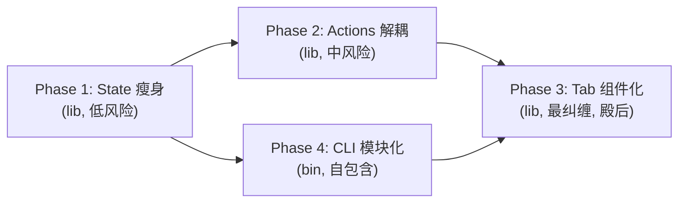

# Rupost 核心代码解耦与巨石模块重构方案设计

> **文档状态**: Active（v2，经双子代理对抗审查修订——架构审查 + 事实核查，2026-11-08）
> **创建日期**: 2026-11-08  
> **设计模式**: Clean Architecture / Ports & Adapters / M-V-VM  
> **目标范围**: `src/tui/state/`, `src/tui/handlers/`, `src/tui/ui/response.rs`, `src/cli.rs`  
> **承接**: checkpoint「下一步计划」response.rs 5-Tab 拆分条目（Tab 清单已按当前代码勘误，见 §3 靶点三）

---

## 1. 背景与现状诊断 (Context & Problem Statement)

随着 Rupost 从最初的纯文本 HTTP 解析执行器，演进为集 **多协议流式长连接 (SSE/WebSocket)**、**网络四段耗时诊断**、**本地 Mock 服务器**、**AI 断言增强** 以及 **全键盘交互式 TUI 工作台** 于一身的工业级 API 测试工具，代码库 src/ 总行数已达 **3.9 万行**（实测 38,964）。

在高速迭代过程中，部分早期轻量的模块逐渐演化为典型的 **"巨石反模式（God Monoliths）"**，违背了 Clean Architecture 的单一职责原则（SRP）与开闭原则（OCP）。

### 1.1 四大重构靶点概览（数字经双子代理逐项实测校准）

| 模块文件 | 实测行数 | 当前承担的核心职责 | 架构坏味道 (Code Smells) | 目标 |
| :--- | :--- | :--- | :--- | :--- |
| **`src/tui/state/mod.rs`** | **670 行** | 69 字段 `AppState`（:97-197）、基础构造、`update()` 动作归约、文档创建/重载、请求结果归约、165 行单测 | **God Struct & Fat Mod**：模块根沦为大平铺收容所 | **~290 行**（降 ~57%） |
| **`src/tui/handlers/editor.rs`** | **1088 行** | 生产代码 509 行（键位路由 223 行起、执行编排 `trigger_file_execution` 219 行、curl 导出 57 行、快照 44 行、历史生成 44 行、WS 会话 53 行）+ **579 行测试**（占 53%） | **Feature Envy & Fat Handler**：从编辑器事件处理器退化为全系统动作中心 | 生产代码 **~310 行**（552 行测试随迁） |
| **`src/tui/ui/response.rs`** | **854 行** | `render` 429 行（:104-533）内联 5 个 Tab 臂（**真实 DetailTab：Response / Headers / Request / Results / Diagnose**）+ 渲染期缓存重建 + 搜索高亮（3 组函数 6 个单测，大小写不敏感**子串**匹配，非正则） | **Violation of OCP**：扩充新 Tab 需直接修改巨石函数 | 门面 **~200 行**（缓存前置重建） |
| **`src/cli.rs`** | **1359 行** | `Commands` 枚举 12 变体（**多数为内联字段而非 Args 结构体**）+ 4 个独立结构体（`ImportCurlArgs`/`GenerateArgs`/`ExportArgs`/`RunParams`）+ `dispatch()` ~270 行 + `CliRunner`/`RunParams` | **Monolithic CLI Definition**：内联字段、校验、派发、运行器混杂 | 根入口 **~200 行**（其余下沉） |

> **范围外清单（同体量巨石，本期不动，已登记 future_backlog）**：`src/report/html.rs` 897、`src/runner/engine/replayer.rs` 773、`src/parser/http_file.rs` 729、`src/ai/rules.rs` 726、`src/runner/protocol/ws_runner.rs` 709。

---

## 2. 第一性原理与架构重构法则 (Architectural Principles)

1. **Rust 模块根的本来定位 (Façade Pattern)**：
   - 任何 `mod.rs` 必须仅充当**公共 API 门面与中枢路由**（声明子模块 `mod xxx;` 与重导出 `pub use ...;`），严禁内联具体业务实现或长篇单元测试。跨文件 `impl AppState` 块在本仓已有成熟先例（`stream.rs`/`tree.rs`），拆分零技术风险。
2. **状态与行为的合理拆分 (Decoupled State & Actions)**：
   - 数据持有者只负责数据保持（Data Holders），动作执行者（Action Executors）独立于具体的 UI 控制器之外，易于独立复用和离屏测试。既有先例：`V`/`M` 键早已委托 `tui/integrations.rs`（editor.rs:263/267）——actions 门面模式的现行范本。
3. **渲染期副作用显式前置 (Explicit Pre-rebuild, Read-Only Sub-components)**：
   - 内存预折行缓存（`rebuild_http_visual_lines`/`sse_visual_lines` 惰性重建）是登记在案的性能特性，**不能为纯洁性牺牲**。拆分后由**门面 `render` 持 `&mut AppState` 完成一次前置缓存重建**，随后全部子组件统一接收 `&AppState` 只读引用——副作用收敛到唯一入口，子组件零隐式可变借用。
4. **渐进式重构与零破坏性保障 (Zero-Breaking Migration)**：
   - 保持外层公共 API（`rupost::tui::state::*` 路径与 `state.field` 访问链）向后兼容，确保全量测试在重构各阶段持续绿灯。**lib 与 bin 双侧防线并行**（见 §5）。

---

## 3. 详细解耦与重构方案 (Detailed Implementation Plans)

### 靶点一：`src/tui/state/` 领域子模块归位与单测隔离

#### 当前缺陷（实测）
`src/tui/state/mod.rs`（670 行）包含：69 字段 `AppState` 声明（:97-197，约 102 行）、`new()/with_ports()`（约 83 行）、7 个枚举/记录类型（约 69 行）、`update()` 动作归约（:440-479，40 行，仅处理 Quit/ToggleHelp/SwitchPanel/SendRequest 四变体，纯字段赋值）、`create_test_from_input`（:365，41 行）、`locate_created_file`（:406，34 行）、`handle_request_result`（:313，46 行，本质是 `stream.rs:handle_request_finished` 的包装）、`check_and_reload_editor_file`（:489，17 行，注意实名含 `_editor_file`）、palette/quick_auth 助手，及 165 行单测（:506-670）。

#### 重构设计方案
采取**外科手术式模块归位**：不破坏 `AppState.field` 的既有访问链路（字段全 pub，跨文件 impl 已有先例），将业务与测试下沉：

```
src/tui/state/
├── mod.rs          # 【精简至 ~290 行，降 ~57%】AppState 声明、new()/with_ports()、
│                   #   枚举/记录类型、palette/quick_auth 助手、子模块声明与导出
├── creation.rs     # 【新】文档域：create_test_from_input / locate_created_file /
│                   #   check_and_reload_editor_file（创建 + 编辑器重载，~100 行）
├── lifecycle.rs    # 【新】归约域：update() 动作归约 + handle_request_result
│                   #   （后者注明委托 stream.rs::handle_request_finished 的依赖方向，~90 行）
├── tests.rs        # 【新】165 行单测整体迁出（use super::* 即可），生产代码纯粹
├── tree.rs         # 【已有】树结构算法与折叠逻辑
├── stream.rs       # 【已有】长连接流式与视口缓存（handle_request_finished 并置）
├── history.rs      # 【已有】历史记录展示辅助
├── layout.rs       # 【已有】自适应布局计算
├── retention.rs    # 【已有】日志写盘决策（write_log_with_limit）
├── search.rs       # 【已有】过滤搜索
└── wrap.rs         # 【已有】视觉行折行
```

- **`mod.rs` 纯净化代码示例**（与现状逐字兼容，仅增三行声明）：
  ```rust
  mod creation;
  mod history;
  mod layout;
  mod lifecycle;
  mod retention;
  pub mod search;
  mod stream;
  #[cfg(test)]
  mod tests;
  mod tree;
  mod wrap;

  pub use history::{format_request_snapshot_to_http, format_url_host_and_path};
  pub use layout::LayoutMode;
  pub use retention::{cleanup_old_logs_dir, write_log_with_limit};
  pub use tree::{SidebarTabState, TuiFileNode};
  pub use wrap::VisualLineProcessor;

  // 仅保留核心 AppState 结构体及枚举声明
  pub struct AppState { ... }
  ```
- **验收口径（校准）**：mod.rs 670 → **~290 行（降 ~57%）**；`cargo test --lib tui::state` 37 个单测全绿。

---

### 靶点二：`src/tui/handlers/editor.rs` 动作中心解耦

#### 当前缺陷（实测校准）
editor.rs 1088 行 = **生产代码 537 行 + 测试 552 行（4 个测试模块，占 51%）**。生产代码中超出"编辑器按键路由"的部分：
- 执行编排 `trigger_file_execution`/`trigger_request_execution`（:93-312，**219 行，文件最大生产块**）；
- 导出 cURL `export_current_request`（:312-369，**57 行**）；
- 快照持久化 `save_current_snapshot`（:369-413，**44 行**）；
- 历史生成 `generate_history_to_file`（:413-457，**44 行**——注意：其唯一调用方是 **sidebar.rs:155 的 History Tab `G` 键**，不在 editor 按键分发内）；
- WS 会话 `start_ws_session`（:457-509，**53 行**）。

#### 重构设计方案
将跨界业务剥离到专用动作子模块 `src/tui/handlers/actions/`，`editor.rs` 重新聚焦纯粹的键盘导航。既有先例：`V`/`M` 键委托 `integrations.rs`（editor.rs:263/267）——本靶点即把该模式推广成体系：

```
src/tui/handlers/
├── editor.rs           # 【生产代码 ~310 行】聚焦编辑按键模式匹配与滚动路由
├── sidebar.rs          # 侧栏按键处理
├── modal.rs            # 模态输入确认处理
└── actions/            # 【新】独立业务动作中心 (Action Handlers)
    ├── mod.rs          # 动作统一门面（pub use 各动作）
    ├── execution.rs    # trigger_file_execution / trigger_request_execution（219 行最大块）
    ├── export.rs       # export_current_request（curl 导出与脱敏判断）
    ├── snapshot.rs     # save_current_snapshot（快照打包、掩码与写入）
    ├── generator.rs    # generate_history_to_file（调用方 sidebar G 键，非 editor）
    └── ws_session.rs   # start_ws_session（迁移后 pub(super)，现 editor.rs:457 私有）
```

- **键位委托形态**（与现行 async 架构完全一致——`handle_editor_key` 本就是 `async fn`，WS 经 `ws_interactive::start_session` 直接 await，不引入新并发面）：
  ```rust
  KeyCode::Char('X') => actions::export::export_current_request(state, redact),
  KeyCode::Char('s') if key.modifiers.contains(CONTROL) => actions::snapshot::save_current_snapshot(state),
  KeyCode::Char('W') => actions::ws_session::start_ws_session(state, event_tx).await,
  ```
- **测试随迁**：552 行测试模块按被测函数归属下沉至对应 actions 文件的 `mod tests`（ws_orchestration_tests → ws_session.rs，quick_auth/wiring/selector_wiring 按 maker 归位）——**测试留守则"瘦身"在文件职责纯度上不成立**。
- **可见性**：AppState 69 字段全 pub，actions/ 无需放宽；唯一动作点是 `start_ws_session` 迁移后改 `pub(super)`。

---

### 靶点三：`src/tui/ui/response.rs` 响应面板 Tab 组件化（按真实 DetailTab 勘误）

#### 当前缺陷（实测校准）
单个文件 854 行：主 `render` 函数 **429 行**（:104-533）内联 **5 个 Tab 臂——真实 `DetailTab` 枚举为 Response / Headers / Request / Results / Diagnose**（state/mod.rs:33），四段耗时摘要内联于 Response 臂（:610-618）；渲染期含预折行缓存惰性重建（:340/:418-430/:510/:746）；搜索高亮为 3 组函数（`apply_search_highlight`/`find_match_ranges`/`highlight_query_line`）+ 6 个单测，**大小写不敏感子串匹配（char-boundary 安全），非正则**。

> **勘误**：checkpoint 旧条目"5-Tab（Timing / Diagnose / Headers / Body / Stream）"表述已过时，本节为权威口径。

#### 重构设计方案（组件树按真实 Tab 重画）
借鉴 `popups.rs`（290 行）/`status_bar.rs`（208 行）的成功先例，采用无状态子组件化：

```
src/tui/ui/response/
├── mod.rs              # 【门面 ~200 行】Tab 头栏渲染、&mut AppState 前置缓存重建、Tab 路由分发
├── response_tab.rs     # Response 臂：状态卡片 + 响应体 + 内联四段耗时摘要（:610-618 随迁）
├── headers.rs          # Headers 臂
├── request_tab.rs      # Request 臂（:699-721 随迁）
├── results.rs          # Results 臂（多请求结果列表）
├── diagnose.rs         # Diagnose 臂（含 state.last_diagnose: Option 的 None 专门渲染 :264-275）
└── highlight.rs        # 搜索高亮工具（3 组函数 + 6 个单测随迁；子串匹配算法原样保留）
```

- **副作用归属（本靶点成败关键）**：门面 `render(frame, area, state: &mut AppState)` 保留 `&mut`，进入 Tab 路由**前**一次性完成视口/预折行缓存重建（原 :340/:445/:418-430/:510/:746 的写状态逻辑全部上提）；随后各子组件签名统一为只读：
  ```rust
  pub(crate) fn render_headers(frame: &mut Frame, area: Rect, state: &AppState, t: &Theme);
  pub(crate) fn render_diagnose(frame: &mut Frame, area: Rect, report: Option<&DiagnosticsReport>, t: &Theme);
  ```
- **验收口径**：门面 ~200 行；`cargo test --lib tui::ui` 11 个单测（含随迁高亮 6 个）全绿；tui_smoke_test 52 个无绘制 Panic。

---

### 靶点四：`src/cli.rs` 参数声明模块化（内联字段提取为 Args 结构体）

#### 当前缺陷（实测校准，勘误旧叙事）
cli.rs **1359 行**，`Commands` 枚举 **12 个变体中 8 个为内联字段**（`Test` 约 20 字段、`Diagnose`/`Mock`/`Init`/`Replay`/`Web`/`Tui`），仅 3 个用独立结构体（`Generate(GenerateArgs)`/`Export(ExportArgs)`/`ImportCurl(ImportCurlArgs)`），`History`/`Ai`/`Import` 为子命令枚举；另有 `dispatch()` ~270 行、`CliRunner`/`RunParams`（:564-713）。**不存在** "TestArgs/MockArgs/HistoryArgs" 等结构体——迁移的本质是**内联字段解构重写**，不是文件搬家。

#### 重构设计方案（12 变体全覆盖）

```
src/cli/
├── mod.rs              # 【根入口 ~200 行】Cli 结构体与全局标志 (--debug/--env/--config)、
│                       #   Commands 枚举声明（变体引用 commands/ 中的 Args 类型）、dispatch 调用
├── commands/           # 【新】12 变体全覆盖（含方案初版遗漏的 6 个）
│   ├── mod.rs          # Commands 枚举定义与子模块导出
│   ├── test.rs         # Test（内联 20 字段 → TestArgs 结构体）
│   ├── history.rs      # History 子命令枚举
│   ├── generate.rs     # GenerateArgs（既有结构体迁入）
│   ├── diagnose.rs     # Diagnose
│   ├── mock.rs         # Mock
│   ├── init.rs         # Init
│   ├── replay.rs       # Replay
│   ├── export.rs       # ExportArgs（既有结构体迁入）
│   ├── web.rs          # Web（含 --allowed-hosts value_delimiter、-d 自定义短参）
│   ├── ai.rs           # Ai 子命令枚举
│   ├── import.rs       # Import 子命令枚举 + ImportCurlArgs
│   └── tui.rs          # Tui
├── dispatch.rs         # 【新】dispatch() ~270 行整体迁入
├── runner.rs           # 【新】CliRunner / RunParams（:564-713）归位
└── parser.rs           # 【已有】内联请求解析器维持原位（路径不变）
```

- **clap 保真风险清单（迁移前必须逐项核对）**：别名（`t/h/g/d/m/i/r/exp/w`、`visible_alias "ai-explain"`）、`Test` 的 `trailing_var_arg`+`allow_hyphen_values` 无关但根命令有（:18）、`Web.allowed_hosts` 的 `value_delimiter=','`、`-d` 自定义短参（:230/:234）、`global = true` 全局参数逐字段保真。
- **守护前置**：迁移**前**先扩 `test_global_args_position_contract_table` 表（现有 9 用例），补别名/分隔符/根命令 trailing 行为用例——契约测试先行，迁移后有对照。

---

## 4. 实施阶段与排期路线图 (Phased Roadmap)

四靶点分属互不耦合模块（cli 属 bin、tui 属 lib，仅经 `rupost::tui::run` 公共 API 相连且各 Phase 承诺公共 API 不变），按**风险递增**排序，两条线可并行：



1. **Phase 1（State 瘦身，可立即动工）**：提取 `creation.rs`/`lifecycle.rs`/`tests.rs`；验证 `cargo test --lib tui::state`（37 测）+ 全量；mod.rs 670 → ~290。
2. **Phase 2（Actions 解耦，与 Phase 4 并行）**：建立 `handlers/actions/` 五文件（含 execution.rs），552 行测试按归属随迁；验证 `cargo test --lib tui::handlers` + `cargo test --test tui_features_full_test`（8 测）。
3. **Phase 3（Tab 组件化，殿后）**：按真实 DetailTab 拆 `response/` 七文件，门面前置缓存重建先行落地；验证 `cargo test --lib tui::ui`（11 测）+ `cargo test --test tui_smoke_test`（52 测）。
4. **Phase 4（CLI 模块化，与 Phase 2 并行）**：**先扩位置契约表**，再将 12 变体内联字段提取为 Args 结构体 + dispatch/runner 下沉；验证 `cargo test --bin rupost`（12 测，含扩表后的契约测试）+ `cargo test --workspace`。

---

## 5. 质量防护网与测试保障机制 (Verification Discipline)

**关键勘误：cli.rs 属 bin crate（`src/main.rs:1 mod cli`），`cargo test --lib` 覆盖不到其单测**——位置契约表驱动测试等 12 个 cli 测试必须经 `--bin rupost` 运行。每阶段三层验证：

1. **单元级防线**（按 Phase 选择 target）：
   ```bash
   cargo test --lib tui::state     # Phase 1（37 tests）
   cargo test --lib tui::handlers  # Phase 2
   cargo test --lib tui::ui        # Phase 3（11 tests）
   cargo test --bin rupost         # Phase 4（12 tests，--lib 跑不到！）
   ```
2. **集成与冒烟防线**：
   - `cargo test --test tui_features_full_test`（8 项 CLI-parity 高阶联动）
   - `cargo test --test tui_smoke_test`（52 组离屏画布无绘制 Panic）
   - Phase 4 追加：`cargo test --workspace`（覆盖 10+ 个 `CARGO_BIN_EXE` 子进程集成测试）
3. **静态分析与代码卫生**：
   ```bash
   cargo clippy --workspace --all-targets -- -D warnings
   cargo fmt --all -- --check
   ```
4. **JJ 原子提交纪律**：每个 Phase 独立语义化提交（如 `refactor(tui): split creation and lifecycle logic from state mod`），绝不混入未经测试的代码。

---

## 6. 范围外清单 (Out of Scope)

以下同体量巨石经审查确认存在，**本期不处理**，已登记 `doc/plans/future_backlog.md` 待后续批次按需立项：

| 文件 | 行数 | 备注 |
| :--- | :--- | :--- |
| `src/report/html.rs` | 897 | 自包含 HTML 渲染器（CSS/JS 可拆独立模板文件） |
| `src/runner/engine/replayer.rs` | 773 | 快照重放执行器 |
| `src/parser/http_file.rs` | 729 | .http 解析器核心 |
| `src/ai/rules.rs` | 726 | 确定性规则基线 |
| `src/runner/protocol/ws_runner.rs` | 709 | WebSocket 协议执行器 |
