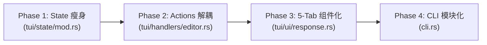

# Rupost 核心代码解耦与巨石模块重构方案设计

> **文档状态**: Active  
> **创建日期**: 2026-11-08  
> **设计模式**: Clean Architecture / Ports & Adapters / M-V-VM  
> **目标范围**: `src/tui/state/`, `src/tui/handlers/`, `src/tui/ui/response.rs`, `src/cli.rs`

---

## 1. 背景与现状诊断 (Context & Problem Statement)

随着 Rupost 从最初的纯文本 HTTP 解析执行器，演进为集 **多协议流式长连接 (SSE/WebSocket)**、**网络四段耗时诊断**、**本地 Mock 服务器**、**AI 断言增强** 以及 **全键盘交互式 TUI 工作台** 于一身的工业级 API 测试工具，代码库总行数已达 3.8 万行。

在高速迭代过程中，部分早期轻量的模块逐渐演化为典型的 **“巨石反模式（God Monoliths）”**，违背了 Clean Architecture 的单一职责原则（SRP）与开闭原则（OCP）。

### 1.1 四大重构靶点概览

| 模块文件 | 当前行数 | 当前承担的核心职责 | 架构坏味道 (Code Smells) | 目标行数 |
| :--- | :--- | :--- | :--- | :--- |
| **`src/tui/state/mod.rs`** | **670 行** | 46 字段平铺状态、类型定义、状态机分发、文件创建、光标定位、170行单测 | **God Struct & Fat Mod**：模块根节点沦为大平铺收容所 | **~120 行** |
| **`src/tui/handlers/editor.rs`** | **1088 行** | 编辑器按键/滚动、cURL 导出、快照落盘、历史一键生成、WS 会话启动、选择器注入 | **Feature Envy & Fat Handler**：从编辑器事件处理器退化为全系统动作中心 | **~300 行** |
| **`src/tui/ui/response.rs`** | **854 行** | Overview/Headers/Body/Timing/Diagnose 五大 Tab 渲染、正则搜索高亮、Unicode 截断 | **Violation of OCP**：单个 `render` 函数 400+ 行，扩充新 Tab 需直接修改巨石函数 | **~180 行** (主门面) |
| **`src/cli.rs`** | **1339 行** | 包含全部十几个子命令的参数定义、默认值校验、帮助信息与内联转换 | **Monolithic CLI Definition**：配置、校验与命令类型混杂，单文件难以检索 | **~250 行** (根入口) |

---

## 2. 第一性原理与架构重构法则 (Architectural Principles)

1. **Rust 模块根的本来定位 (Façade Pattern)**：
   - 任何 `mod.rs` 必须仅充当**公共 API 门面与中枢路由**（声明子模块 `mod xxx;` 与重导出 `pub use ...;`），严禁在 `mod.rs` 内内联具体业务实现或长篇单元测试。
2. **状态与行为的合理拆分 (Decoupled State & Actions)**：
   - 数据持有者只负责数据保持（Data Holders），动作执行者（Action Executors）独立于具体的 UI 控制器之外，易于独立复用和离屏测试。
3. **纯函数只读视图契约 (Read-Only Render Contract)**：
   - 所有 UI 组件必须遵循 `&AppState` 入参约束，绝对阻断渲染期的隐式副作用与内存分配（Zero-Cost Borrowing）。
4. **渐进式重构与零破坏性保障 (Zero-Breaking Migration)**：
   - 保持外层公共 API 和上层调用路径（如 `state.field`）向后兼容，确保全量 52 个冒烟测试和全特性守护测试在重构各阶段持续绿灯。

---

## 3. 详细解耦与重构方案 (Detailed Implementation Plans)

### 靶点一：`src/tui/state/` 领域子模块归位与单测隔离

#### 当前缺陷
`src/tui/state/mod.rs` 既定义了 46 个字段的巨石 `AppState`，又在 `impl AppState` 中塞入了 `create_test_from_input`（读写工作区磁盘并重新遍历可见树）、`locate_created_file`（树节点回退与光标定位）、`handle_request_result`（多请求结果规约），并在尾部堆叠了 170 行单测。

#### 重构设计方案
采取**外科手术式模块归位**：不破坏 `AppState.field` 的既有访问链路，将具体业务与测试下沉：

```
src/tui/state/
├── mod.rs          # 【精简至 ~120 行】AppState 结构体声明、基础 new()/with_ports() 与子模块导出
├── creation.rs     # 【新】下沉 create_test_from_input / locate_created_file / check_and_reload
├── lifecycle.rs    # 【新】下沉 handle_request_result / update(action) 状态机规约
├── tests.rs        # 【新】剥离原有的 170 行 quick_create 单元测试，保持生产代码纯粹
├── tree.rs         # 【已有】树结构算法与折叠逻辑
├── stream.rs       # 【已有】长连接流式与视口缓存
├── history.rs      # 【已有】历史记录展示辅助
└── layout.rs       # 【已有】自适应布局计算
```

- **`mod.rs` 纯净化代码示例**：
  ```rust
  mod creation;
  mod history;
  mod layout;
  mod lifecycle;
  mod retention;
  pub mod search;
  mod stream;
  #[cfg(test)]
  mod tests;
  mod tree;
  mod wrap;

  pub use history::{format_request_snapshot_to_http, format_url_host_and_path};
  pub use layout::LayoutMode;
  pub use retention::{cleanup_old_logs_dir, write_log_with_limit};
  pub use tree::{SidebarTabState, TuiFileNode};
  pub use wrap::VisualLineProcessor;

  // 仅保留核心 AppState 结构体及枚举声明
  pub struct AppState { ... }
  ```

---

### 靶点二：`src/tui/handlers/editor.rs` 动作中心解耦

#### 当前缺陷
`editor.rs` 目前长达 1088 行。原本设计用于处理“编辑器面板按键（如光标移动 `j/k`、翻页、运行 `Ctrl+Enter`）”，但后来不断追加了：
- 导出 cURL 逻辑（100+ 行）；
- 快照持久化脱敏逻辑（80+ 行）；
- 历史条目生成 HTTP 文件逻辑（90+ 行）；
- WebSocket 会话启停逻辑（60+ 行）。

#### 重构设计方案
将跨界业务剥离到专用的动作子模块 `src/tui/handlers/actions/` 中，让 `editor.rs` 重新聚焦回纯粹的键盘导航：

```
src/tui/handlers/
├── editor.rs           # 【瘦身至 ~300 行】聚焦编辑按键模式匹配与滚动路由
├── sidebar.rs          # 侧栏按键处理
├── modal.rs            # 模态输入确认处理
└── actions/            # 【新】独立业务动作中心 (Action Handlers)
    ├── mod.rs          # 动作统一门面
    ├── export.rs       # export_current_request (curl 导出与脱敏判断)
    ├── snapshot.rs     # save_current_snapshot (快照打包、掩码与写入)
    ├── generator.rs    # generate_history_to_file (一键生成 .http 文件入工作区)
    └── ws_session.rs   # start_ws_session / close_ws_session 会话生命周期
```

- **收益**：`editor.rs` 的键盘分发分支极其精简，每一条按键分支仅做单行委托调用：
  ```rust
  KeyCode::Char('X') => actions::export::export_current_request(state, redact),
  KeyCode::Char('s') if key.modifiers.contains(CONTROL) => actions::snapshot::save_current_snapshot(state),
  KeyCode::Char('W') => actions::ws_session::start_ws_session(state, event_tx).await,
  ```

---

### 靶点三：`src/tui/ui/response.rs` 响应面板 5-Tab 组件化

#### 当前缺陷
单个文件 854 行，主 `render` 函数内联了：
1. Results / Overview 状态卡片绘制；
2. Headers 表格化展示；
3. Body 语法与折行渲染；
4. Timing 四段耗时瀑布图；
5. Diagnose 网络连通性诊断报告；
6. 庞大的正则搜索高亮辅助函数（4 组高复杂度匹配）。

#### 重构设计方案
借鉴已成功重构的 `popups.rs` 与 `status_bar.rs` 经验，采用 **无状态子组件化模式（Stateless Sub-components）**：

```
src/tui/ui/response/
├── mod.rs              # 【门面 ~180 行】Tab 头栏自适应渲染与当前 Tab 路由分发
├── overview.rs         # Overview / Results 状态概览卡片子组件
├── headers.rs          # 请求与响应头展示子组件
├── body.rs             # 响应体渲染与高亮子组件
├── timing.rs           # 四段网络耗时瀑布卡片子组件
├── diagnose.rs         # 诊断探针与连通性失败分析子组件
└── highlight.rs        # 独立的词法搜索高亮工具（含 Unicode/CJK 边界安全算法）
```

- **入参规范**：所有子组件统一接收纯只读引用，杜绝在渲染函数内产生状态可变借用：
  ```rust
  pub(crate) fn render_timing(frame: &mut Frame, area: Rect, timing: &RequestTiming, t: &Theme);
  pub(crate) fn render_diagnose(frame: &mut Frame, area: Rect, report: &DiagnosticsReport, t: &Theme);
  ```

---

### 靶点四：`src/cli.rs` 千行参数声明模块化

#### 当前缺陷
单文件 1339 行，平铺了包括 `TestArgs`, `MockArgs`, `HistoryArgs`, `ExportArgs`, `DiagnoseArgs`, `ImportArgs` 等在内的数十个配置结构体。

#### 重构设计方案
将子命令参数拆分至 `src/cli/commands/` 目录：

```
src/cli/
├── mod.rs              # 根 Cli 结构体定义与全局标志 (--debug, --env, --config)
└── commands/
    ├── mod.rs          # Commands 枚举定义
    ├── test.rs         # TestArgs 与批量执行参数
    ├── mock.rs         # MockArgs 与虚拟服务参数
    ├── history.rs      # HistoryArgs 及其子命令
    ├── export.rs       # ExportArgs 与格式选项
    └── diagnose.rs     # DiagnoseArgs 网络诊断参数
```

---

## 4. 实施阶段与排期路线图 (Phased Roadmap)

按照 **先高内聚低耦合、由浅入深、小步快跑** 的原则分 4 个阶段实施：



1. **第一阶段 (Phase 1 - State 瘦身)**：
   - 提取 `src/tui/state/creation.rs`、`lifecycle.rs` 与 `tests.rs`；
   - 验证 `cargo test --lib tui::state` 与全量测试；
   - 提交原子化变更，`mod.rs` 行数直降 75%。
2. **第二阶段 (Phase 2 - Actions 解耦)**：
   - 建立 `src/tui/handlers/actions/`，将 export / snapshot / generator / ws 下沉；
   - 验证 `tui_features_full_test.rs` 8 个特性守护测试全绿；
   - `editor.rs` 代码聚焦回按键路由。
3. **第三阶段 (Phase 3 - 5-Tab 组件化)**：
   - 将 `src/tui/ui/response.rs` 拆解为 `src/tui/ui/response/` 系列子组件；
   - 验证已有的 11 个高亮单测与 52 个冒烟测试全部通过。
4. **第四阶段 (Phase 4 - CLI 参数模块化)**：
   - 将各子命令参数下沉至 `src/cli/commands/`。

---

## 5. 质量防护网与测试保障机制 (Verification Discipline)

在每一个重构阶段实施过程中，必须严格执行三层回归验证：

1. **单元级防线**：针对提炼出来的子模块运行细粒度测试：
   ```bash
   cargo test --lib tui::state
   cargo test --lib tui::ui
   ```
2. **集成与冒烟防线**：
   - `cargo test --test tui_features_full_test`（验证 CLI-parity 全部 8 项高阶联动无破损）
   - `cargo test --test tui_smoke_test`（验证 52 组端到端离屏画布无绘制 Panic）
3. **静态分析与代码卫生**：
   ```bash
   cargo clippy --tests -- -D warnings
   cargo fmt --check
   ```
4. **JJ 原子提交纪律**：
   - 每个 Phase 完成一个独立的物理重构即打出语义化提交（如 `refactor(tui): split creation and lifecycle logic from state mod`），绝不混入未经测试的代码。
