# RuPost 全场景架构完备性审查与演进路线图 (Full-Scenario Architecture Review & Roadmap)

- **文档状态**: Active / Approved
- **创建日期**: 2026-11-09
- **归档路径**: `doc/plans/active/2026-11-09-full-scenario-architecture-review-and-roadmap.md`
- **关联架构事实源**: [`doc/plans/progress_summary.md`](file:///Users/zsyzzx/project/rust/rupost/doc/plans/progress_summary.md), [`doc/architecture/directory_structure.md`](file:///Users/zsyzzx/project/rust/rupost/doc/architecture/directory_structure.md)

---

## 1. 背景与审查方法论

### 1.1 项目定位与类型特性
`rupost` 是一款基于“**文档即代码、测试即文档**”第一性原理构建的现代高性能 API 测试与交互工具。其核心定位是提供**极致简洁、高性能异步、零多余外部依赖、高审美**的开发与测试体验，兼顾三种产品形态：
1. **Headless CLI**：面向 CI/CD 流水线与自动化测试门禁；
2. **Interactive TUI**：面向开发人员本地沉浸式终端调试与会话探索；
3. **Web 活文档工作台**：面向团队协作的富表现层与原位可视化仿真。

### 1.2 开发类型与过程准则
- **开发类型**：基于 Rust 2024 / Tokio / Reqwest / Axum / Ratatui 构建的纯异步系统应用，严格遵循 **Clean Architecture（微内核 + 中间件 + 端口与适配器）**；
- **开发过程**：严格执行 **TDD 驱动开发**（Red-Green-Refactor）、**变异反假守护**（删除生产逻辑测试必须确定性变红）、**三层测试金字塔**（全量单元测试、冒烟验证脚本、真实复杂场景全回归）以及 **Jujutsu (jj) 原子化版本控制**。

---

## 2. 现代多端应用架构场景适配矩阵

| 架构形态 (Architecture) | 场景核心特征与现实痛点 | `rupost` 当前已实现的优势能力 | 当前存在的功能断裂带 (Feature Gaps) | 适配评级 |
| :--- | :--- | :--- | :--- | :---: |
| **1. SPA (单页应用)**<br>*(React, Vue, Svelte)* | • 前端离线独立开发<br>• 强依赖 Token/JWT 鉴权<br>• CORS 跨域预检 (OPTIONS) 拦截 | • **内置 Mock 服务器**：直接定义变体与桩数据，前端脱离后端独立联调<br>• **Web 活文档工作台**：浏览器内原位测试与仿真<br>• **统一脱敏与导出**：一键转为 curl / fetch 代码 | • `rupost mock` 缺少一键声明式 **CORS 预检响应** 配置，本地联调易被浏览器跨域拦截<br>• 缺少直接生成 **TypeScript Fetch/Axios API SDK** 的脚手架能力 | **8.5 / 10**<br>(优秀) |
| **2. SSR (服务端渲染)**<br>*(Next.js, Nuxt, Remix)* | • 双向 Cookie/Session 透传<br>• 内外网双重 DNS 路由<br>• 水合 (Hydration) 数据一致性<br>• 服务端请求慢导致 TTFB 飙高 | • **细粒度网络探针 (`diagnose`)**：精准拆分 DNS/TCP/TLS/TTFB，秒级定位是 SSR 机器内网慢还是外部慢<br>• **Cookie 跨运行隔离管理**：模拟 SSR 服务端会话流转 | • **HTML/DOM 选择器断言缺位**：无法直接用 CSS/XPath 提取 `<script id="__NEXT_DATA__">` 校验服务端水合数据，目前需用正则绕行 | **8.0 / 10**<br>(良好) |
| **3. App 移动端 & BFF**<br>*(iOS, Android, Flutter)* | • 多 API 版本兼容 (`/v1`, `/v2`)<br>• 弱网环境、重试与自愈<br>• 实时行情/IM 消息通道<br>• 抓包流量重放 | • **WebSocket 剧本与 MsgPack 二进制**：原生支持移动端高频长连接和 Protobuf/MsgPack 解码断言<br>• **抓包导入逆向测试**：`import curl` 将 Charles/Proxyman 抓包一键还原为 `.http` 用例<br>• **快照重放与 Smart Diff**：比对移动端发版前后响应差异 | • **动态加签 (Request Signing) 机制缺失**：移动端普遍存在基于 Timestamp+Body 计算 `X-Sign` 签名防刷机制，当前缺乏轻量脚本钩子 (如 pre-request 签名脚本) | **8.5 / 10**<br>(优秀) |
| **4. 微服务架构**<br>*(K8s, Gateway, Mesh)* | • 复杂的多服务 DAG 调用链路<br>• 分布式追踪 (OpenTelemetry, TraceId)<br>• 网关限流 (429) 与熔断 (502/504) | • **天然绝配：DAG 拓扑执行引擎**：基于 `@depends-on` 自动编排鉴权服务→用户服务→订单服务的调用图谱<br>• **Trace 锚点协议 (`--on-failure`)**：自动提取 `Traceparent / X-Request-Id`，一键联动 k9s / 日志系统取证 | • **gRPC / Protobuf 协议缺位**：内部微服务通信主流采用 gRPC，目前仅覆盖 HTTP/1/2 与 WebSocket<br>• 缺少分布式 Trace 链路的直接可视化呈现 | **9.0 / 10**<br>(极高) |
| **5. 云函数 / Serverless**<br>*(Lambda, Workers, FaaS)* | • 冷启动 (Cold Start) 延迟敏感<br>• 无状态 (Stateless) 与按次计费<br>• CI 流水线极速验证门禁 | • **单二进制零依赖，极速启动**：纯静态编译，15MB 大小，毫秒级冷启，极适合部署为容器镜像健康检查或 CI 探针<br>• **精准 TTFB 耗时测量**：一眼识别云函数冷启动与热执行的耗时差距 | • 对特定云厂商事件封装体（如 AWS API Gateway Proxy Request/Response 包装结构）缺少专用解包宏 | **9.0 / 10**<br>(极高) |
| **6. 传统 Web 多页面应用**<br>*(MVC, 表单提交)* | • Cookie 强依赖与自动重定向<br>• 表单提交 (`form-data`)<br>• CSRF Token 防御 | • **自动重定向与 Cookie 自动持久化**：开箱即用遵循 HTTP 302/301 跳转与 Set-Cookie 规范 | • **文件上传支持薄弱**：尚未原生支持 `multipart/form-data` 的大文件/多部件上传声明（如 `@file: ./avatar.png`） | **7.5 / 10**<br>(可用但有盲区) |

---

## 3. 用户画像与端到端场景推演 (User Personas & Scenarios)

### 画像 1：DevOps & CI/CD 平台工程师 —— 小张
- **角色定位**：负责公司微服务流水线建设，保障每日上千次 Git 提交的自动化门禁质量。
- **真实痛点**：
  > “我们在 GitLab CI / Jenkins 里用 `rupost test` 跑微服务集成测试。虽然 rupost 报错退出码很准，控制台打印也很漂亮，但由于没有输出标准的 **JUnit XML 报告**，GitLab 的 Merge Request 页面无法显示「3 个用例失败，耗时 120ms」的原生红绿测试卡片，必须点开几千行的原生控制台日志慢慢找报错，极大拉低了团队排障效率。”
- **解决方案与价值**：
  提供 `--report junit`（或 `--report-file junit.xml`），标准生成 `<testsuites>` 格式，让所有企业级 CI/CD 平台（GitHub Actions, GitLab CI, Jenkins, Azure Pipelines）秒级识别并内嵌渲染测试面板。

### 画像 2：自动化 QA / 测试开发工程师 —— 小王
- **角色定位**：负责电商系统高难度、长链路业务回归（注册 → 开店 → 上架 → 支付 → 结算）。
- **真实痛点**：
  > “测试第一步会在数据库创建测试店铺 `test_shop_123`。如果在第 4 步支付断言失败（或者触发了 Fail-Fast 中断），测试直接退出，第 5 步的‘删除测试店铺’根本没机会执行！导致测试数据库残留了大量垃圾数据，下一次跑测试直接因为唯一索引冲突（如店铺名已存在）全部假报错。”
- **解决方案与价值**：
  引入 `@teardown` 终态生命周期保证。即使测试链路中途失败、甚至进程收到中断，引擎保证确定性执行清理请求，保障有状态测试的环境幂等。结合 `{{$random_string}}`、`{{$random_email}}` 等动态 Faker 宏，消除测试数据硬编码与碰撞冲突。

### 画像 3：SPA 前端 / 全栈开发工程师 —— 小刘
- **角色定位**：基于 Vue 3 / React 进行单页应用开发，日常依赖本地 Mock 独立调试。
- **真实痛点**：
  > “后端接口还没开发完，我用 `rupost mock suite.http --port 8080` 启动了桩服务。当我在本地 `http://localhost:3000` 的 Vite/React 应用中发请求联调时，浏览器直接报 `CORS Missing Allow Origin` 跨域预检错误被拦截，我必须在前端代码里临时写复杂的代理或插件，极其繁琐。”
- **解决方案与价值**：
  为 `rupost mock` 增加原生无条件 `--cors` 支持（或默认对所有预检 `OPTIONS` 自动应答并附加标准通配响应头），前端脚手架开箱即连，无痛脱离后端独立推进。

### 画像 4：移动端 App / 游戏 / BFF 研发 —— 小李
- **角色定位**：负责 iOS / Android App 的服务端 BFF，保障高频移动端 API 的稳定与安全。
- **真实痛点**：
  > “为了防刷和防重放，App 端所有向后端发送的请求，Header 必须携带由业务参数+时间戳拼接计算出来的 `X-Sign: HMAC-SHA256(key, timestamp + body)`。目前 rupost 的变量是静态替换的，无法在发包前做动态哈希计算，导致测试用例无法打通这些带签名的核心接口。”
- **解决方案与价值**：
  不引入笨重的 JS 运行时，而是利用纯 Rust 原生密码学宏（如 `{{$hmac_sha256(secret, timestamp + body)}}`），以极致纯粹、零成本的方式闭环移动端加签测试需求。

### 画像 5：SSR 架构师 / 混合渲染工程师 —— 小陈
- **角色定位**：负责 Next.js / Nuxt 核心站点，关注服务端首屏渲染（SSR）性能与 SEO 水合质量。
- **真实痛点**：
  > “Next.js 渲染完页面后，业务数据以 `<script id="__NEXT_DATA__">` 嵌在 HTML 底端。我们目前用 rupost 只能用特别难写的正则表达式去断言 HTML 字符串，一旦标签顺序微调，正则就挂了。”
- **解决方案与价值**：
  为断言引擎增加基础的 HTML/DOM 标签提取器（如 `html.title`、`html.meta[name=description]` 或简易 CSS 选择器），彻底闭环 SSR 页面首屏断言。

---

## 4. 全链路功能断裂带诊断 (Gap Analysis)

```mermaid
flowchart LR
    A["1. 用例编排 (Authoring)"] --> B["2. 请求执行 (Executing)"]
    B --> C["3. 故障调试 (Debugging)"]
    C --> D["4. 报告产出 (Reporting)"]
    D --> E["5. 流水线集成 (CI/CD)"]
    E --> F["6. 状态清理 (Teardown)"]

    style A fill:#e1f5fe,stroke:#03a9f4
    style B fill:#e1f5fe,stroke:#03a9f4
    style C fill:#e1f5fe,stroke:#03a9f4
    style D fill:#fff3e0,stroke:#ff9800
    style E fill:#fff3e0,stroke:#ff9800
    style F fill:#ffebee,stroke:#f44336
```



1. **编排与执行端 (Authoring & Executing - 9.2/10)**：基础协议与 AST 表现优异，缺少 Faker 变量宏与动态加签机制；
2. **调试与探针端 (Debugging - 9.5/10)**：原位诊断、失败重放、AI 归因、熔断器行业领先；
3. **报告与 CI/CD 端 (Reporting & CI - 7.5/10)**：缺少 JUnit XML 标准生态输出，CI 看板集成断裂；
4. **测试生命周期端 (Lifecycle & Cleanup - 7.0/10)**：缺少确定性 `@teardown` 终态保证，有状态数据易污染。

---

## 5. 敏捷演进路线图与优先级规划 (Prioritized Roadmap)

```
Phase 1: CI 闭环与流水线基础设施 (0.5 天)
  └─ [P0] JUnit XML 报告输出 (--report junit / --report-file)

Phase 2: 生命周期与全栈轻量突破 (2.0 天)
  ├─ [P1] 用例生命周期清理钩子 (@teardown)
  ├─ [P1] Faker 随机数据宏扩展 ({{$random_*}})
  ├─ [P1] rupost mock 原生自动化 CORS
  └─ [P1] 密码学动态加签宏 ({{$hmac_*}}, {{$md5}})

Phase 3: 富媒体与全景协同 (2.5 天)
  ├─ [P2] multipart/form-data 原生文件上传
  ├─ [P2] 基础 HTML/DOM 标签断言 (SSR 水合)
  └─ [P2] Web 活文档工作台集成全量 DAG 拓扑执行
```

---

## 6. 核心数据结构与 Clean Architecture 走查设计

### 6.1 JUnit XML 报告数据结构 (`src/report/junit.rs`)
> **原则**：直接基于既有的 `JsonFileReport` / `TestResult` 映射，使用轻量标准字符串模版序列化，**不引入臃肿的外部 XML 框架**，保持纯粹与安全。

```rust
/// 单个测试用例断言失败的 XML 节点
#[derive(Debug, Clone)]
pub struct JUnitFailure {
    pub message: String,
    pub failure_type: String, // e.g. "AssertionFailure" | "NetworkTimeout"
    pub details: String,      // 期望值、实际值与响应片段
}

/// 单个测试用例 (对应一次 HTTP/WS 请求)
#[derive(Debug, Clone)]
pub struct JUnitTestCase {
    pub name: String,         // e.g. "auth.http#1 (Login)"
    pub classname: String,    // e.g. "auth.http"
    pub time_seconds: f64,    // e.g. 0.045
    pub failure: Option<JUnitFailure>,
    pub skipped: bool,
}

/// 测试套件 (对应一个测试文件或批处理)
#[derive(Debug, Clone)]
pub struct JUnitTestSuite {
    pub name: String,
    pub tests: usize,
    pub failures: usize,
    pub skipped: usize,
    pub time_seconds: f64,
    pub testcases: Vec<JUnitTestCase>,
}

/// 顶层汇总
#[derive(Debug, Clone)]
pub struct JUnitTestSuites {
    pub suites: Vec<JUnitTestSuite>,
}

impl JUnitTestSuites {
    /// 转换为严格符合 Jenkins/GitLab 规范的 XML 字符串（含标准 XML 转义）
    pub fn to_xml_string(&self) -> String { ... }
}
```

### 6.2 生命周期 `@teardown` 拓扑与执行器设计 (`src/runner/`)
> **原则**：在 `WorkflowGraph` 构建时不作为常规业务依赖节点，而是作为“清理终态兜底任务”挂载，由 `BatchExecutor` 的 `finally` 阶段确定性执行。

```rust
// 1. 在 AST 解析层 (src/parser/types.rs)
#[derive(Debug, Clone)]
pub struct ParsedRequest {
    // ... 既有字段 ...
    /// 标记该请求块是否为清理任务 (通过 ### @teardown 声明)
    pub is_teardown: bool,
}

// 2. 在执行器结果层 (src/runner/types.rs)
#[derive(Debug, Clone)]
pub struct TestResult {
    // ... 既有字段 ...
    /// 是否为后置清理步骤
    pub is_teardown: bool,
}

// 3. 在批处理调度引擎 (src/runner/batch.rs)
impl BatchExecutor {
    pub async fn execute_batch(&self, req: BatchRunRequest) -> Result<BatchResults> {
        // a. 分离普通测试请求与 @teardown 请求
        let (normal_files, teardown_requests) = self.partition_teardown(&req.files_map);

        // b. 执行常规 DAG 拓扑测试（遇到 fail_fast 或错误提前跳出）
        let mut results = self.run_normal_execution(normal_files, ...).await;

        // c. 【核心不变量：Finally 阶段】无论前序是否发生失败/中断，必定确定性执行 teardown
        if !teardown_requests.is_empty() {
            let teardown_results = self.run_teardown_steps(teardown_requests, &mut req.context).await?;
            results.extend(teardown_results);
        }

        Ok(results)
    }
}
```

### 6.3 动态 Faker 与加签宏设计 (`src/variable/resolver.rs`)
> **原则**：无缝扩展现有的 `substitute` 决策分发，复用已有的 `rand` 与 `chrono` 依赖，零外部新增。

```rust
// 扩展 src/variable/resolver.rs 的变量占位符模式匹配：
match var_name {
    // === 既有内置宏 ===
    "$uuid" => uuid::Uuid::new_v4().to_string(),
    "$timestamp" => chrono::Utc::now().timestamp().to_string(),
    "$timestamp_ms" => chrono::Utc::now().timestamp_millis().to_string(),
    "$timestamp_iso" => chrono::Utc::now().to_rfc3339_opts(chrono::SecondsFormat::Millis, true),

    // === 新增 Faker 数据宏 (P1) ===
    "$random_int" => rand::rng().random_range(1..=10000).to_string(),
    "$random_string" => generate_random_alphanumeric(8), // 随机 8 字符字母数字
    "$random_email" => format!("user_{}@example.com", generate_random_alphanumeric(6)),
    "$random_phone" => format!("138{:08}", rand::rng().random_range(0..99999999)),

    // === 密码学轻量动态加签 (P1，针对 App & BFF) ===
    // 匹配形如 $hmac_sha256(secret_key, text) 或 $md5(text)
    name if name.starts_with("$md5(") => eval_md5_macro(name, context),
    name if name.starts_with("$hmac_sha256(") => eval_hmac_macro(name, context),

    _ => context.get(var_name).unwrap_or_else(|| caps[0].to_string()),
}
```

### 6.4 `rupost mock` 原生 CORS 自动化适配 (`src/mock/server/axum_adapter.rs`)
> **原则**：利用 Axum 中间件拦截所有 `OPTIONS` 请求并秒级应答，对真实请求自动补齐 CORS Header，使前端 SPA 零报错。

```rust
pub async fn serve_matcher(
    listener: tokio::net::TcpListener,
    matcher: std::sync::Arc<dyn MockMatcher>,
    enable_cors: bool, // CLI 传入 --cors 或默认开启
) -> Result<()> {
    let mut router = Router::new()
        .fallback(any(handle_mock_request))
        .with_state(matcher);

    if enable_cors {
        // 原生注入通配 CORS 响应头
        router = router.layer(
            tower_http::cors::CorsLayer::new()
                .allow_origin(tower_http::cors::Any)
                .allow_methods(tower_http::cors::Any)
                .allow_headers(tower_http::cors::Any),
        );
    }

    axum::serve(listener, router).await...
}
```

### 6.5 `multipart/form-data` 请求数据结构 (`src/parser/` 与 `src/http/`)
> **原则**：保持 `.http` 语法的极简优雅，解耦单部件（文本 Field）与多部件文件（File Stream）。

```rust
/// 表单部件项
#[derive(Debug, Clone, PartialEq, Eq)]
pub enum FormPart {
    /// 普通文本字段: @field name = "value"
    Text { name: String, value: String },
    /// 文件字段: @file avatar = "./fixtures/test.png" (支持可选 filename 与 content_type)
    File {
        field_name: String,
        file_path: std::path::PathBuf,
        filename: Option<String>,
        mime_type: Option<String>,
    },
}

// 挂载到 ParsedRequest 实体中
pub struct ParsedRequest {
    // ...
    pub form_parts: Vec<FormPart>,
}
```

---

## 7. 工程守护与质量验收门禁

在落地上述各阶段特性时，必须遵守以下严格门禁：
1. **Red-Green-Refactor 守护**：所有新宏、新协议与新格式解析，先写失败用例（Red），再实现通过（Green），严禁假守护；
2. **三层回归校验**：
   ```bash
   cargo fmt --check
   cargo clippy --workspace --all-targets -- -D warnings
   cargo test --workspace
   bash tests/verify_features.sh
   bash examples/run_all.sh
   ```
3. **版本控制提交**：通过 `jj describe -m "..." && jj new` 进行原子提交。
